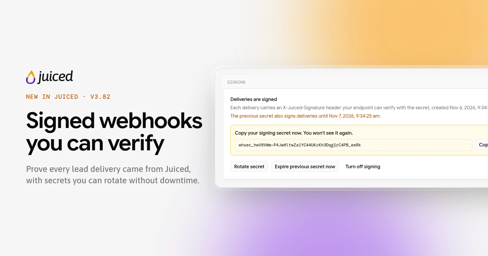
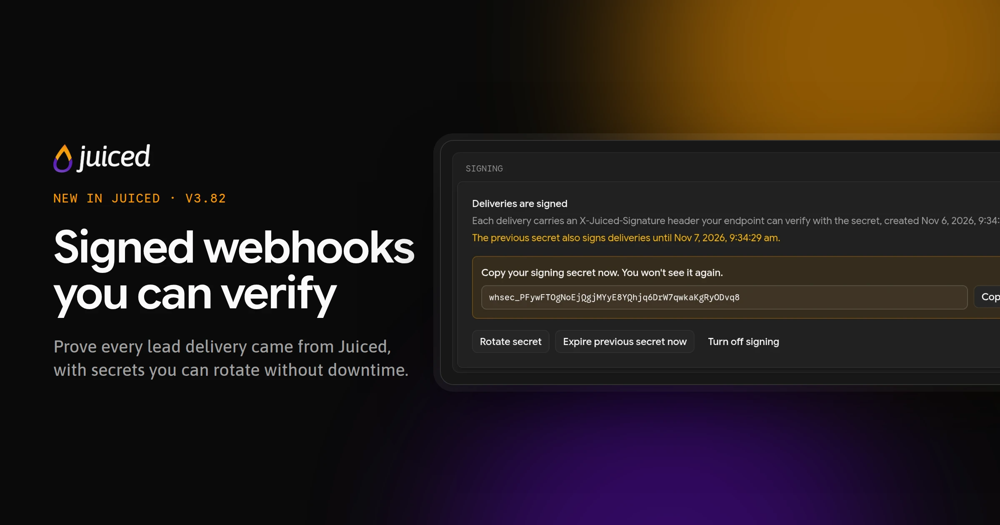

Changes to the customer portal, the app you use to browse the marketplace, manage your leads, and keep your account topped up. Newest first. Use the RSS feed on this page so you never miss a drop.

<Update label="November 6, 2026" description="v3.82.0" tags={["New"]}>
  <Frame>
    
    
  </Frame>

  ## Webhook signing

  - Turn on [signing](/customer-portal/webhooks#signing) for any v1 webhook from its edit page, and every lead delivery carries an `X-Juiced-Signature` header your system can check, proving it came from Juiced. Your secret is shown once, and the page includes PHP and Node examples for checking it.
  - **Rotate secret** gives you a new secret while the old one keeps working for 24 hours, so you can update your system without missing a lead.
  - Every v1 delivery now also carries `X-Juiced-Event`, `X-Juiced-Webhook-Version`, and `X-Juiced-Delivery` [headers](/customer-portal/webhooks#headers).
</Update>

<Update label="November 2, 2026" description="v3.77.4" tags={["New", "Improvements"]}>
  ## Webhook replay

  - **Replay** replaces **Redeliver** on your [webhook](/customer-portal/webhooks#replaying-deliveries) deliveries. For v1 deliveries sent from this release on, a replay sends the original event again with the same `id`, so your system can tell it's a repeat. Otherwise, it sends the lead's current data once.
  - **Bulk replay** re-sends up to 1,000 deliveries at once, such as every failure from the day your CRM was down, and shows its progress above your delivery history.
</Update>

<Update label="October 28, 2026" description="v3.77.2" tags={["New", "Improvements"]}>
  ## Webhook payload v1

  - New [webhooks](/customer-portal/webhooks#payload-versions) start on v1, which wraps each lead in a fixed envelope with a unique event ID, the event type, and when the lead was assigned to you. Your payload choice shapes the lead data inside it.
  - Webhooks you already have stay on Legacy and keep receiving exactly what they get today. To switch one, open its edit page, where a preview shows what changes before you save.
</Update>

<Update label="September 2, 2026" description="v3.53.0" tags={["Improvements"]}>
  ## Return information

  - Your provider can now choose whether to show return-tier details, your return percentage, or a custom message about how your return rate is calculated.
</Update>

<Update label="August 3, 2026" description="v3.46.0" tags={["New"]}>
  ## Club

  - If your provider offers it, you can now use [Club](/customer-portal/club) to browse and claim available leads included with your access.
  - Claimed leads appear in your [Leads](/customer-portal/leads) list, and Club claims do not deduct from your wallet.
</Update>

<Update label="July 23, 2026" description="v3.44" tags={["Fixes"]}>
  ## Fixes

  - Improved Safari rendering for maps on [lead details](/customer-portal/leads).
</Update>

<Update label="June 26, 2026" description="v3.33–v3.37" tags={["Fixes"]}>
  ## Fixes

  - Fixed login when the first customer account on your user is archived.
</Update>
