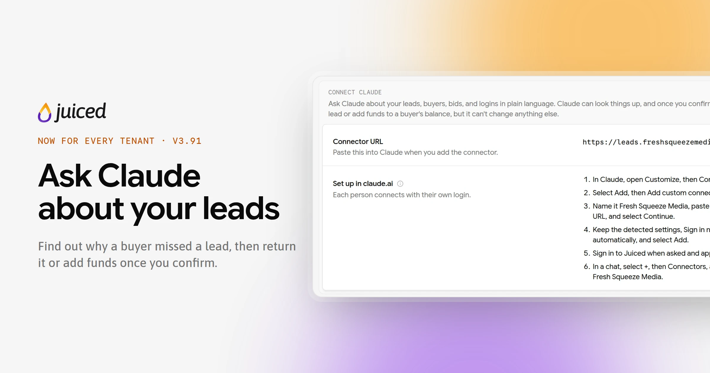
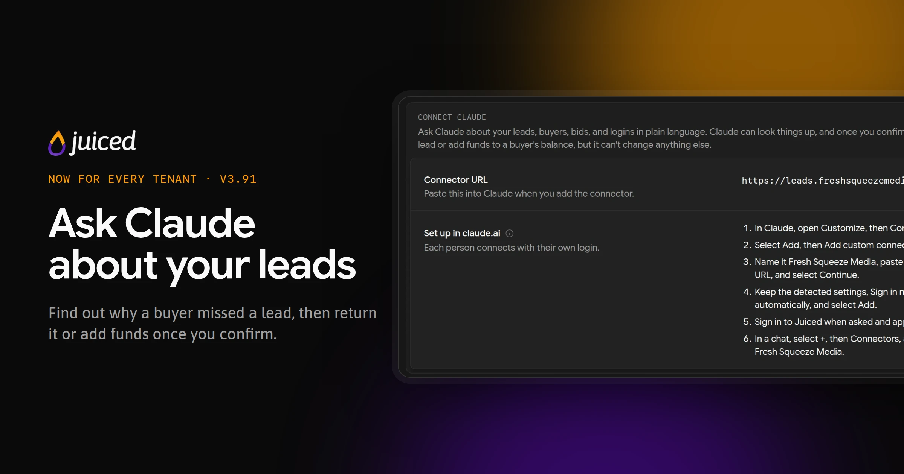
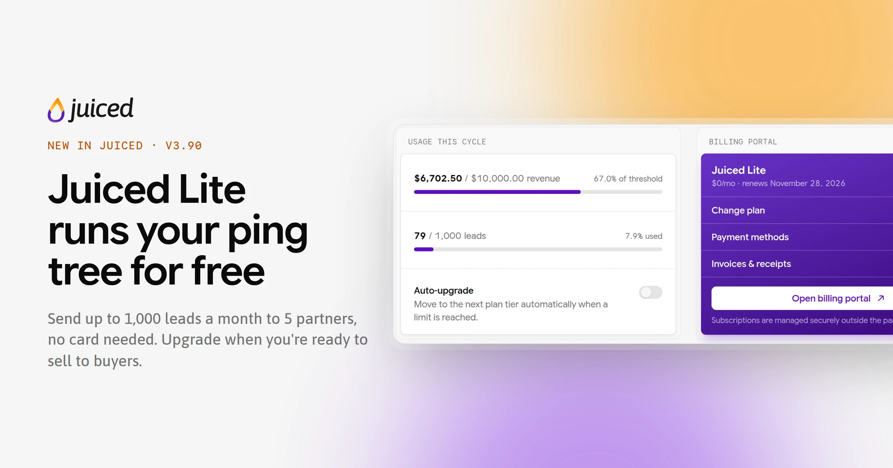
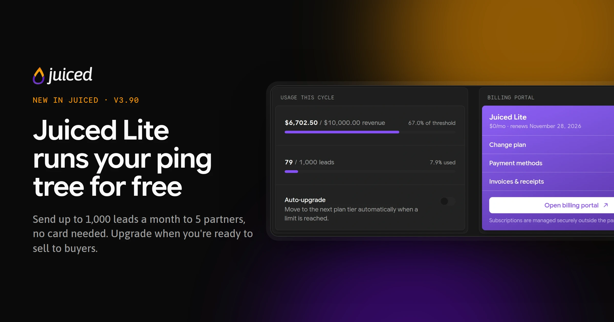
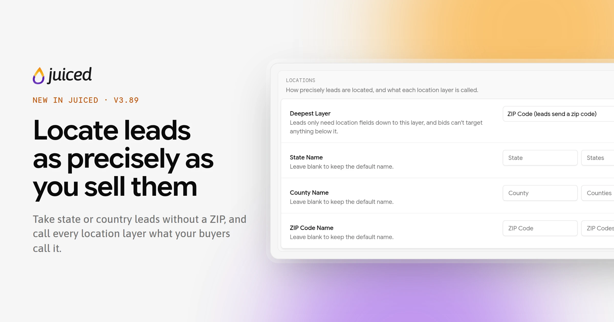
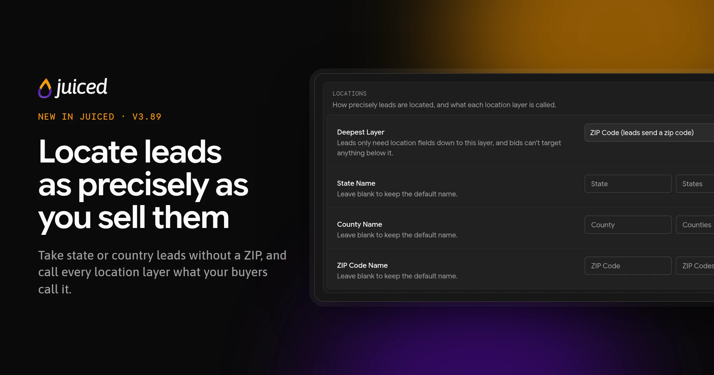
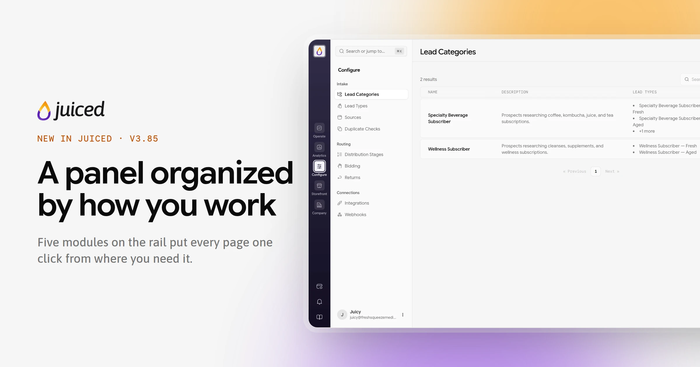
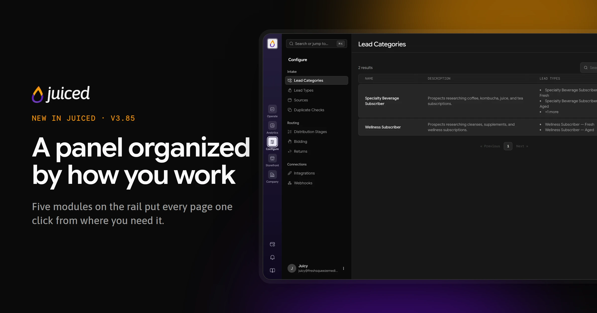
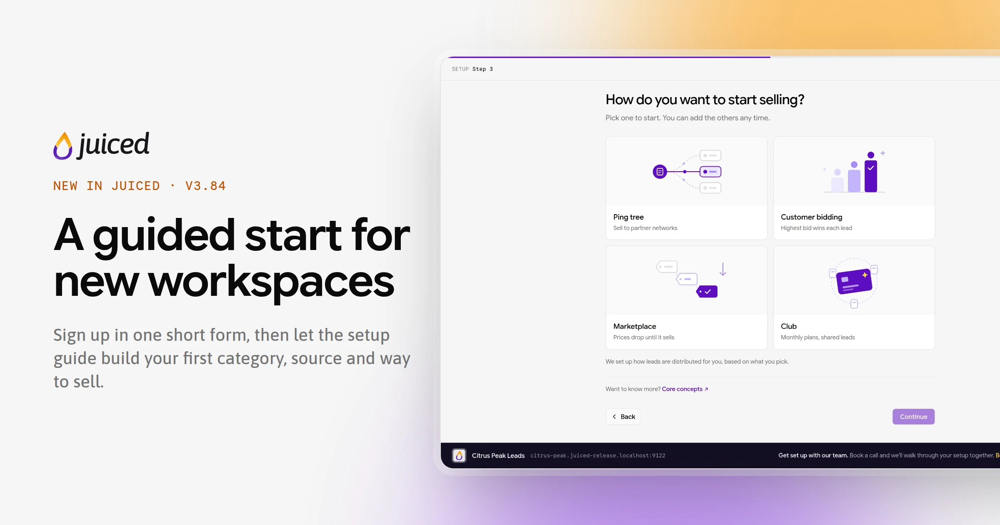
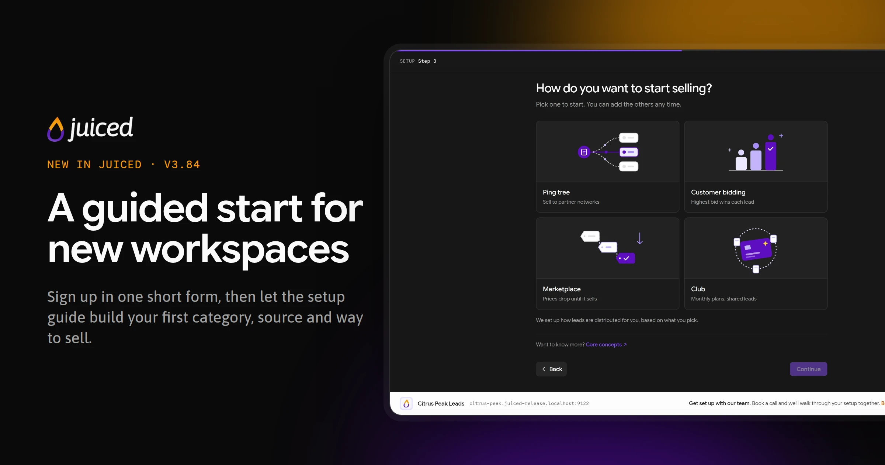

Everything that changed on the tenant side of Juiced, including lead routing, distribution, customers, billing, and the rest of the machinery. Newest first. Use the RSS feed on this page to get updates delivered fresh-squeezed.

Looking for changes to the buyer experience? Those live in [Customer portal updates](/changelog/customer-portal).

<Update label="November 13, 2026" description="v3.91.0" tags={["New", "Improvements"]}>
  <Frame>
    
    
  </Frame>

  AI Assistants is now open to every tenant, with no request needed. Connect Claude to your account and ask why a buyer missed a lead, where buyers are bidding, or why someone can't sign in. It can also return a lead or add funds to a buyer's balance after you confirm. And the free plan has a new name.

  ## AI Assistants

  - [AI Assistants](/features/ai-assistants) no longer needs Juiced to turn it on. Admins and Customer Support users can connect Claude as soon as your account has a verified [custom domain](/guides/adding-a-custom-domain), which comes with Citrus Splash and up. See [Connect an AI assistant](/guides/connecting-an-ai-assistant).
  - Admins always see **Company → AI Assistants**. On a plan without custom domains it shows which plan adds them and an upgrade button, and without a verified domain it walks you through setting one up.
  - Beyond explaining leads, bids, and logins, Claude can answer why a buyer got few leads over a period, what happened on a buyer's account, which states or counties perform best, what's available on the Marketplace and in the Club, and where buyers are bidding right now.
  - Claude can [return a lead or add funds](/features/ai-assistants#returning-leads-and-adding-funds) to a buyer's balance (up to \$1,000 at a time). It shows a preview first and only acts after you say yes, and only for people with the same permission in the panel.

  ## Ginger Shot

  - The free plan is now called [Ginger Shot](/features/billing#ginger-shot). Only the name changed. Its limits, price (free), and what it includes are the same as Juiced Lite's.
  - Ginger Shot workspaces no longer see the banner for booking an onboarding call on the [dashboard](/features/dashboard).
</Update>

<Update label="November 12, 2026" description="v3.90.0" tags={["New"]}>
  <Frame>
    
    
  </Frame>

  Juiced now has a free plan. Juiced Lite runs a ping tree to your partners at no cost and with no card, so you can start moving leads today and upgrade when you're ready to sell to buyers of your own. This release also lets you turn off emails and texts for leads buyers buy themselves.

  ## Juiced Lite

  - [Juiced Lite](/features/billing#ginger-shot) includes 1,000 leads and up to \$10,000 in lead sales a month, 1 lead category, 1 source, and 5 partners. It sells to [partners](/features/partners) only, so customers, bidding, the Marketplace, the Club, checkout pages, and Stripe payments stay on paid plans.
  - Pick it at signup and click **Start for free**. There's no Stripe checkout, and your workspace unlocks right away. See the [Quickstart](/get-started/quickstart#2-unlock-your-workspace).
  - Paid-only pages stay in the panel behind an **Upgrade your plan** prompt, and **New** buttons open it once you reach a limit. Upgrading from the prompt asks for a card if you don't have one yet, and your new plan starts that day. See [Upgrading from Juiced Lite](/features/billing#upgrading-from-ginger-shot).
  - Moving a paid plan to Juiced Lite needs a workspace that fits it, with no customers and nothing over its limits. The switch takes effect right away, and the rest of the paid period isn't credited.

  ## Notifications

  - The Lead Assigned template has a new **Manual Purchases** switch. Turn off **Send email and SMS** and buyers' contacts no longer get emails and texts for leads they buy on the Marketplace or claim in the Club themselves. Bid and buy order wins, leads you assign yourself, and in-app notifications still go out. It's on by default, so nothing changes until you flip it. See [Manual purchases](/features/notifications#manual-purchases).
</Update>

<Update label="November 12, 2026" description="v3.89.0" tags={["New", "Fixes"]}>
  <Frame>
    
    
  </Frame>

  Not every lead comes with a ZIP code. You can now decide how precisely your leads are located, rename the location layers to match your market, and sell leads in Latvia.

  ## Locations

  - A new **Locations** section in [Company Profile](/features/company-profile#locations) sets your **Deepest Layer**. Keep the default postal code, or locate leads by county, state, or country only. Below postal code, leads and pings no longer need a zip and are located from their `state`, `county`, and `country` instead, and states can be sent by name or abbreviation.
  - Your deepest layer also sets which [bidding scopes](/features/bidding#scopes) customers can use. At state depth there are no county bids, and at country depth only nationwide ones. Juiced won't let you switch while open bids would stop matching, and tells you how many are in the way.
  - Rename the state, county, and postal code layers with your own singular and plural names. They replace the built-in names across your panel and customer portal, including bidding scopes and location filters.

  ## Latvia

  - Latvia is now an [operating country](/features/company-profile#operating-countries), with its 42 municipalities as the state level. Real Latvian postal codes aren't loaded yet, so each municipality has a placeholder code from `LV-9001` to `LV-9043`, or you can locate Latvian leads by municipality alone.
  - A new **Phone (LV)** [field type](/features/lead-categories#field-types) accepts Latvian numbers like `21234567` and `+371 2123 4567`. The zip field accepts Latvian codes as `LV-1050`, `LV 1050`, or `lv1050`.
  - Latvia can be picked as a customer's country when you [add a customer](/features/customers), and Latvian phone numbers are accepted on customers, contacts, and your profile.

  ## Fixes

  - The `state` field type now accepts 3-character abbreviations from your operating countries, so Australian leads with `NSW` or `VIC` are no longer rejected.
</Update>

<Update label="November 12, 2026" description="v3.88.0" tags={["Improvements"]}>
  - The page people land on from an invite email has a fresh look, for teammates you [invite](/features/users#inviting-users) and for [customer users](/features/customers) alike. It shows your branding (logo or name, brand color, and favicon) on staff invites too.
  - Invitees who already have an account can sign in with a passkey, and the sign-in form now has a **Forgot password?** link. Anyone who opens an invite while signed in as someone else sees which account they're on and a **Sign out and continue** button that brings them straight back to the invite.
  - Support chat in the tenant panel is now Juicy, Juiced's own chat, in place of Intercom. Your [Intercom integration](/features/integrations#intercom) for your customer portal isn't affected.
  - The **Book a time** link for an onboarding call on your [dashboard](/features/dashboard#getting-started) now opens Juiced's own booking page, with your name, email, and workspace already filled in.
</Update>

<Update label="November 12, 2026" description="v3.87.0" tags={["Improvements", "Fixes"]}>
  - When you create or edit a [webhook](/features/webhooks), the **Event** dropdown now greys out events that already have a webhook and marks them **Has a webhook**. A new webhook form opens on the first event that's still free.
  - Saving a second webhook for an event that already has one now shows "A webhook for this event already exists." instead of failing with a server error. Each event can have one webhook.
</Update>

<Update label="November 10, 2026" description="v3.86.0" tags={["New", "Improvements", "Fixes"]}>
  <Frame>
    
    
  </Frame>

  ## Partner demand

  - Give a [partner](/features/partners) a view of where your buyers are bidding. Turn on the new **Show Demand in Portal** toggle on the partner and their portal gets a **Demand** page listing states, counties, and countries with the number of **Active** bids and the **Top Bid** in each. Partners can filter by lead type and sort by either number. See [Demand in the partner portal](/features/partners#demand-in-the-partner-portal).
  - Your lead values, and which buyers are bidding, stay private. The toggle is off for every partner until you turn it on.

  ## Improvements

  - The [ping inspector](/features/logs#ping-inspector) no longer stores credentials a source sends in its headers, such as its API secret on Basic-auth pings or a bearer token. They show as `[REDACTED]`. Headers added by our CDN and hosting are left out, so the **Headers** tab shows what the source actually sent.
  - Any header whose name contains a secret word, like `X-Auth-Token` or `X-Client-Secret`, is now treated as a secret on [webhooks](/features/webhooks), customer webhooks, and partner endpoints. It shows **Saved** with **Replace** once saved, is asked for again when the URL moves to a new host, and is masked in delivery history. See [Saved credentials and secret headers](/features/webhooks#saved-credentials-and-secret-headers).

  ## Fixes

  - Leads posted to the API are no longer rejected when a [lead type](/features/lead-types) condition points at a field that was deleted. That condition now counts as not matching, so the lead goes to the next matching lead type or the category's fallback. A [banner](/features/banners) with such a condition stops showing instead of failing.
</Update>

<Update label="November 9, 2026" description="v3.85.0" tags={["New", "Improvements", "Fixes"]}>
  <Frame>
    
    
  </Frame>

  The tenant panel has a new shape. The rail now switches between five modules, and the sidebar only shows the pages you need for the job at hand. You can also hide the Marketplace from customers while it keeps filling, and webhooks that keep failing now warn you and pause themselves.

  ## Navigation

  - The rail is now a module switcher, with **Operate**, **Analytics**, **Configure**, **Storefront**, and **Company**. Click one and the sidebar shows that module's pages, grouped under headings like **Intake**, **Routing**, and **Selling**. The settings gear is gone, since settings pages now live in the module they belong to (Bidding and Returns in Configure, Banners in Storefront, Users in Company). See [Finding your way around](/get-started/finding-your-way-around#the-rail-and-its-modules).
  - Each module remembers the last page you opened in it. Page addresses haven't changed, so bookmarks still work.
  - **Logs** and **Demand** (formerly Locations) are now single sidebar items, with **Incoming** and **Outgoing**, or **Counties**, **States**, and **Countries**, as tabs at the top of the page. [Returns](/features/returns) and [Subscription Products](/features/subscription-products) each split into **Tiers** and **Settings** tabs.
  - A new **Analytics** module previews the reports on the way.
  - On a phone, the menu lists the modules, and tapping one opens its pages.

  ## Checkout pages

  - Offers now live on their own **Offers** tab on each [checkout page](/features/checkout-pages#adding-offers), instead of inside the edit form. Each offer is added, edited, recommended, reordered, or removed on its own, and a change that would stop a live page from selling isn't saved.
  - A new page starts off and opens on its **Offers** tab, ready for its first offer. It can go live once it has one.
  - Orders moved to their own **Orders** tab, next to **Overview**.

  ## Marketplace

  - Turn off the new **Show Marketplace to customers** switch under **Company → Domains & Links** to hide the [Marketplace](/features/marketplace#hiding-the-marketplace-from-customers) from your customers while your Marketplace stage keeps placing leads on it. It's on by default, so nothing changes until you flip it.
  - When you hide it with open buy orders, choose **Keep buy orders** to leave them running or **Cancel and refund** to return the funds to each customer's wallet.
  - The public marketplace is turned off while the Marketplace is hidden.

  ## Webhooks

  - [Workspace and customer webhooks](/features/webhooks#automatic-pausing) whose deliveries all fail for 24 hours now show **Failing**, and your Admins get an email and an in-app notification. After 72 hours (and at least 10 failures) the webhook is paused automatically and shows **Paused: failing**, with the reason on its page. Fix the endpoint and click **Enable webhook** to start it again.
  - For customer webhooks, the customer's users get the same notices, branded as you.

  ## Improvements

  - Customer and partner invites sent through your [SendGrid integration](/features/integrations) no longer have SendGrid's click and open tracking, so their links point straight at your portal instead of a tracking address.

  ## Fixes

  - Notices from Juiced, such as billing reminders, now show at the top of the new panel, not just the classic one.
  - Opening an email verification link in a browser that isn't signed in now shows the confirmation page instead of a server error.
  - A return tier with a discount or penalty turned on but no percentage now shows 0% instead of breaking the page.
</Update>

<Update label="November 6, 2026" description="v3.84.0" tags={["New", "Improvements"]}>
  <Frame>
    
    
  </Frame>

  New workspaces now go from signup to selling in one guided flow. It's a fresher squeeze for anyone signing up, and existing workspaces aren't asked to go through it.

  ## Signup and onboarding

  - Signup asks for less. The form is just your name, work email, password, and company name, with a workspace address that fills itself in, checks itself as you type, and suggests free alternatives when yours is taken. See [Create your account](/get-started/quickstart#1-create-your-account).
  - Confirm your email with a 6-digit code on the **Confirm it's you** screen, or open the link in the same email on any device.
  - A new sign-in step offers a passkey or an authenticator app. Email codes are already on, so it never holds you up.
  - Three steps unlock the workspace, finishing your company details, choosing your operating countries, and choosing a plan through Stripe Checkout. Connecting Stripe is no longer one of them. See [Unlock your workspace](/get-started/quickstart#2-unlock-your-workspace).

  ## Setup guide

  - A [setup guide](/get-started/quickstart#3-follow-the-setup-guide) builds your first lead category from a market template, your first source, and the way you want to sell (ping tree, customer bidding, marketplace, or Club), then walks you through the steps that path needs, like a bid range, a first partner or customer, and card payments.
  - Picking a way to sell creates its [distribution stage](/features/distribution) for you, so new workspaces start with the one stage they need instead of a default Bidding and Marketplace pair.
  - Import fields from a spreadsheet of leads you already have. Upload a CSV or Excel file and the guide suggests a field name and type for each column.
  - Ask the guide for a test customer and it creates one with a bid and credit for one lead, ready for your first test.
  - Skipped steps wait in **Guided setup** on the rail, with a progress ring, **Show me** tours of the right page, and a way to start another way to sell. See [Pick up where you left off](/get-started/quickstart#pick-up-where-you-left-off).

  ## Improvements

  - The dashboard's **Getting started** cards are gone. New workspaces track setup in **Guided setup** instead.
  - The search box at the top of the sidebar now reads **Search or jump to...**. It still opens the same [command palette](/get-started/finding-your-way-around#the-command-palette).
  - Contact and support addresses on the Juiced website, and in the custom domain setup copy, now point to support@usejuiced.com.
</Update>

<Update label="November 6, 2026" description="v3.83.0" tags={["Improvements", "Fixes"]}>
  ## Improvements

  - Secret header values on [webhooks](/features/webhooks), customer webhooks, and [partner](/features/partners) endpoints are now hidden once saved, just like passwords and tokens. A header named `Authorization`, `X-Api-Key`, `Token`, `Secret`, or similar shows a lock and **Saved**, with **Replace** to type a new value. Moving the URL to a different host asks for these values again. See [Saved credentials and secret headers](/features/webhooks#saved-credentials-and-secret-headers).
  - When a receiver echoes a password, token, or secret header back in its response, the delivery history now masks it.

  ## Fixes

  - A [banner](/features/banners) linking to `::billing_url::` now sends customers to their own payment methods page in the portal, instead of a button that went nowhere. The banner form's **Link** field explains the token.
</Update>

<Update label="November 6, 2026" description="v3.82.0" tags={["New", "Improvements", "Fixes"]}>
  <Frame>
    
    
  </Frame>

  ## Webhook signing

  - Turn on [signing](/features/webhooks#signing) for any saved v1 workspace or customer webhook from the new **Signing** section on its edit page. Each delivery then carries an `X-Juiced-Signature` header, an HMAC-SHA256 of the timestamp and raw body, that your receiver can check with the secret. The secret is shown once. [Verifying a signature](/features/webhooks#verifying-a-signature) has PHP and Node examples.
  - **Rotate secret** issues a new secret, and both sign deliveries for 24 hours so receivers can switch over without dropping anything. **Expire previous secret now** ends the overlap early.
  - Every v1 request now carries `X-Juiced-Event`, `X-Juiced-Webhook-Version`, and (on real deliveries) `X-Juiced-Delivery` headers. Custom headers with those names are no longer sent on v1. See [v1 headers](/features/webhooks#v1-headers).
  - v1 webhooks using the Form format now send date and list values that were previously left out.
  - Legacy webhooks are unchanged.

  ## Fixes

  - Partner eligibility, distribution stage, and lead type condition forms now show why a condition couldn't be saved, instead of failing with no message.
</Update>

<Update label="November 5, 2026" description="v3.81.0" tags={["Fixes"]}>
  ## Fixes

  - Unexpected failures now show a short, safe message instead of raw internal error text (database errors, server names or code details). This covers [incoming and outgoing logs](/features/logs), lead timelines, webhook delivery history, and test sends to partners and webhooks. Failed requests to a partner still say what went wrong, such as a timeout, a connection failure or the HTTP status. Older records read the same way.
  - The **Error** tab on an [outgoing log](/features/logs#outgoing-logs) shows only the message, without the error class.
  - Password reset emails for your team and your partners now link to the reset page on the domain they asked from, instead of Juiced's central reset page.
</Update>

<Update label="November 3, 2026" description="v3.80.0" tags={["New", "Improvements", "Fixes", "Breaking changes"]}>
  <Frame>
    
    
  </Frame>

  ## Notification emails

  - Email [notification templates](/features/notifications) can now include links. Write them as `<a href="https://…">`, and any variables inside the link are URL-encoded, so you can send buyers to a partner tool with the lead's details filled in. See [Links and the action button](/features/notifications#links-and-the-action-button).
  - Write `{{ actionLink | Button text }}` to place the action button anywhere in the email with your own label. The automatic button at the bottom is then left off. A plain `{{ actionLink }}` still prints the URL.
  - New `{{ lead.state }}` and `{{ lead.zip }}` variables for lead notifications.
  - Lead and customer values in emails and texts always show as plain text, so a lead name that looks like a link or HTML can't become one in your customer's inbox. In texts, links from your template show as their text followed by the URL.

  ## Source fields

  - **Breaking:** A source's **Fields** tab no longer adds fields of its own. It now lists its lead category's fields, and you choose **Override** on a field to change its type, required settings, values, or description for that source only. New fields go on the lead category. See [Field overrides](/features/sources#field-overrides).
  - Fields that only existed on a source have moved to its lead category, so every source on that category now accepts them. Where a source required one of them, the lead category's copy is optional and that source keeps requiring it through an override, so no source starts rejecting leads. Overrides that matched their lead category field in every setting but the description were removed.
  - A lead category field that a source overrides can't be renamed or deleted, and a source can't move to a lead category without the fields it overrides. The error names the sources or fields involved.
  - **Values** for List of Values fields are now entered one at a time (press Enter, or paste a list), and spaces, blanks, and repeats are cleaned up on save.

  ## Fixes

  - A ping that can't be categorized into a lead type, or whose lead type is archived, now gets `no_match` before any distribution stage runs. Before, a Club or partner stage could accept it, often at $0, and the post then came in Uncategorized and was never distributed. If your lead types depend on fields a source only sends with the post, see [Ping-post](/features/ping-post#pinging-juiced-from-your-sources).
  - [Webhooks](/features/webhooks) for new leads, new customers (including checkout signups), and transaction updates no longer occasionally fail to send when they fire while the record is still being saved.
</Update>

<Update label="November 2, 2026" description="v3.77.0–v3.79.0" tags={["New", "Improvements", "Fixes"]}>
  <Frame>
    
    
  </Frame>

  Checkout pages are now open to every tenant, Canada joins the map as an operating country, and a stack of webhook, payout, and location fixes rounds out the week. Webhook payload v1 and replay have their own entries.

  ## Checkout pages for everyone

  - Every tenant can now create and publish [checkout pages](/features/checkout-pages), with no request needed. Admins find **Checkout Pages** under **Application** in settings. Sell lead credit, bonus credit, and Club memberships from a public page buyers pay on directly.
  - The checkout welcome and purchase confirmation emails now appear in [Notification Templates](/features/notifications) for every tenant.
  - The **Stage** design's main button now reads **Claim offer**, matching its sticky bar, and its countdown line reads **Offer ends**.

  ## Canada

  - Add Canada as an [operating country](/features/company-profile#operating-countries) during setup or in Company Profile. Provinces are the state level and Regions (cities, big-city districts, and the areas around them) are the county level, so buyers can bid nationwide, by province, or by region.
  - Leads, pings, and CSV imports accept Canadian postal codes with or without the space and in any case, so `m5v3l9` and `M5V 3L9` resolve to the same place. See the `zip` [field type](/features/lead-categories).
  - Workspaces that operate in several countries see combined labels like **States / Provinces** and **Counties / Regions** in [Locations](/features/location-analytics).

  ## Locations

  - Hide columns on the Counties, States, and Countries lists with the new **Columns** menu, handy before you screenshot your prices for a customer. See [Location analytics](/features/location-analytics#timeframe-filters-and-search).
  - The **Active** column, the location page's **Active Bids** stat, and the county export now count Limited bids, matching who distribution actually sends leads to.

  ## Webhooks

  - Live deliveries to workspace and customer [webhooks](/features/webhooks) now send the request headers and Basic or Bearer auth you configured. Before, they were only used for test sends.
  - Each webhook gets its own delivery, so one slow endpoint never holds up another. Delivery history shows each attempt and its status, and v1 webhooks retry failures up to six times over about eight and a half hours.
  - An error response from a Legacy webhook is now logged with its status code, headers, and body, instead of looking like no response at all.
  - A customer can't have two webhooks with the same URL. Where one already did, Juiced kept the active, most recently edited webhook and moved the others' delivery history onto it.
  - **Generate sample data** on a customer webhook now builds its sample from a lead category, so it works before the customer's first bid. With several lead categories, you pick the lead type to sample.

  ## Partners, API, and payments

  - A partner's payout is now set once, when the lead is posted, as the price in the post response. Reprocessing, returns, resales, and Club claims no longer change it, and a lead sold to several customers counts its payout once. Past vendor leads whose payout was later changed have been restored to the price quoted at post, where that quote is on record. See [Source pricing](/features/sources#source-pricing).
  - **View API Spec** on a [source](/features/sources) and the partner **Integrate** page now document the [v1 lead API](/api-reference/introduction#versioning).
  - New customers are linked to an existing Stripe customer with the same email in your connected Stripe account, instead of creating a duplicate.

  ## Sign-in

  - Users with a passkey who sign in with their password are now asked for the passkey next, instead of being turned away. If the passkey fails, they can use their authenticator app, or an emailed code if they don't have one.

  ## Fixes

  - Webhooks and partner pings and posts to endpoints with only IPv4 addresses, which were briefly blocked on October 26, deliver again.
  - A post no longer sees a buyer's balance reduced by their own ping win, which had sent some leads to the Marketplace or sold them below the bid.
  - Auto-upgrade charges only the flat difference between plans, without extra prorated charges on the same invoice.
  - Dropdowns in the tenant panel no longer lock the page while open, so browser extensions can't block selecting an option.
</Update>

<Update label="November 2, 2026" description="v3.77.4" tags={["New", "Improvements"]}>
  ## Webhook replay

  - **Replay** replaces **Redeliver** on workspace and customer webhook deliveries, and it's queued instead of sent while you wait. For v1 deliveries sent from this release on, a replay sends the original event again with the same `id`, `created_at`, and `data`, and it's retried if it fails. Legacy webhooks, and older v1 deliveries, get the lead's current data, sent once as a new event. Replays are refused while a webhook is paused. See [Replaying deliveries](/features/webhooks#replaying-deliveries).
  - **Bulk replay** re-sends up to 1,000 deliveries at once, filtered by status and the date each event was first sent. It replays only the latest delivery of each event, at 5 per second, and shows its progress above the delivery history.
  - The delivery history now says how far back deliveries can be replayed, which is 90 days, or 180 days for deliveries that failed or needed a retry.
</Update>

<Update label="October 28, 2026" description="v3.77.2" tags={["New", "Improvements"]}>
  ## Webhook payload v1

  - New [workspace and customer webhooks](/features/webhooks) start on the v1 [payload version](/features/webhooks#payload-versions). Each request wraps `data` in a fixed envelope with `version`, `id`, `type`, `created_at`, and `tenant_id`, and `data` carries public IDs in place of internal ones.
  - Existing webhooks stay on Legacy and keep receiving exactly what they get today. Switch one from its payload version settings, where a preview shows the current payload next to the one after save, and an amber note flags `{{ event }}` or `{{ tenant.* }}` fields that would render empty on v1.
  - Every v1 event has its own `evt_…` ID, the same on every delivery attempt, so your receiver can skip duplicates.

  ## Lead fields

  - New field titles can't reuse the names Juiced reserves for its own lead data, such as `source_id` or `customer_id`. Fields that already use one keep their title and show a warning to rename them. See [Adding fields to a lead category](/guides/adding-fields-to-a-lead-category#title).
</Update>

<Update label="October 26, 2026" description="v3.76.0" tags={["New", "Improvements"]}>
  ## v1 lead API

  - Send pings and leads to the new [v1 API](/api-reference/introduction#versioning) at `/api/v1/ping` and `/api/v1/leads`. Responses use public IDs only, a consistent `{data, version}` body, and one error format with a stable `code` for every failure.
  - Every v1 response carries an [`X-Request-Id`](/api-reference/introduction#request-ids) header. Quote it when contacting support.
  - The unversioned `/api/ping` and `/api/leads` endpoints are now the deprecated legacy API. They keep working, and their responses now carry [`Deprecation` and `Link` headers](/api-reference/introduction#deprecation-headers) that point to the v1 endpoints. No shutdown date has been set.
  - A `transaction_id` covers both versions, so a retry on the other version never creates a second lead. See [Safe retries](/api-reference/introduction#safe-retries).
  - Legacy lead posts can now reference a ping by its `ping_…` public ID as well as its UUID.
</Update>

<Update label="October 19, 2026" description="v3.69.0" tags={["New", "Improvements", "Fixes"]}>
  ## Faster setup, clearer operations

  - Start a new lead category from a market-specific template or from scratch. Templates give you a field-set starting point; categories you already created keep their existing fields.
  - Filter the **Leads** page by state or county, including Marketplace and Club tabs, and carry those filters into exports.
  - Customer-facing email now uses a shared, tenant-branded layout, including your logo and colors for messages you send to customers, partners, and invitees.

  ## Fixes

  - Prevent full domains from being entered where a platform subdomain is required during signup or an admin subdomain rename. Existing custom-domain setup is unchanged.
</Update>

<Update label="October 15, 2026" description="v3.67.0" tags={["New", "Improvements"]}>
  ## AI-assisted diagnostics and Stripe-optional onboarding

  - Eligible tenant staff can connect a supported AI assistant to read-only, tenant-scoped diagnostic tools after Juiced enables the Tenant MCP connector for their tenant. The connector can explain lead distribution, buyer misses, bid position, login problems, and custom-domain setup without changing data. See [Connect an AI assistant](/guides/connecting-an-ai-assistant).
  - Complete onboarding without connecting Stripe when your operation does not collect customer payments. You can create customers and manage their balances manually; connect Stripe later to enable cards, deposits, auto recharge, and card subscriptions.
</Update>

<Update label="October 14, 2026" description="v3.66.0" tags={["New", "Improvements"]}>
  ## More control over Club subscriptions

  - Let customers apply eligible Stripe promotion codes when they start a new [Club](/features/club) subscription. They see the discounted first charge and renewal terms before subscribing.
  - Hide a Club tier from new signups while existing subscribers keep their price and allowance, then offer it again or archive it when you are done with it.
  - Preview and schedule individual or bulk subscriber moves to an offered tier at the next renewal, without proration. Ineligible subscriptions are identified before confirmation.
  - See tier availability and subscriber counts in subscription settings, plus Club access, billing, allowance, and pending-move details on each customer overview.
</Update>

<Update label="October 12, 2026" description="v3.64.0" tags={["New", "Improvements", "Fixes"]}>
  ## Better buyer controls and source visibility

  - Set [lead eligibility conditions](/features/customers#lead-eligibility) for each customer, using source, lead type, lead category, and lead-field rules. Juiced applies them during bid selection and round-robin delivery; Marketplace purchases and Club claims are not affected.
  - See [return rate](/features/sources#source-performance) by source in the source list and source overview, so you can identify traffic that is producing returns.
  - Include a customer's registration URL and selected tracking parameters in [webhook](/features/webhooks) payload mappings for customer and subscription events.

  ## Cleaner duplicate-check settings

  - Find global, customer, and partner-default duplicate-check settings together under **Ingest → Duplicate Checks**. Existing Lead Delivery links redirect to the customer duplicate-check tab.

  ## Fixes

  - Process an individual duplicate lead from the React panel, matching the classic panel behavior. Bulk processing remains unchanged.
  - Retry top-bid refreshes safely after database lock contention, reducing the chance of stale top-bid data during busy periods.
</Update>

<Update label="September 2, 2026" description="v3.53.0" tags={["New", "Improvements", "Fixes"]}>
  ## Return settings and lead quotas

  - Configure the lead-volume lookback used for [return tiers](/features/returns), choose whether customers see their return-tier details, and customize the message shown when tiers are disabled.
  - Add daily, weekly, or monthly lead-count and value quotas to [sources](/features/sources) and [partners](/features/partners).
  - Show tenant-branded 404 pages with an account-switching action when someone lands in the wrong account or does not have permission.
</Update>

<Update label="August 3, 2026" description="v3.46.0" tags={["New"]}>
  ## Club subscriptions and claimable leads

  - Add [Club](/features/club), a subscription-gated pool where eligible customers can claim available leads without a wallet charge.
  - Create Club subscription products and monthly tiers through your connected Stripe account, then give tiers access to Club.
  - Route leads into Club through a Distribution Stage or place them there through bulk upload, with a configurable claim cap.
</Update>

<Update label="July 23, 2026" description="v3.44.0–v3.44.4" tags={["Improvements", "Fixes"]}>
  ## Customer management improvements

  - Sort [customers](/features/customers) by wallet balance and filter the customer list by a minimum or maximum balance.

  ## Fixes

  - Improved handling of duplicate [custom-domain](/features/domains) updates.
  - Prevented duplicate [workflow webhooks](/features/webhooks) for the same lead event.
</Update>

<Update label="July 10, 2026" description="v3.38–v3.43" tags={["New", "Fixes", "Breaking changes"]}>
  ## Bidding, notifications, and billing

  - Add tenant-only below-minimum [bid](/features/bidding) options.
  - Add buyer contacts to the Lead Assigned [workflow webhook](/features/webhooks), including mapping support in the webhook UI.
  - Include assignment scope and partner public ID in Lead Assigned webhook payloads.
  - Add another safeguard against duplicate [auto-recharges](/features/payments-and-deposits) during rapid lead assignment.
  - Expand tenant registration to a configuration-driven billing-country allow-list.

  ## API and portal changes

  - **Breaking:** remove the deprecated `POST /api/marketplace` endpoint. See the [API reference](/api-reference/introduction) for current endpoints.
  - Fix [partner](/features/partners)-dashboard queries that could cause portal timeouts.
  - Fix tenant [branding](/features/branding) uploads on custom domains and subdomains.
  - Gracefully redirect Livewire requests that reach a missing page.
  - Complete prefixed-public-ID cleanup.
</Update>

<Update label="June 26, 2026" description="v3.33–v3.37" tags={["Improvements", "Fixes"]}>
  ## Customer and partner experience

  - Correct funding status for newly created [customers](/features/customers).
  - Fix customer login when a user's first customer account is archived.
  - Use postcodes rather than LGAs for Australian county-tier handling.
  - Limit [partner](/features/partners)-portal leads to accepted leads.
  - Add a per-tenant setting for the unauthenticated [customer-panel landing experience](/guides/customizing-the-portal).
  - Update [Domains & Links](/features/domains) labels and customer-panel entry behavior.

  ## Data, exports, and observability

  - Restore custom [lead](/features/leads)-detail columns in exports.
  - Speed up Incoming Logs.
  - Fix [webhook](/features/webhooks) configuration test results and authentication headers.
  - Prevent stale [distribution](/features/distribution) offers from routing leads to paused customers.
  - Guard against duplicate [auto-recharges](/features/payments-and-deposits) during rapid activity.
</Update>

<Update label="June 4, 2026" description="v3.28–v3.32" tags={["New", "Improvements", "Fixes"]}>
  ## Delivery and partner reliability

  - Track duplicate [partner-post](/features/ping-post) responses and preserve explicit price and message paths.
  - Continue [distribution](/features/distribution) to other eligible offers when a partner post fails.
  - Apply [source](/features/sources)-based [lead-type](/features/lead-types) conditions to ping requests.
  - Correct [partner](/features/partners) eligibility when state and postal-code filters are used.
  - Recover stuck [reverse auctions](/features/bidding) and unprocessed [buy orders](/features/marketplace).

  ## Operations and onboarding

  - Add form-urlencoded partner [ping/post](/features/ping-post) support for Leadspedia integrations.
  - Add custom date ranges.
  - Replace the admin Filament panel with the React admin experience.
  - Improve subscription auto-upgrade behavior. See [Billing](/features/billing).
  - Unlock default [lead-category fields](/features/lead-categories) for configuration.
</Update>

<Update label="May 12, 2026" description="v3.27.1" tags={["Improvements"]}>
  - Treat county and country as first-class [location field types](/features/lead-categories).
  - General cleanup and maintenance.
</Update>
