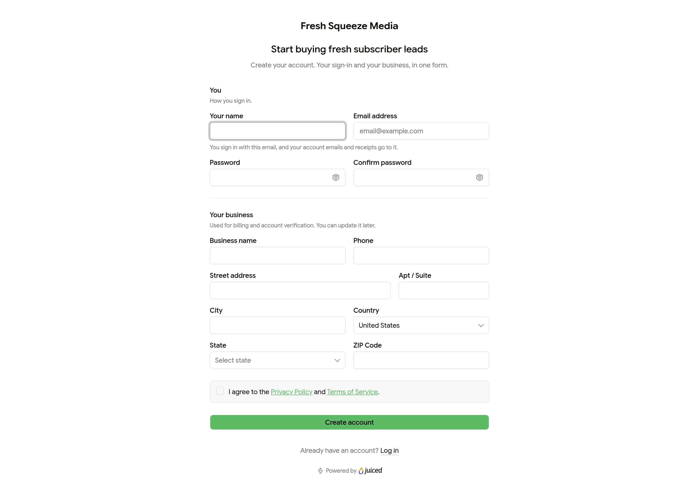
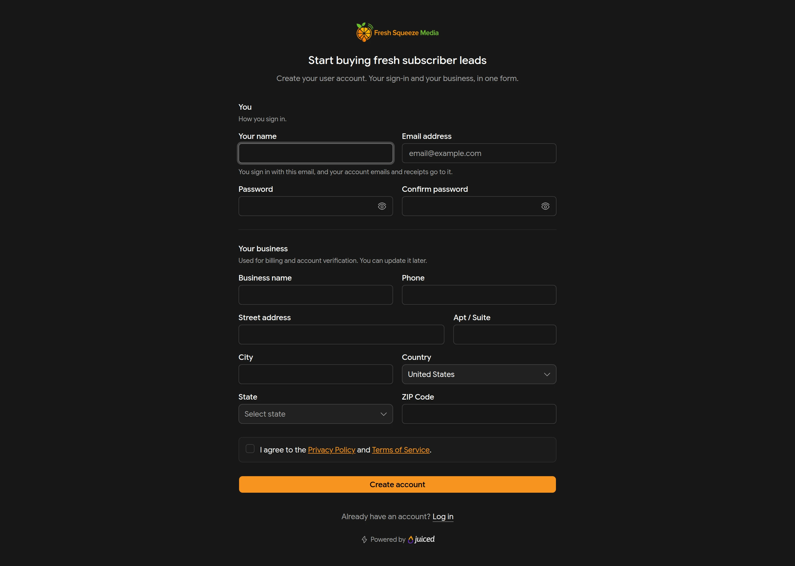
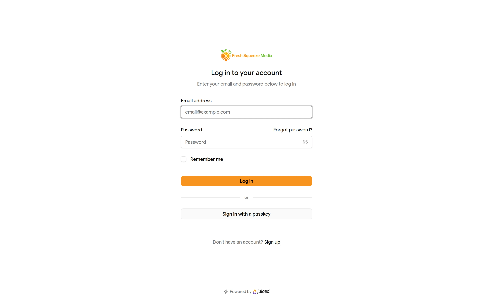
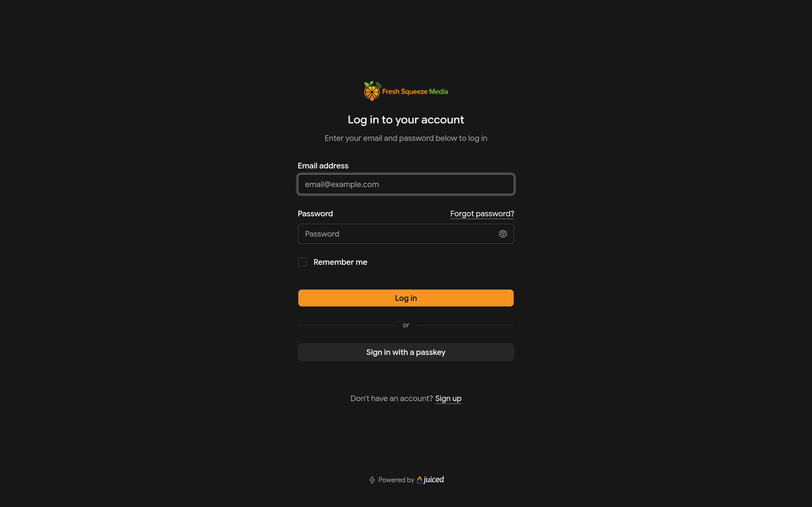
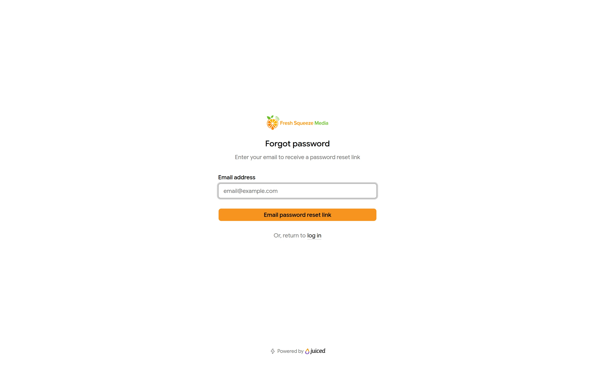
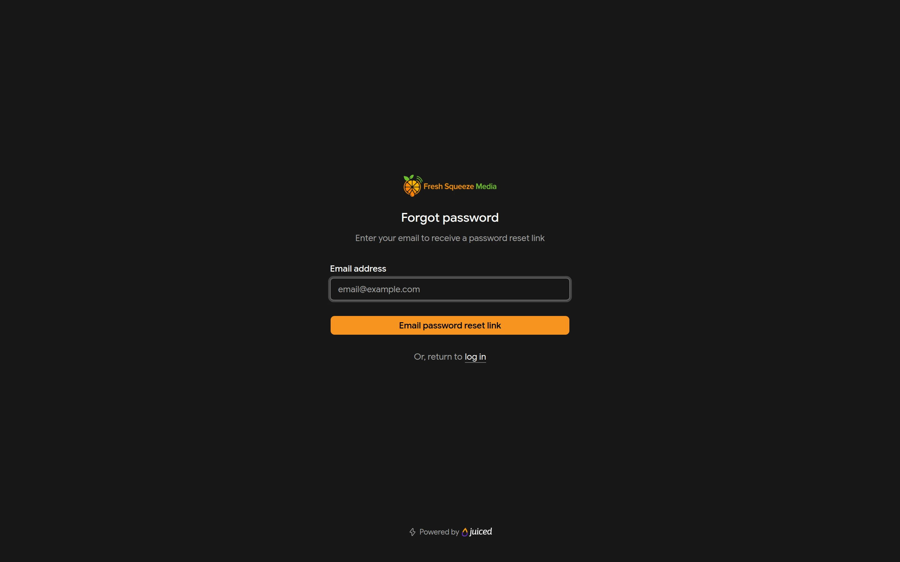

Your provider's portal lives at their `/app` address, for example `yourprovider.com/app`. Everything on this page starts there.

## Creating an account

Signing up is one form, with your login and your business together.

### 1. Fill in the sign-up form

From the login page, click **Sign up** (or go straight to `/app/register`).

<Frame>
  
  
</Frame>

1. Under **You**, enter **Your name**, **Email address**, **Password**, and **Confirm password**. You sign in with this email, and your account emails and receipts go to it too.
2. Under **Your business**, enter the **Business name**, **Phone**, **Street address**, **Apt / Suite**, **City**, **Country**, and your state (or province, or county) and postal code. The last two labels change to match the country you pick.
3. If your provider lists terms or policies, read them and check the box to agree.
4. Click **Create account**.

Your provider may use their own headline on this page, but the fields are the same.

If your email already belongs to a business your provider set up for you, for example after you paid on one of their checkout pages, the form doesn't create a second one. Juiced emails you a link to set up your login for that business instead. If your provider added the business without inviting you, ask them for an invite.

### 2. Verify your email

Juiced sends a verification link to the address you entered. Open it to continue. If it hasn't arrived, check your spam folder, or click **Resend verification email**.

Once you're verified, you land on your [Dashboard](/customer-portal/dashboard), ready to [fund your wallet](/customer-portal/billing#adding-funds) and [place bids](/customer-portal/bids).

<Note>
If your login doesn't have a business yet, for example because you signed up before the form included one, Juiced asks you to **Set up your business** the next time you log in. You need a business before you can use the rest of the portal.
</Note>

### Securing your account

The first time you sign in, Juiced shows a **Secure your account** screen. Email codes protect your account by default, and this is your chance to add a **passkey** or an **authenticator app** for stronger, faster sign-in. Set one up, or click **Continue** to stick with email codes. You can change this any time from [Profile and security](/customer-portal/account-settings#sign-in-methods).

## Logging in

<Frame>
  
  
</Frame>

Enter your **Email address** and **Password** and click **Log in**. Check **Remember me** to stay signed in on this device. If your provider requires it, you'll also need to check the box agreeing to their terms each time you log in.

Already set up a passkey? Click **Sign in with a passkey** instead and skip the password entirely.

Depending on your sign-in methods, Juiced may then ask for a second step.

- For an **Email code**, enter the code sent to your account email. It expires in five minutes, so click **Resend code** if you need a fresh one.
- For an **Authenticator app**, enter the code from your app, or click **Use a recovery code** if you don't have your phone.
- If you have a **passkey** and logged in with your password, your browser asks for the passkey next. If that doesn't work, switch to your authenticator app, or to an emailed code if you haven't set one up.

After you log in, you land on the dashboard of your business. If you were asked to log in partway through buying from one of your provider's offer pages, you go back to that offer instead, so you can finish checking out. If you belong to several businesses, use the [business rail](/customer-portal/getting-around#the-business-rail) to switch.

## Resetting your password

<Frame>
  
  
</Frame>

1. On the login page, click **Forgot password?**
2. Enter your **Email address** and click **Email password reset link**.
3. Open the link in the email, enter your new **Password** twice, and click **Reset password**.

If you're already logged in and just want a new password, change it from [Profile and security](/customer-portal/account-settings#changing-your-password) instead.

## Adding another business

One login can buy for several businesses, each with its own wallet, bids, and leads. To add one, click the **+** (**Create a new business**) button in the [business rail](/customer-portal/getting-around#the-business-rail), or choose **Create a new business** from the **Switch business** menu on mobile. Fill in the same **Set up your business** form and click **Complete setup**. Click **Back** if you change your mind.

## Using the public marketplace before you sign up

Some providers let you browse their marketplace without an account, at `/marketplace` on their site. You can look around, but you'll need to sign up and log in to buy. See [Marketplace](/customer-portal/marketplace).
