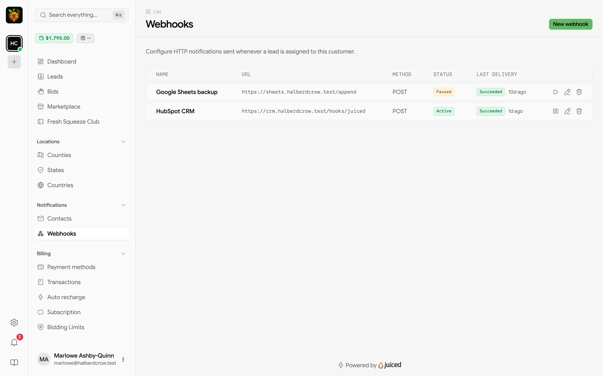
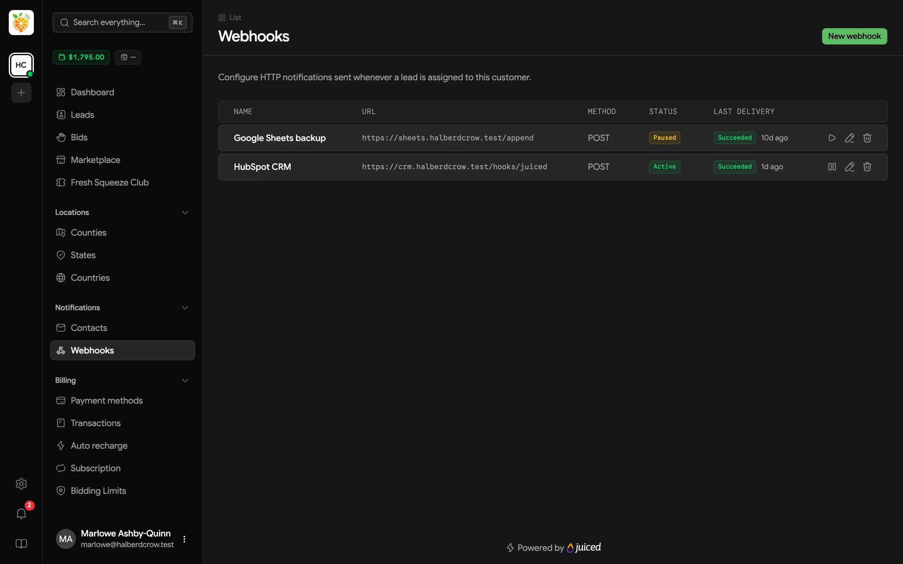
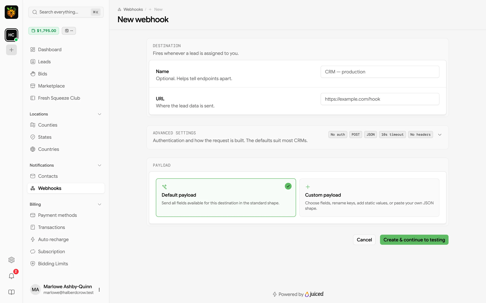
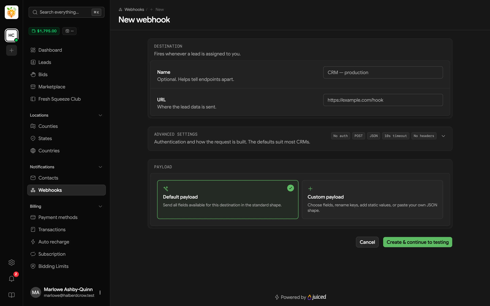
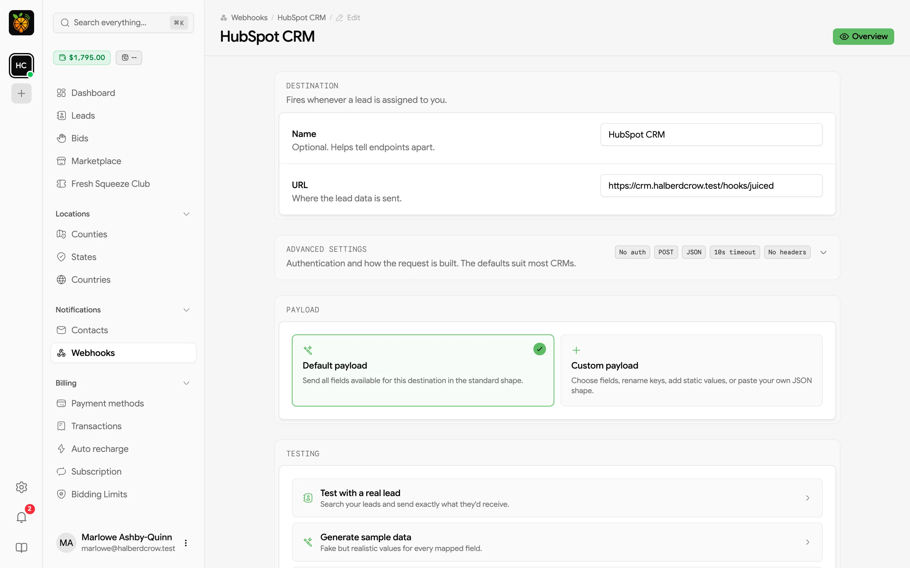
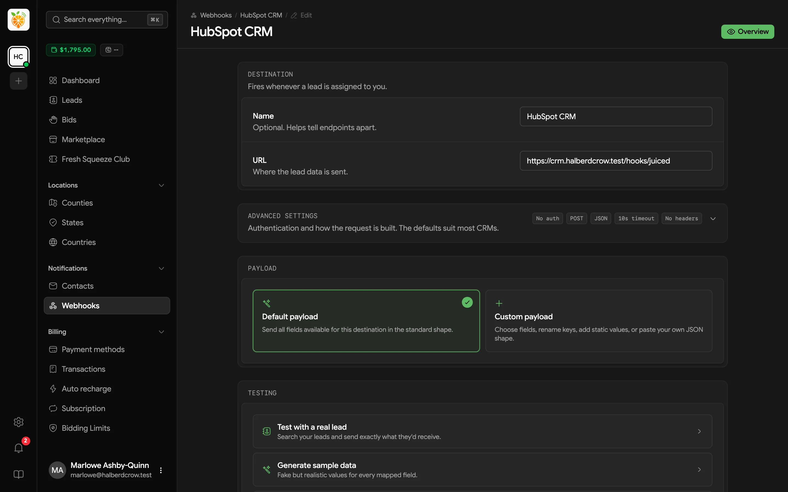
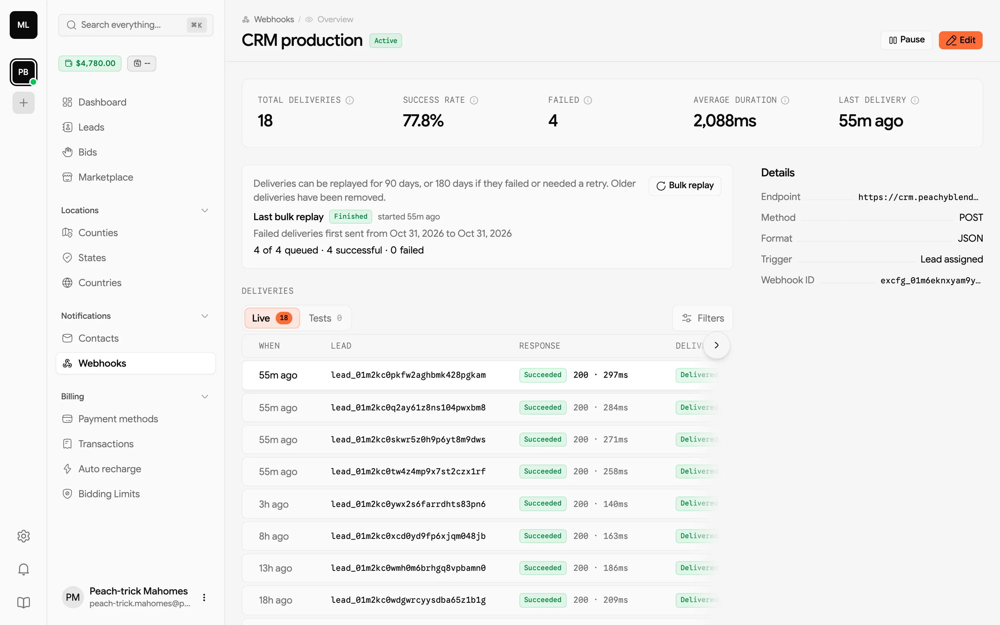
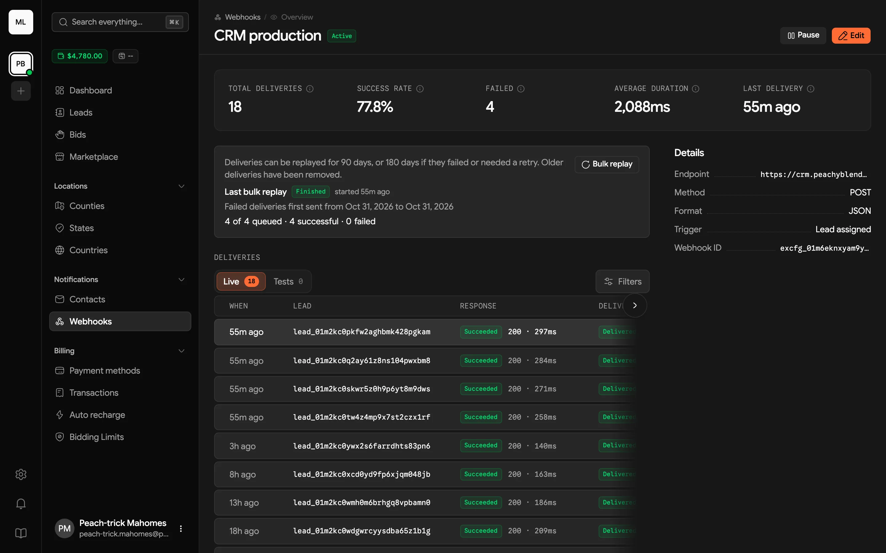

A webhook sends each lead to a URL you choose the moment it's assigned to you, whether you won it with a bid, bought it in the [Marketplace](/customer-portal/marketplace), or claimed it from the [Club](/customer-portal/club). Point it at your CRM, a Zapier or Make hook, or your own system, and leads arrive there fresh-squeezed without anyone copying and pasting.

Find webhooks under **Notifications** → **Webhooks** in the sidebar.

<Frame>
  
  
</Frame>

The table shows each webhook's **Name**, **URL**, **Method**, **Status** (Active or Paused), and the result of its **Last delivery**. Click a row to see its deliveries, or use the row actions to **Pause webhook** / **Enable webhook**, **Edit webhook**, or **Delete webhook**.

## Creating a webhook

Click **New webhook**.

<Frame>
  
  
</Frame>

### Destination

- **Name** (optional) helps you tell webhooks apart, for example "CRM production".
- **URL** is where the lead data is sent.

### Advanced settings

The defaults (no authentication, POST, JSON, 10-second timeout, no extra headers) suit most CRMs. Expand **Advanced settings** if your endpoint needs something different.

| Setting | Options |
|---------|---------|
| **Authentication** | **None**, **Basic Auth** (username and password), or **Bearer Token** |
| **Method** | **POST**, **PUT**, or **GET** |
| **Format** | **JSON**, or **Form** (URL-encoded) |
| **Timeout** | Seconds to wait for your endpoint to respond |
| **Headers** | Extra HTTP headers to send with each request |

Saved passwords and tokens stay hidden. To change one, type a new value.

### Payload

Choose what the request contains.

- **Default payload** sends every field available for your leads in a standard shape. It's the quickest way to get started.
- **Custom payload** lets you choose fields, rename keys, and add fixed values, so the data matches what your system expects. Use **Paste JSON** to start from an example of the shape your system wants, or **Load default mapping** to start from the default and edit it.

With the default payload, each request includes the price you paid (`charged_amount`), the `scope` you won it at, when you received it (`received_on`), the `lead_type`, and all the lead's deliverable fields, such as name, email, phone, and address. Fields your provider adds later are included automatically.

### Payload version

The **Payload version** section sets the shape of every request, with a card for **Legacy** and one for **v1**. New webhooks start on **v1**, which wraps each lead in a fixed envelope, and your payload choice shapes only the lead data inside it. Pick **Legacy** only if your system already expects the original shape. A preview below the cards shows what your endpoint will receive. See [Payload versions](#payload-versions) for what each version sends.

Click **Create & continue to testing**. Your webhook is saved and switched on straight away, and you land on its edit page to send a test.

## Testing a webhook

Open a webhook's edit page (**Edit webhook**) and scroll to **Testing**.

<Frame>
  
  
</Frame>

Pick the data to test with.

- **Test with a real lead** searches your leads by ID, name, email, or phone and sends exactly what that lead would send.
- **Generate sample data** fills every mapped field with fake but realistic values, which is handy before you've received any leads or placed your first bid. If your provider sells more than one kind of lead, pick the lead type to sample first.
- **Add test data manually** lets you build the payload one field at a time.

Then click **Run Webhook Test**. Juiced sends the request and shows whether your endpoint **Accepted** or **Rejected** it, along with the details of the request and your endpoint's response, so you can see what went wrong.

Test deliveries don't count as real lead deliveries. They're kept on a separate **Tests** tab in the delivery history.

<Tip>
Since new webhooks start active, run a test right after creating one. If your endpoint isn't ready yet, click **Pause** so real leads aren't sent to it until it is.
</Tip>

## Payload versions

Webhooks you created before payload versions existed stay on **Legacy**, so they keep receiving exactly what they always have. New webhooks start on **v1**.

- **v1** wraps your payload in a fixed envelope. Your payload choice shapes only `data`.
- **Legacy** is the original shape, where your payload choice shapes the whole request.

Here's a v1 request for a new lead, trimmed to a few fields.

```json
{
  "version": "v1",
  "id": "evt_01jbq7m4x2c9t5w8k3n6r0yzde",
  "type": "lead.assigned",
  "created_at": "2026-10-28T14:03:12Z",
  "tenant_id": "ten_01h8x2k4m6p8r0t2v4w6y8z0ab",
  "data": {
    "first_name": "Ada",
    "last_name": "Lovelace",
    "email": "ada@example.com",
    "phone": "5555550199",
    "city": "Austin",
    "state": "TX",
    "zip": "78701",
    "lead_public_id": "lead_01arz3ndektsv4rrffq69g5fav",
    "charged_amount": "$13.00",
    "scope": "county",
    "received_on": "2026-10-28T14:03:12.000000Z",
    "lead_type": "Motivated Seller"
  }
}
```

| Key | What it holds |
|-----|---------------|
| `version` | Always `"v1"`. |
| `id` | A unique ID for this lead's assignment to you, like `evt_01jbq7m4x2c9t5w8k3n6r0yzde`. It stays the same when a failed delivery is retried, and when a delivery is [replayed](#replaying-deliveries) with its original data. A replay that sends the lead's current data, or a re-send by your provider, gets a new `id`. |
| `type` | Always `lead.assigned` for your webhooks. |
| `created_at` | When the lead was assigned to you, in UTC. It's not the time the request was sent. |
| `tenant_id` | Your provider's ID. |
| `data` | The lead, shaped by your payload choice. IDs in it are public IDs only. |

Build your system so a lead that arrives twice does no harm. Have it store each `id` and skip any it has already processed.

### Switching a webhook's version

Open **Edit webhook** and pick the other card in **Payload version**. The preview shows the **Current** request next to the one **After save**, so you can check the difference before anything changes. The `id` and `created_at` in the preview are samples, since every delivery carries its own. **Use a real lead** previews one of your leads instead of sample data.

When you switch, a note above the preview turns amber and sums up what changes. On v1, everything moves under `data`, and the request no longer has the `tenant` and `event` keys Legacy sends, so check your system reads the new shape. If a custom payload uses `{{ event }}` or `{{ tenant.* }}` fields, the note names them, because they're empty on v1 (the envelope's `type` and `tenant_id` carry the same information).

Nothing changes until you save, and **Testing** sends the version you picked, so you can try it first. Your provider can also change the version for you.

## Monitoring deliveries

Click a webhook in the table to open its overview.

<Frame>
  
  
</Frame>

- **Stats** cover the last 30 days, with **Total deliveries**, **Success rate**, **Failed**, **Average duration**, and **Last delivery**.
- **Deliveries** lists every attempt, with **Live** and **Tests** tabs. Each row shows when it was sent, the lead, the result and response code with how long it took, and a delivery ID. Filter by **Result** or **Delivery date**, and click a row to see the full request and response, including headers and body.
- **Details** shows the endpoint, method, format, trigger (**Lead assigned**), and webhook ID.

Use **Pause** / **Enable** and **Edit** at the top of the page to change the webhook.

### Replaying deliveries

If a delivery failed (say your CRM was down), click **Replay** on its row, or open it and click **Replay** at the bottom, once your system is back up. The replay is queued, and it shows in the delivery history as a new delivery once it's sent. When you open a delivery, a note beside the button tells you what it will send. Every replay uses the webhook's current URL, method, format, authentication, and headers, so fix a wrong URL or expired credentials before you replay.

- **On a v1 webhook**, a replay sends the original event again, with the same `id`, `created_at`, and lead data, so your system can tell it's a repeat. If it fails, it's retried like any other delivery. Deliveries sent before replay existed, or while the webhook was on Legacy, are the exception. They go out once with the lead's current data and a new `id`.
- **On a Legacy webhook**, a replay sends the lead's current data once, as a new delivery.

A panel above the delivery history shows how far back you can go. Deliveries can be replayed for 90 days, or 180 days if they failed or needed a retry.

To replay a batch, say everything that failed during an outage, click **Bulk replay**. Pick the **Deliveries** to replay (**Failed**, **Successful**, or **Successful and failed**), optionally set **First sent from** and **First sent until**, and click **Start replay**.

- Only the latest delivery of each event is replayed, so an event you've replayed before is sent once, not once for every earlier replay. **Failed** and **Successful** refer to that latest delivery.
- Replays go out at 5 per second, and up to 1,000 at a time. If more match, narrow the dates or status.
- You can run one bulk replay per webhook at a time. The panel shows its progress as <span className="tone-badge tone-info">Queueing</span>, then <span className="tone-badge tone-info">Sending</span>, then <span className="tone-badge tone-success">Finished</span>, with counts of the replays that succeeded and failed. It shows <span className="tone-badge tone-warning">Finished</span> instead when some failed, and <span className="tone-badge tone-danger">Stalled</span> if Juiced couldn't queue them all.

Tests (run the test again instead) and deliveries that are still being attempted have no **Replay** button, and you can't replay a delivery that already has a replay on its way. Nothing can be replayed while the webhook is paused, so enable it first.

If you don't see **Bulk replay**, your role doesn't let you edit webhooks. Ask your account admin or provider for access.
