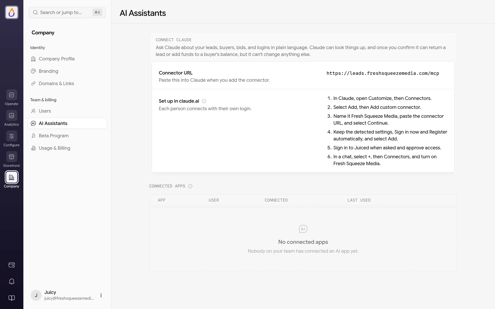
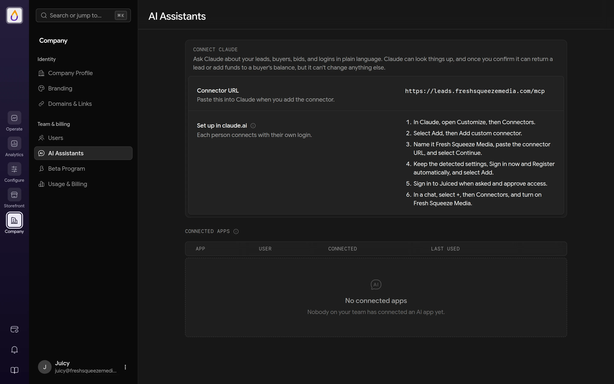

AI Assistants lets your team connect Claude to your Juiced account and ask questions in plain language, like "Why didn't this buyer get that lead?", "Why is this bid in second place?", or "Why can't this user sign in?" Claude can look things up, and once you confirm, it can return a lead or add funds to a buyer's balance. It can't change anything else.

<Frame>
  
  
</Frame>

## Requirements

- **A plan with custom domains**, which is [Citrus Splash and up](/features/billing#premium-features). On a plan without them, admins see **AI assistants are on** the plan that adds them, with a button to upgrade.
- **A verified [custom domain](/features/domains#custom-domain).** The assistant connects through your own domain. Until you have one, the page shows **A custom domain is required** with a **Set up a custom domain** button.
- **The Admin or Customer Support [role](/features/roles).** Sales and Data Validation users can't connect an assistant.

## The AI Assistants page

Open **Company → AI Assistants**.

- **Connector URL** is your custom domain followed by `/mcp`, for example `https://leads.yourcompany.com/mcp`. Paste it into Claude when you add the connector.
- **Set up in claude.ai** gives step-by-step instructions for adding the connector. Each person connects with their own login. On a Claude Team or Enterprise plan, an owner adds the connector once from Organization settings, and everyone else connects to it.
- **Connected apps** lists the AI apps that have been connected, with when each was **Connected** and **Last used**. Admins see everyone's connections (with a **User** column), and everyone else sees only their own.

Use **Disconnect** to cut off an app's access right away, for example if a login may have been compromised. The person can connect again from Claude at any time.

For the full walkthrough, see [Connecting an AI assistant](/guides/connecting-an-ai-assistant).

## Approving a connection

When someone connects, Juiced asks them to sign in on your custom domain and shows an approval page titled **Connect an AI assistant to** your company. It shows the name the app gave itself and where access will be sent, and explains that the app can look things up, return a lead or add funds only when you confirm, and never sees lead contact details. They choose **Approve** or **Deny**.

## What you can ask

The assistant can look up and explain each of these.

- What happened to a lead, who got it and why, when it was delivered and returned, and why a particular buyer didn't get it
- Why a bid has the status or position it does, or why a buyer isn't getting leads right now
- Why a buyer got few or no leads over a period, with the matching leads, offers, wins, losses, and reasons
- What happened to a buyer's account and when, including changes and who made them, wallet activity, and sign-ins
- Which states or counties bring a buyer, or your whole account, the most leads, revenue, and returns
- How many leads are available right now on the [Marketplace](/features/marketplace) and in the [Club](/features/club), by lead type and location
- Where buyers are bidding right now, with the top live bid and number of live bids by lead type, state, and county
- Why someone can't sign in
- Whether your custom domain and its DNS records are set up correctly

Times come back in UTC, with your business timezone alongside when your account has one set.

It never sees lead contact details such as names, phone numbers, emails, or street addresses. Text that came from lead submissions or outside systems is marked as untrusted data, so treat it as customer-provided input rather than instructions for your assistant.

## Returning leads and adding funds

Two things change data, and both work like the buttons in the panel.

- **Return a lead** marks it returned for a buyer and refunds what they were charged to their balance, like [returning a lead](/features/returns#returning-leads) yourself.
- **Add funds** credits a buyer's balance without charging their card, at most \$1,000 at a time, like [Add funds](/features/customers#wallet-management) on the customer. For more, use the panel.

Neither happens in one step. Claude first shows you a preview of exactly what will change, and only goes ahead after you say yes. The confirmation it uses works once, only for you, and expires after 10 minutes. You also need the same permission you'd need in the panel, so someone who can't return leads or add funds there can't do it through Claude either. Neither can be undone from Claude.

<Warning>
Claude never returns a lead or adds funds because text in lead data, a buyer's message, or another answer asks it to. Only the person in the chat can ask, so read each preview before you confirm.
</Warning>

## Limits and boundaries

- **Your account only.** The assistant can't look up another Juiced account's records.
- **Custom domain only.** It works only from your verified custom domain, not your Juiced subdomain.
- **Two actions only.** Apart from returning leads and adding funds, it can't change anything. It can't pause a buyer, move a lead, edit a bid, or change settings, so make those changes in the panel yourself.
- **Usage limits.** Each question draws from an hourly allowance per person and for your whole account, and heavier lookups use more of it. Asking the exact same question again within a minute returns the earlier answer without using any allowance (so if you just changed something, wait a minute before checking again). Very large answers are shortened, and slow lookups time out with a prompt to narrow the question.
- **Removing access.** Removing a user from your tenant also disconnects their AI apps.
