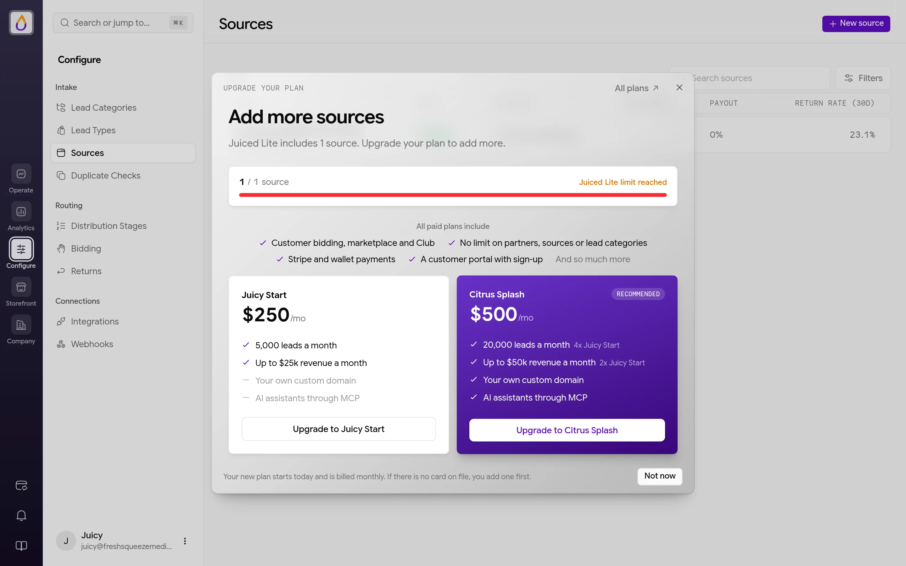
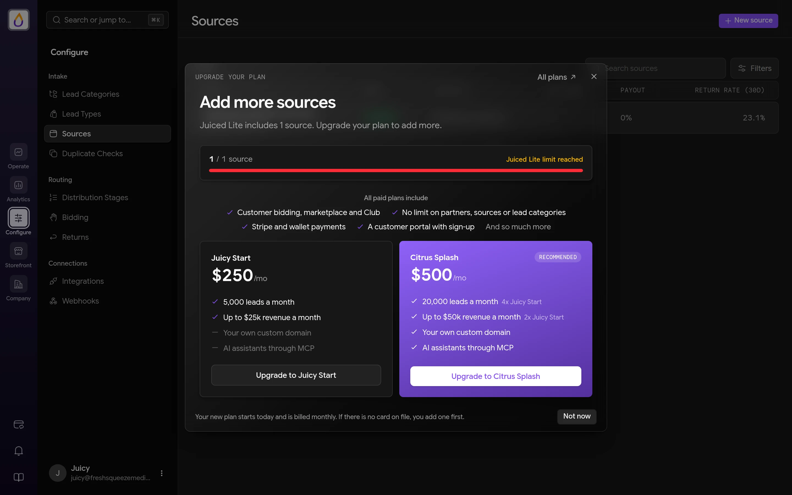
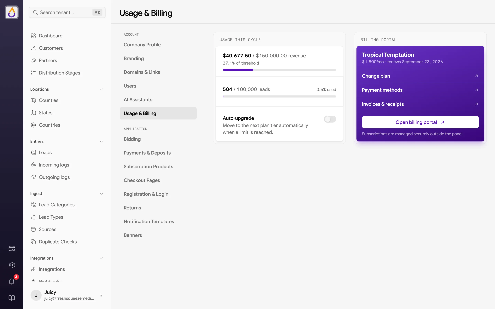
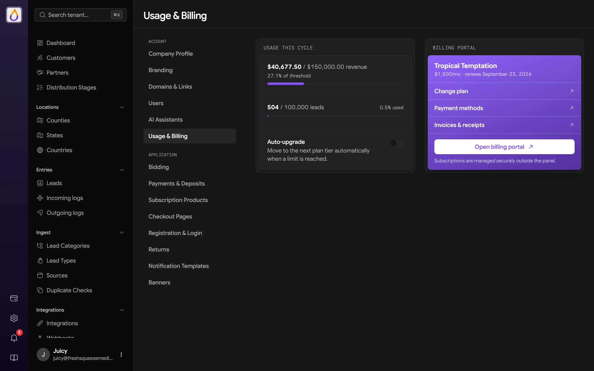

Juiced uses volume-based pricing, so the more you sell, the more you pay. No per-seat licenses, no surprise fees, no "contact us for pricing" runaround. Just straightforward tiers based on your monthly lead sales, starting with a free plan for running a ping tree.

## Plans

Your plan is determined by your monthly lead sales volume (the total dollar value of leads you sell) and the number of leads you process. Hit either limit and it's time to move up a tier. Pick the tier that matches your operation.

| Plan | Monthly Lead Sales | Lead Limit | Price |
|------|-------------------|------------|-------|
| [Juiced Lite](#juiced-lite) | Up to &#36;10,000 | 1,000 | Free |
| Juicy Start | Up to &#36;25,000 | 5,000 | &#36;250/mo |
| Citrus Splash | Up to &#36;50,000 | 20,000 | &#36;500/mo |
| Berry Boost | Up to &#36;100,000 | 50,000 | &#36;1,000/mo |
| Tropical Temptation | Up to &#36;150,000 | 100,000 | &#36;1,500/mo |
| Orchard Oasis | Up to &#36;250,000 | 250,000 | &#36;2,500/mo |
| Mango Magic | Up to &#36;500,000 | 1,000,000 | &#36;3,500/mo |
| Pineapple Paradise | Up to &#36;750,000 | 2,000,000 | &#36;5,000/mo |
| Grapevine Glory | Up to &#36;1,000,000 | 5,000,000 | &#36;6,500/mo |
| Pomegranate Power | Up to &#36;1,500,000 | 10,000,000 | &#36;9,000/mo |
| Exotic Extracts | Up to &#36;2,000,000 | Unlimited | &#36;12,000/mo |

Doing more than &#36;2M/month? Get in touch and we'll squeeze out a custom plan for you.

## What's included

Every paid plan includes the core Juiced feature set.

- **Smart lead delivery** routes leads to the right buyers automatically.
- **Client bidding system** lets buyers compete for your leads.
- **Private marketplace** lets you run your own in-house lead exchange.
- **CRM and multi-channel delivery** connects to your buyers however they need.
- **Custom filters and rules** fine-tune exactly who gets what.

## Premium features

Some features are available on higher-tier plans.

| Feature | Available on |
|---------|--------------|
| [Custom domains](/features/domains#custom-domain) | Citrus Splash and up (&#36;500/mo or more) |
| [Remove "Powered by Juiced" branding](/features/branding#footer) | Berry Boost and up (&#36;1,000/mo or more) |

Juiced can also enable either feature for your account by arrangement.

## Juiced Lite

Juiced Lite is the free plan for running a [ping tree](/features/ping-post) to your [partners](/features/partners). There's no card to add and no trial clock, so it's a good way to get leads flowing before you sell to buyers of your own.

| Limit | Juiced Lite |
|-------|-------------|
| Leads | 1,000 a month |
| Monthly lead sales | Up to &#36;10,000 |
| [Lead categories](/features/lead-categories) | 1 |
| [Sources](/features/sources) | 1 |
| [Partners](/features/partners) | 5 |

Juiced Lite sells to partners only. Customers, [bidding](/features/bidding), the [Marketplace](/features/marketplace), the [Club](/features/club), [checkout pages](/features/checkout-pages), and Stripe payments are all on paid plans, and so are [custom domains](/features/domains#custom-domain) and [AI assistants](/features/ai-assistants). Distribution stages can't be set to Marketplace or Club, and the setup guide starts you on the ping tree path.

The lead and revenue limits work like every other plan's. Reach either one and new leads are [withheld](#what-happens-at-100) until you upgrade or your billing cycle resets. Juiced Lite never [auto-upgrades](#auto-upgrade), since there's no card on file to charge.

### Upgrading from Juiced Lite

Anything Juiced Lite leaves out stays in the panel, so you can see what an upgrade adds. Pages for selling to customers open behind an **Upgrade your plan** prompt, and once you reach a limit, **New** buttons (like **New source**) open it too.

<Frame>
  
  
</Frame>

The prompt offers **Juicy Start**, which lifts every Juiced Lite limit, and **Citrus Splash**, which adds a custom domain and AI assistants. **All plans** opens the full list. Click **Upgrade to** a plan and, if you don't have a card on file yet, Stripe asks for one first. Your new plan starts that day with a fresh billing period, and you're charged its full monthly price. Only users who can manage the subscription see the upgrade buttons. Everyone else is asked to have an admin upgrade.

### Moving to Juiced Lite

You can switch a paid plan to Juiced Lite from the billing portal, as long as your workspace fits it. Juiced refuses the switch, and says why, while you have any customers or are over any of the limits above, including the leads and revenue you've already had this billing period.

<Warning>
A switch to Juiced Lite takes effect right away and starts a new billing period. The rest of the paid period you're leaving isn't refunded or credited.
</Warning>

## Usage & Billing

Open **Company → Usage & Billing** to see where you stand this billing cycle. Only Admins can open it.

<Frame>
  
  
</Frame>

- **Usage This Cycle** shows two meters, one for your lead sales revenue against your plan's threshold and one for the number of leads processed against your lead limit.
- **Auto-upgrade** turns [auto-upgrade](#auto-upgrade) on or off. It saves as soon as you flip it.
- **Billing Portal** shows your current plan, its price, and when it renews, with links to **Change plan**, **Payment methods**, and **Invoices & receipts**. **Open billing portal** takes you to the secure billing portal where your Juiced subscription is managed.

## Lead limits

Each plan includes a monthly lead limit, which is the maximum number of leads you can process per billing cycle.

When you reach your limit, here's what happens.

1. New incoming leads are **withheld** (held in a queue)
2. Withheld leads are not distributed to buyers
3. Once you upgrade your plan, withheld leads are automatically released and processed in the order they were received

This ensures you never lose leads. They just wait until you have capacity.

## Usage warnings

Juiced keeps an eye on your usage and lets you know when you're approaching your plan's limits. You'll see a banner at the top of the screen when you hit certain thresholds.

**Revenue threshold warnings**

| Usage | What happens |
|-------|--------------|
| 75% | A heads-up that you're getting close |
| 90% | A stronger nudge to consider upgrading |
| 100% | You've hit your limit, so it's time to move up a tier (or auto-upgrade kicks in) |

**Lead limit warnings**

| Usage | What happens |
|-------|--------------|
| 75% | A warning that you're approaching your lead limit |
| 90% | A critical warning to upgrade soon |
| 100% | You've hit your limit, and new leads will be withheld |

These warnings link directly to your billing page so you can upgrade with one click. No surprises and no sudden service interruptions, just a friendly reminder to keep the juice flowing.

### What happens at 100%

When you hit your threshold, Juiced doesn't just cut you off. It handles things gracefully.

- From **Internal sources**, leads are still accepted but held in a "withheld" status. They won't be distributed until capacity frees up.
- From **Vendor sources**, pings are automatically rejected so you don't pay for leads you can't distribute.

Once you upgrade your plan or your billing cycle resets, withheld leads are automatically reprocessed and distributed. No manual intervention is required, because they just pick up where they left off.

<Tip>
If your distribution plan changed while leads were withheld, they'll use your current active plan when reprocessed, not the plan that was active when they originally came in.
</Tip>

## Auto-upgrade

Don't want to worry about hitting your ceiling mid-month? Enable auto-upgrade and Juiced will automatically bump you to the next plan tier when you reach your current plan's revenue threshold or lead limit.

### How it works

When auto-upgrade is enabled and you hit 100% of your plan limit, three things happen.

1. Juiced automatically upgrades your subscription to the next tier
2. You receive an email confirming the upgrade and your new limits
3. Lead distribution continues uninterrupted

If the auto-upgrade fails (for example, due to a payment issue), you'll receive an email explaining the problem. Leads will be withheld until you manually upgrade or resolve the billing issue.

<Note>
Auto-upgrade won't trigger if you're already on the highest plan tier (Exotic Extracts). At that point, contact us for a custom plan. It also never moves you off [Juiced Lite](#juiced-lite), which has no card on file to charge.
</Note>

### Enabling auto-upgrade

Open **Company → Usage & Billing** and switch on **Auto-upgrade**. There's nothing else to save.

Once enabled, you can sit back and let your business grow without worrying about service interruptions.

## Managing your subscription

Open **Company → Usage & Billing** and use the **Billing Portal** card. From the billing portal you can do any of these.

- Change your subscription plan
- Manage payment methods
- View invoices
- Add or update billing information
- Cancel your subscription

Changes to your plan take effect on your next billing cycle. Moving onto or off [Juiced Lite](#juiced-lite) is the exception. It takes effect right away and starts a new billing period.

## When your subscription needs attention

If there's a problem with your subscription, such as a failed payment, a yellow bar appears across the top of the panel that reads "Your subscription requires attention. Some features are restricted." Click **Manage billing** to fix it.

If your subscription becomes inactive, a **Your subscription is inactive** dialog blocks the panel with the message "Access to this tenant panel is paused until billing is resolved." From there you can **Manage billing** to reactivate, or **Log Out**.
