Checkout pages are public, pay-first offer pages. A buyer picks a package, pays by card, and lands with credit in their wallet (and a Club membership, if the offer includes one) without waiting for you to set anything up. They're built for launches, webinars, and promotions where you want the money in before the conversation.

## Before you start

- **The Admin role.** Checkout pages take payments on your Stripe account, so only users who can manage billing see them.
- **Card payments.** Your [Stripe account](/features/integrations) must be connected and able to take customer payments. Until it is, pages show as **Not selling**.
- **For Club offers**, turn on the [Club](/features/club) and offer a tier in [Subscription Products](/features/subscription-products).

Open **Storefront → Checkout Pages**. It has four tabs (**Pages**, **Products**, **Affiliates**, and **Results**).

## Products

Products are what your pages sell. Create them first by clicking **New product** on the **Products** tab.

<Frame>
  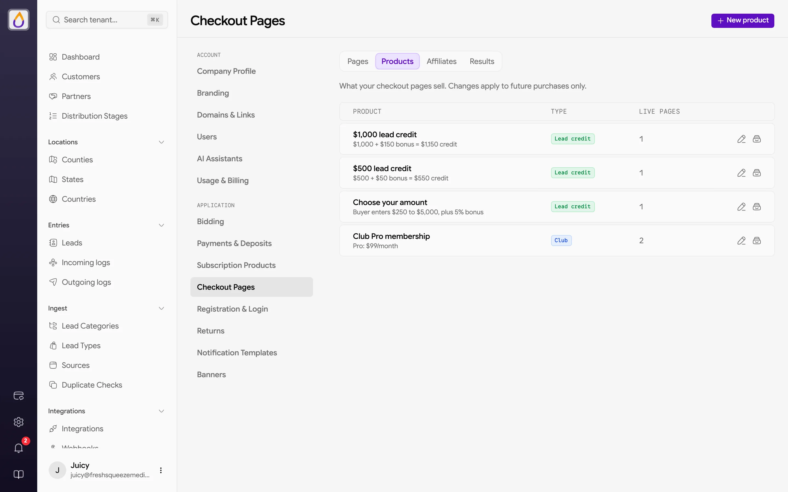
  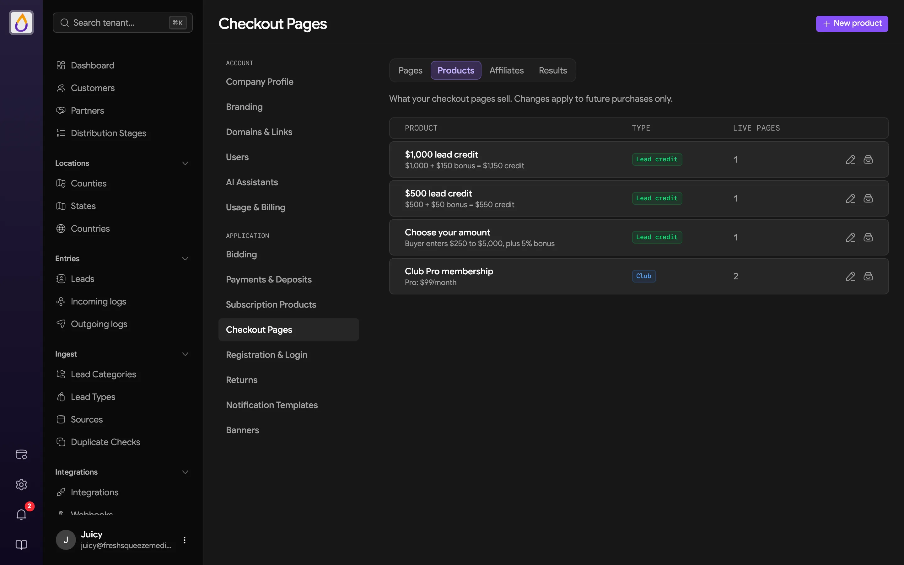
</Frame>

There are two kinds.

**Lead credit** adds money to the buyer's wallet.

- **Pricing** is either a **Fixed price**, which is credited in full, or **Buyer enters the amount** with a **Minimum** and **Maximum** in whole dollars.
- **Bonus** can be **No bonus**, a **Fixed amount**, or a **Percent of price**, added on top as a separate checkout bonus. For buyer-entered amounts, **Bonus applies to the first** caps how much of the amount earns a bonus; leave it blank to apply the bonus to the whole amount. You can also round the bonus down to whole dollars.

**Club membership** starts a subscription to one of your Club tiers. Add **Free months** to give buyers a head start. Their card is saved and the tier price starts after the free months. Free months are only available through checkout pages.

The name you give a product is shown to buyers on the page and in Stripe Checkout. Changes apply to future purchases only. Products can be archived and restored.

## Pages

The **Pages** tab lists each page with its **Status**, **Price**, **Visits**, **Sales**, and **Revenue**.

<Frame>
  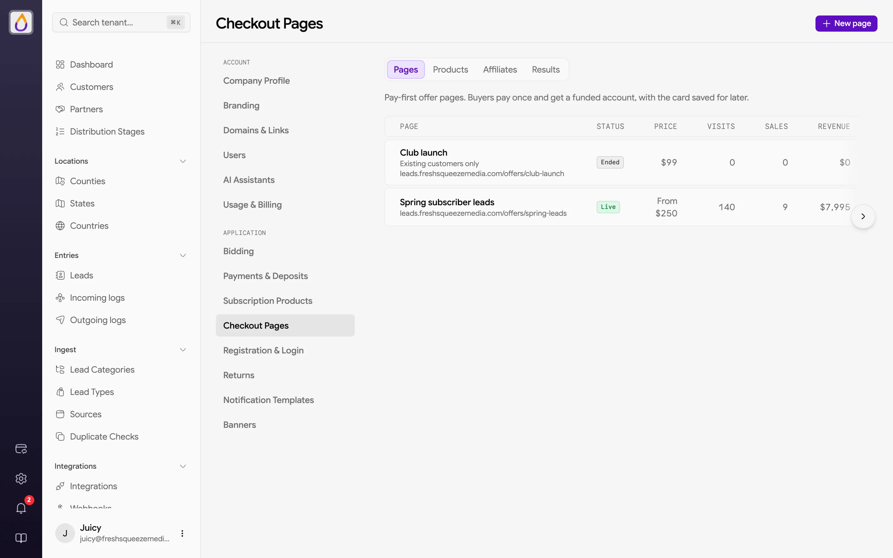
  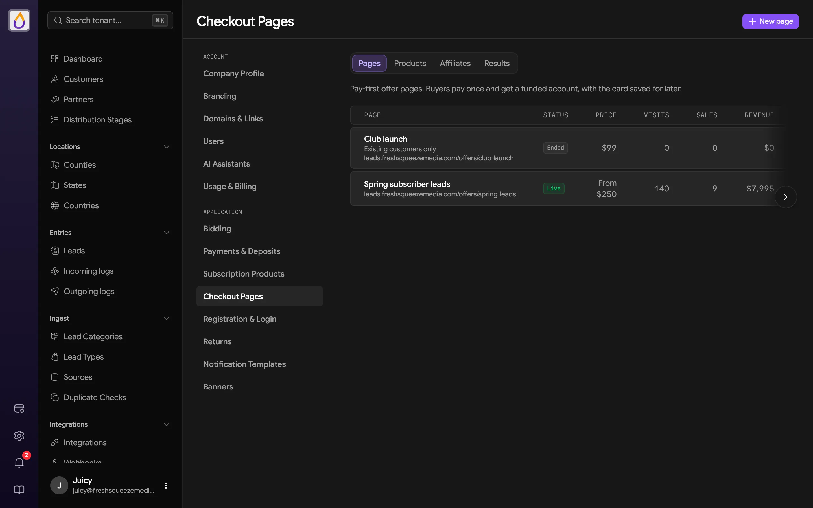
</Frame>

| Status | Meaning |
|--------|---------|
| Live | Buyers can check out |
| Off | The page's **Live** switch is off |
| Ended | The offer's end time has passed |
| Not selling | The page is on but something is blocking sales. Hover the badge for the reason, for example card payments not being set up, the page having no offers, or a problem with one of its products. |

Each row has **Edit**, **Preview**, and **Duplicate**.

### Building a page

<Frame>
  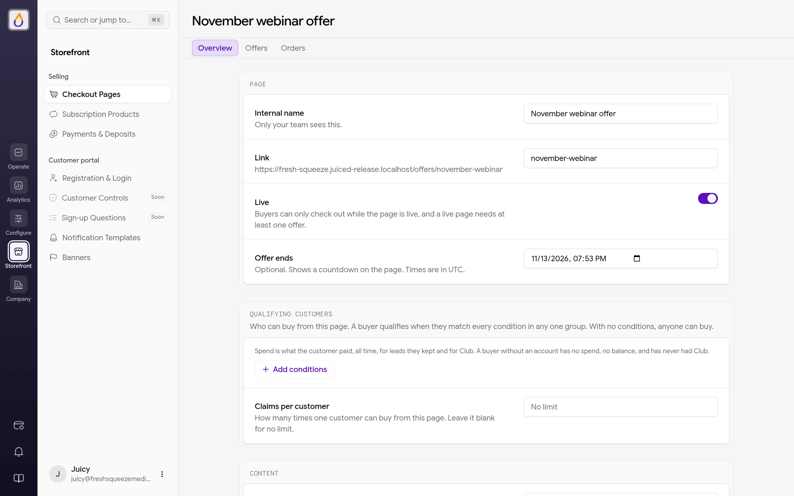
  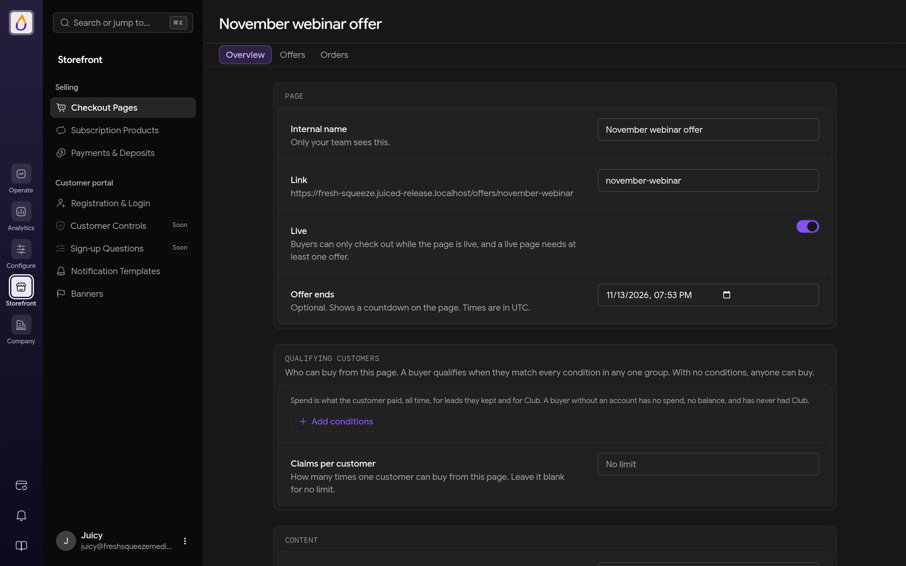
</Frame>

**Page**

| Field | What it does |
|-------|--------------|
| **Internal name** | Only your team sees it |
| **Link** | The page's address, which is `/offers/` followed by the link you choose, on your custom domain if you have one |
| **Live** | Buyers can only check out while the page is live. A new page starts off, and it can only go live once it has an offer. |
| **Who can buy** | **Everyone**; **New customers only** (people who already have an account can't check out, good for welcome offers); or **Existing customers only** (buyers must sign in, good for reload sales) |
| **Offer ends** | Optional. Shows a countdown on the page. Times are in UTC. |
| **Default affiliate** | Sales are credited to this affiliate unless the link carries another affiliate's `?ref=` code |

**Content** is what the page says, made up of a **Headline**, **Subheadline**, an optional **Video** (YouTube, Vimeo, or Loom), and **Details**. In Details, lines written as "Label: text" or starting with "-" show as a highlighted list; other text shows as paragraphs.

**Design** picks the look. Every design shows the same content and checkout.

| Design | Best for |
|--------|----------|
| **Frame** | A full landing page that shows the buyer's account filling with credit |
| **Receipt** | The offer printed as a receipt, with the money math up front |
| **Stage** | Dark, with a big countdown. Built for traffic straight from a live webinar. |
| **Split** | Your brand color on one half, a calm order form on the other |
| **Bento** | One fact per tile, with checkout pinned beside them |

Use **Preview** to see the saved page before you share it.

### Adding offers

**Offers** are the packages buyers choose between, and they live on the page's **Offers** tab. Saving a new page takes you straight there.

Click **Add offer**, give it a **Name**, and add products. The buyer gets all of them in one checkout. An offer can include one buyer-entered product and one Club tier, and a page can have up to six offers. The dialog shows what's **Due today** and how much **Credit** the buyer gets.

<Frame>
  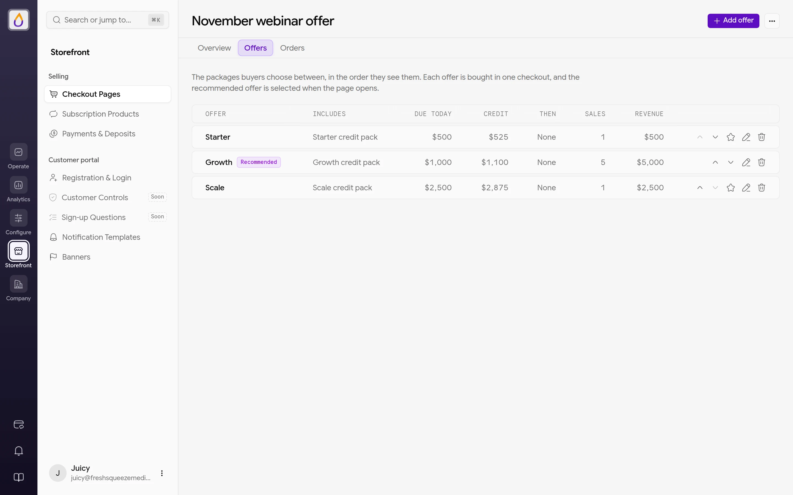
  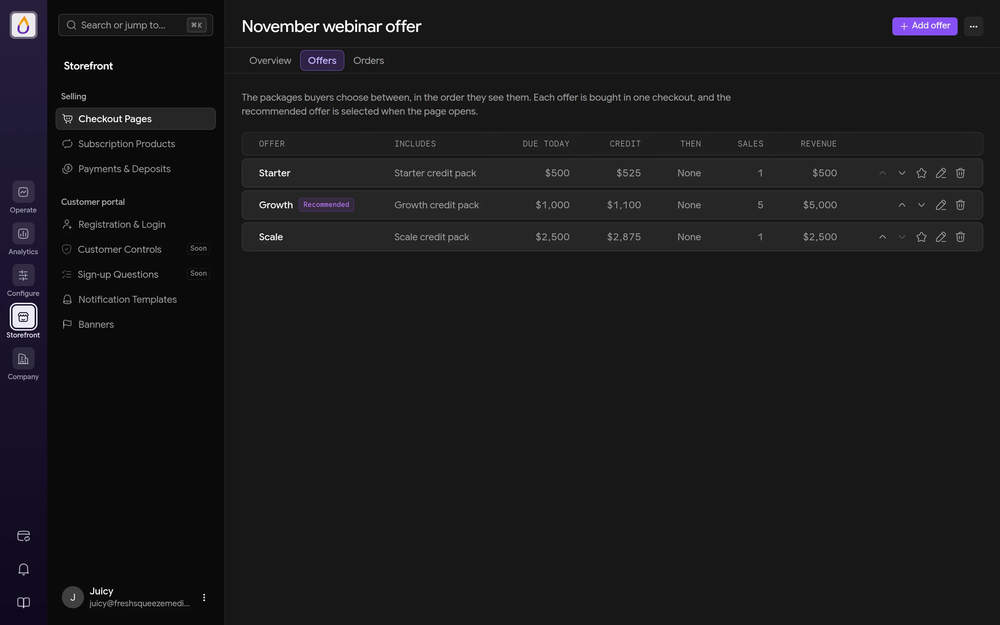
</Frame>

Each offer saves on its own. Use the row buttons to edit, **Recommend** (the recommended offer is selected when the page opens), move up or down (buyers see offers in this order), or remove an offer. On a live page, a change that would stop the page from selling isn't saved, and the last offer can't be removed until you turn the page off.

### What happens when someone buys

The buyer pays in Stripe Checkout. Once payment is confirmed, Juiced creates their customer account (or uses the one they signed in to), saves their card, adds the credit and any bonus to their wallet, and starts their Club membership if the offer included one. New buyers get a welcome email with a link to set up their login, and existing customers get a purchase confirmation. You can edit both emails in [Notification Templates](/features/notifications).

In the customer's [transactions](/features/transactions), the credit shows as **Funds Added** and the bonus as a separate **Checkout Bonus**.

### Page results

Open a page to see its record, with **Overview**, **Offers**, and **Orders** tabs. **Overview** shows its status, link (with **Copy link**), when the offer ends, and how it's doing. **Edit** is in the header, with **Preview** and **Duplicate** under **More actions**.

<Frame>
  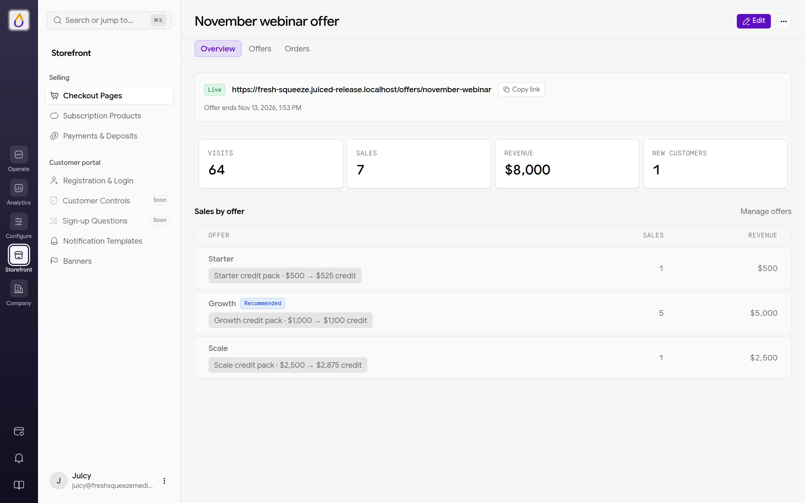
  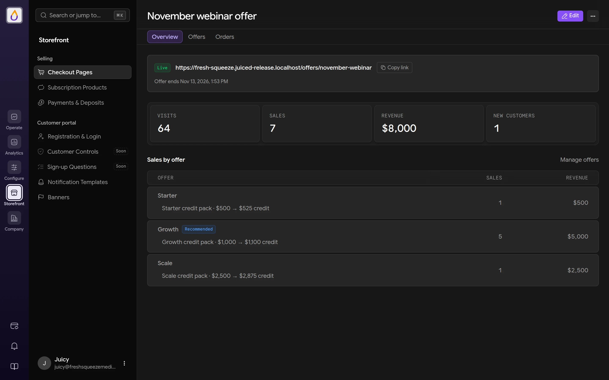
</Frame>

- **Visits**, **Sales** (with the conversion rate), **Revenue**, and **New customers**
- **Sales by offer**, including offers you've since removed

The **Orders** tab lists every order, with the buyer, the customer account, what they **Paid**, **Credit + bonus**, and a status of Fulfilled, Needs attention (paid, but delivery couldn't complete as bought, so review it), or Abandoned (the buyer left Stripe Checkout and nothing was charged)

<Frame>
  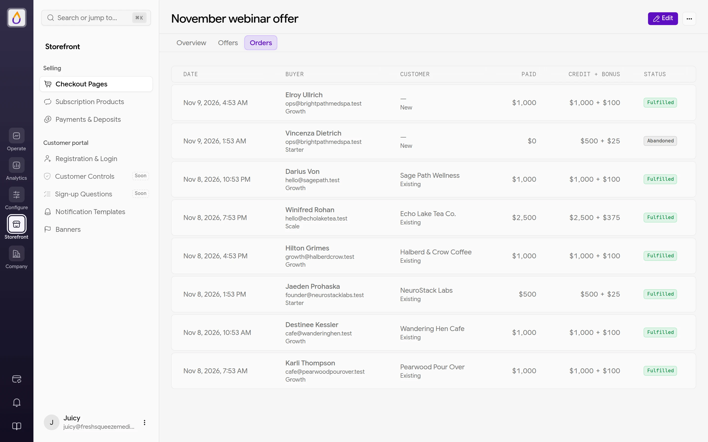
  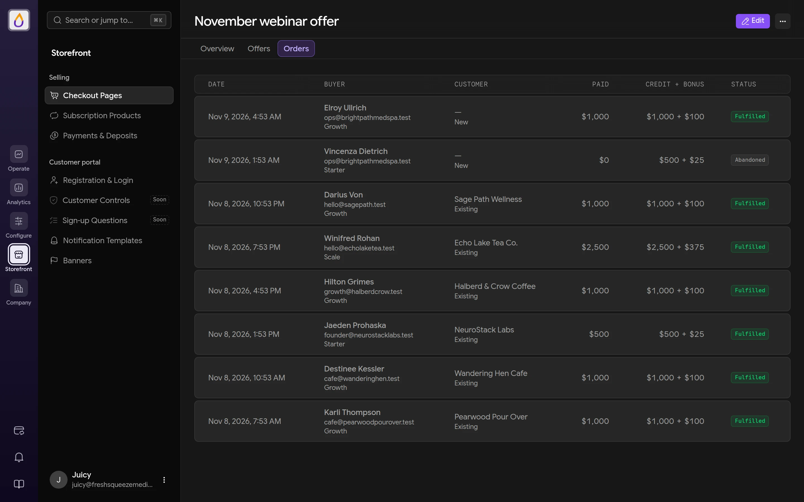
</Frame>

## Tracking who referred a customer

There are two ways to credit a referrer, depending on what you need.

| | Signup URL tracking | Affiliates |
|---|---|---|
| **How it works** | Add a parameter such as `?utm_source=jane` to your customer signup link (`/app/register`). | Create the affiliate on the **Affiliates** tab with a referral code. They share your checkout page link with `?ref=` and their code added. |
| **Where it shows** | Each parameter gets its own row under **Registration Tracking** on the customer's overview. See [Onboarding customers](/guides/onboarding-customers). | The affiliate's record, under **View customers**. A customer's first affiliate also shows under **Registration Tracking**. |
| **Works on** | Customer signups | Checkout page sales |
| **Use it when** | You want to see who sent a signup and handle any commission yourself. | You want sales credited to a referrer automatically, with commissions tracked for you. |

A `?ref=` code on the signup link is only stored as a tracking parameter. It doesn't credit an affiliate, so send affiliates' audiences to a checkout page instead.

## Affiliates

Affiliates are the people promoting your offers, like a podcast host or a partner agency. Credit their sales and track what you owe them on the **Affiliates** tab.

<Frame>
  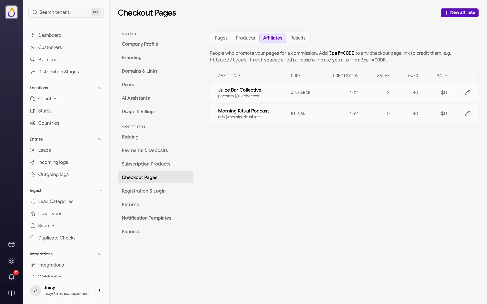
  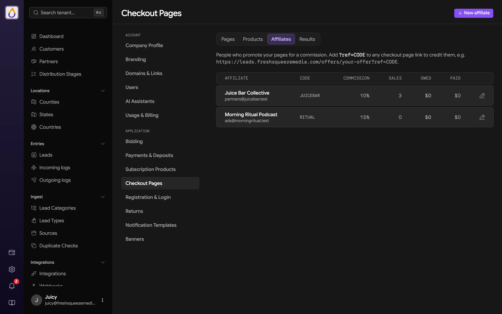
</Frame>

Click **New affiliate** and fill in the details.

- **Name**, and an optional **Email** for your records (affiliates don't get a login)
- **Referral code**, which goes after `?ref=` in their link
- **Commission**, a percent of what the buyer pays at checkout. Bonus credit, free months, reloads, and renewals earn nothing. Rate changes only apply to future sales.
- **Active** (inactive codes are ignored on checkout pages)

Open an affiliate to see their **Owed**, **Paid**, and **Sales**, and a list of **Commissions**. Use **Copy ?ref= code** to grab their code, and **View customers** to see who they brought in.

<Frame>
  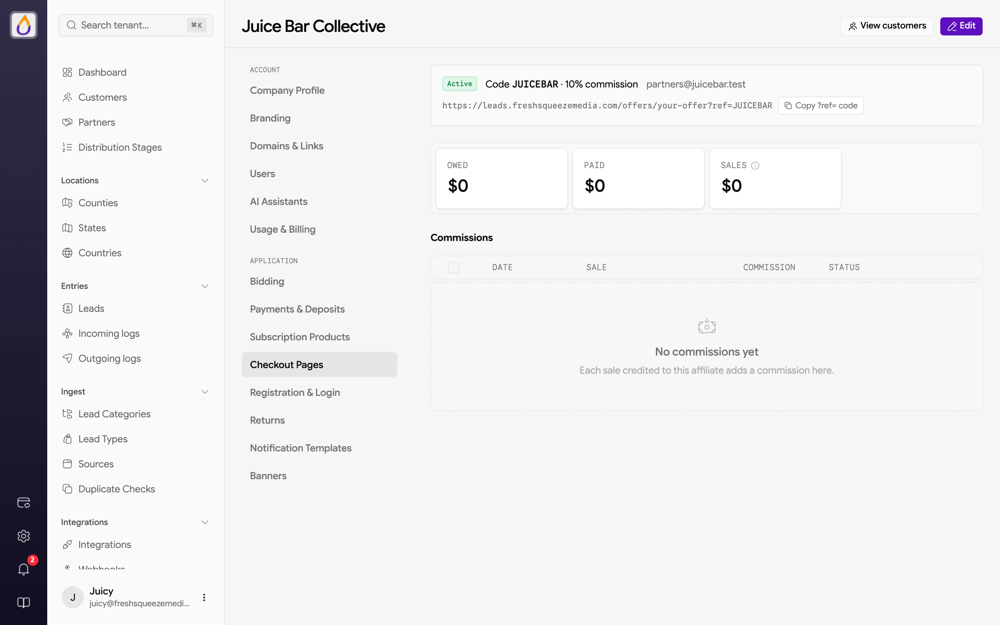
  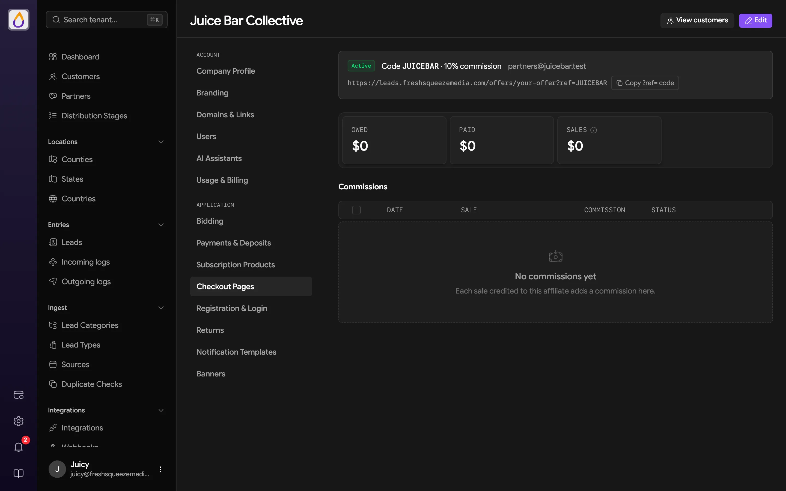
</Frame>

To record a payout, select the commissions you've paid and click **Mark paid**, then enter the **Paid on** date and a note such as "PayPal". Use **Void** on a commission the affiliate shouldn't be owed for, for example after a refund; it can't be undone.

A customer's first affiliate also shows under **Registration Tracking** on their [customer overview](/features/customers).

## Results

The **Results** tab compares your pages and affiliates for the timeframe you pick, best performers first.

<Frame>
  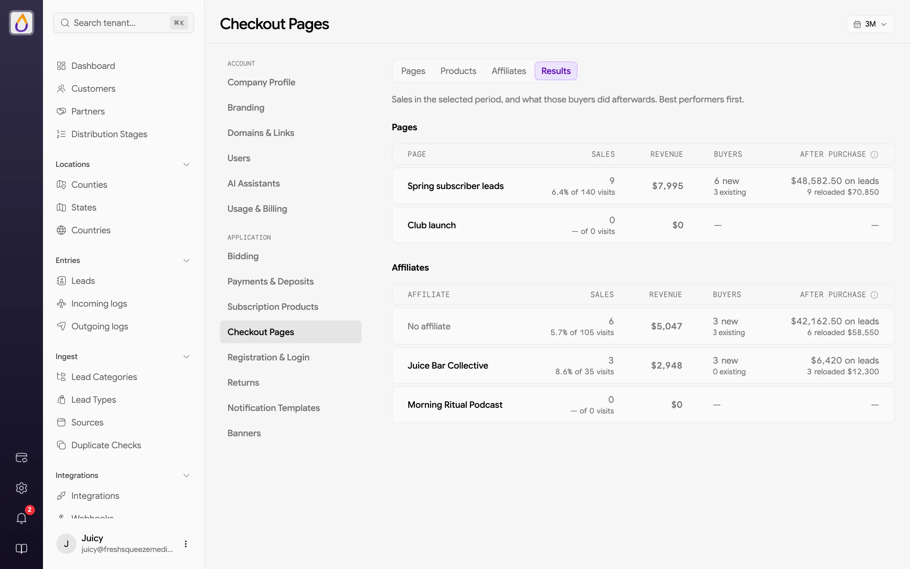
  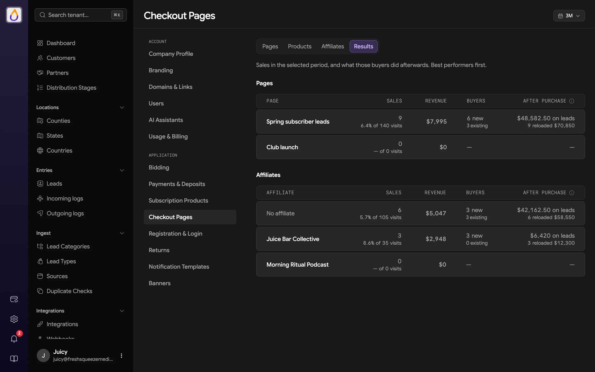
</Frame>

Each row shows **Sales** (with conversion from visits), **Revenue**, and **Buyers**, plus two more columns.

- **After purchase** shows what those buyers did next, meaning lead spend net of returns and how many added funds again by top-up or auto recharge. The original purchase doesn't count.
- **Club** (when any sale included the Club) shows where those members stand today. Renewed means they've made a Club payment, and canceled includes memberships set to end.

It's the quickest way to see whether a promotion brought in buyers who stick around, or just a one-time sugar rush.

<Tip>
  Want feedback on an offer before you launch it? Share it in [That Agency Group](https://www.skool.com/that-agency-group), our free Skool community, or bring it to a live call in the [Hybrid Agency Mastermind](https://www.skool.com/hybrid-agency-mastermind).
</Tip>
