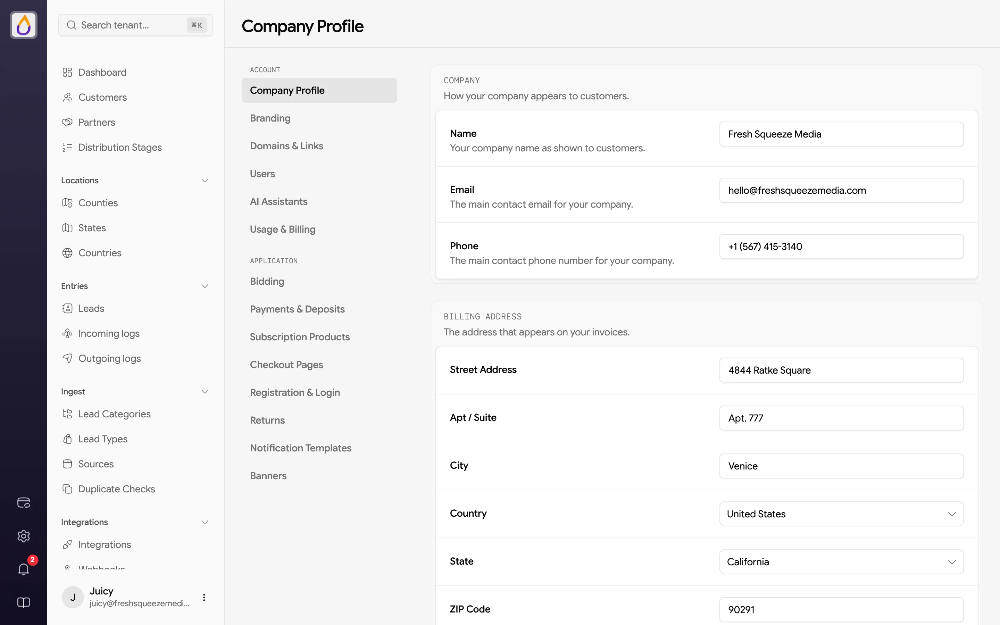
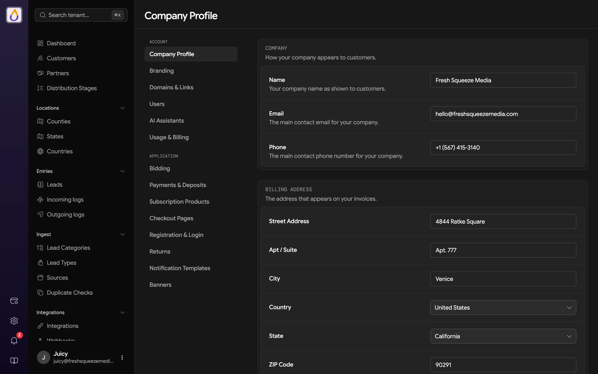
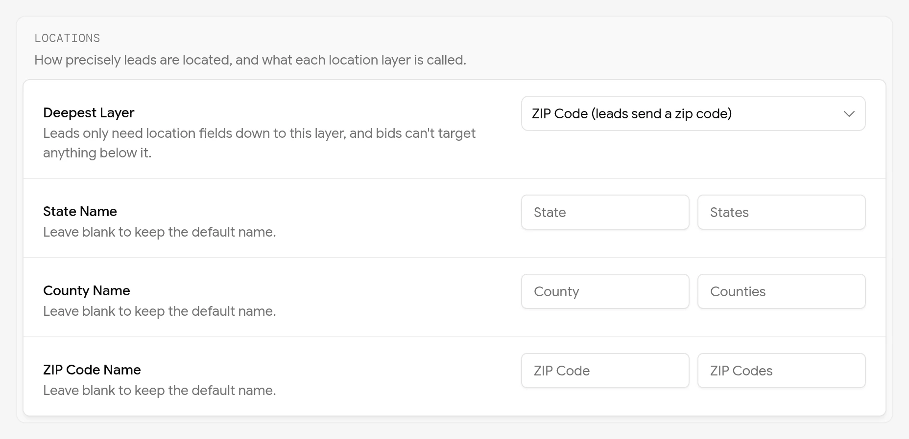
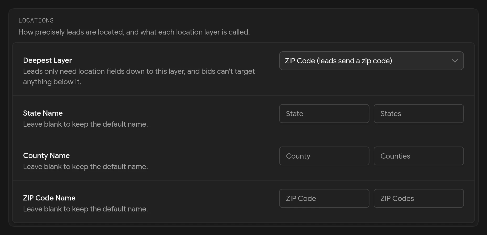

import { HugeIcon } from '/snippets/hugeicon.jsx';

Your company profile holds the core information about your business. Much of it appears throughout the platform and is shown to your customers in the buyer portal.

To edit it, open **Company → Company Profile**. Make your changes, then save with the floating save bar.

<Frame>
  
  
</Frame>

## Company

This section sets how your company appears to customers.

- **Name** is your company name as shown to customers.
- **Email** is the main contact email for your company.
- **Phone** is the main contact phone number for your company.

## Billing Address

This is the address that appears on your invoices, with street address, apt/suite, city, country, state (or province or territory), and ZIP or postal code. The state and postal code labels change to match the country you pick.

This is separate from your payment methods, which you manage in [Billing](/features/billing).

## Operating countries

The countries you accept and distribute leads in. You can operate in any mix of the **United States**, **Canada**, **Australia**, and **Latvia**, switching each one on or off. At least one country must stay enabled, so the last one can't be turned off.

You first choose these when you [unlock your workspace](/get-started/quickstart#2-unlock-your-workspace) after signing up.

In Latvia, the 42 municipalities (35 novadi and 7 state cities) are the state level, and each has a single **Area** below it with the same name. Real Latvian postal codes aren't loaded yet, so each municipality has one placeholder code between `LV-9001` and `LV-9043`, which your lead forms send as the zip. Set your [deepest layer](#locations) to the municipality (state) level and Latvian leads won't need a postal code at all.

## Locations

This section sets how precisely your leads are located, and what each location layer is called across your panel and customer portal.

<Frame>
  
  
</Frame>

**Deepest Layer** is the most precise location your leads need. It also decides which [bidding scopes](/features/bidding#scopes) customers can use.

| Deepest layer | What leads send | Bids customers can place |
|---------------|-----------------|--------------------------|
| **Postal code** (the default) | A ZIP or postal code, which sets the county, state, and country | County, state, and nationwide |
| **County** | A state and a county | County, state, and nationwide |
| **State** | A state | State and nationwide |
| **Country** | Only a country | Nationwide |

Below postal code, the zip is optional and leads are located from their `state`, `county`, and `country` fields instead. A state can be its abbreviation or its full name, and a county matches with or without the word "County". If you operate in a single country, leads don't need to send it. See [Field types](/features/lead-categories#field-types) for the formats.

<Note>
You can't switch to a layer that would leave open bids unable to match. Juiced tells you how many county or state bids are in the way. Turn off that scope on your [lead types](/features/lead-types#bidding-scopes), or delete those bids, then switch.
</Note>

The three name rows (**State Name**, **County Name**, and **ZIP Code Name** for a US workspace) rename the state, county, and postal code layers. Each has a singular and a plural box, and the placeholders show the built-in names for your operating countries (like **Province** in Canada or **Municipality** in Latvia). Fill one in and it replaces the built-in name everywhere, including bidding scopes, location filters, and the customer portal. Leave a box blank to keep the default. A blank plural reuses your singular.

## Support

These fields set how customers can reach your support team.

| Field | Purpose |
|-------|---------|
| **Primary Contact Method** | Email or URL. Choosing URL shows the **Support Portal URL** field and makes it required. |
| **Support Email** | The email address customers are directed to for support |
| **Support Portal URL** | A link to your helpdesk or support portal |

In the customer portal, the sidebar's support links include **Support Portal** when you've saved a support portal URL and **Email Us** when you've saved a support email, so customers see whichever you've filled in. A **Lead Returns** link to your [return policy](/features/returns) appears there too when you've set one.

## 1:1 Default Consent

The **Default Name** field sets the default name used for TCPA compliance when recording consent. This applies to one-to-one consent scenarios where a specific company name is required.

## Related pages

<CardGroup cols={2}>
  <Card title="Branding" icon={<HugeIcon name="paint-board" card />} href="/features/branding">
    Colors, logos, and the look of your customer portal.
  </Card>
  <Card title="Customizing the customer portal" icon={<HugeIcon name="paint-board" card />} href="/guides/customizing-the-portal">
    Set support contacts and consent links alongside the rest of your portal branding.
  </Card>
</CardGroup>
