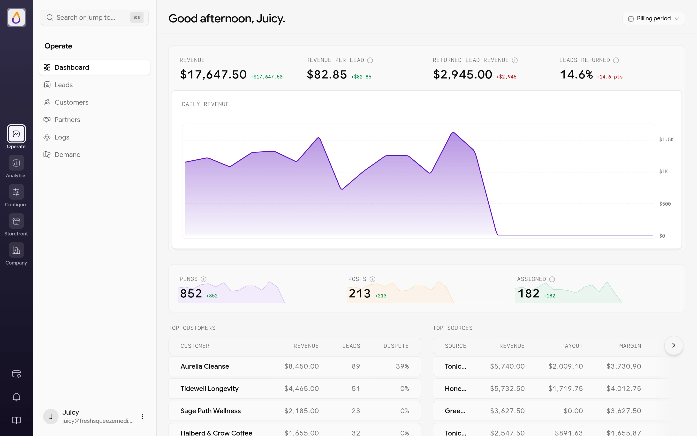
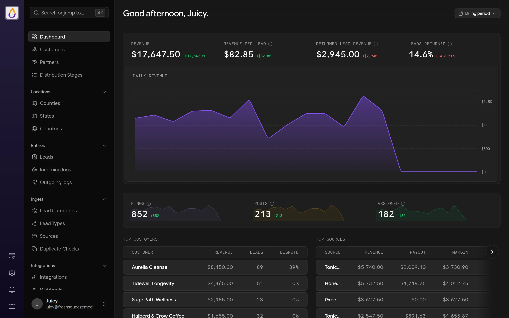
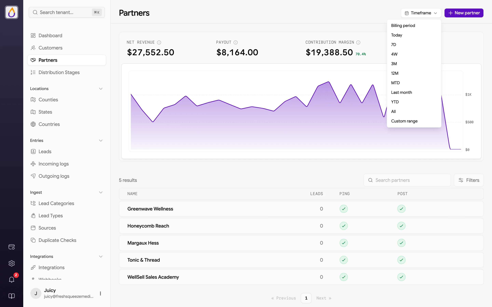
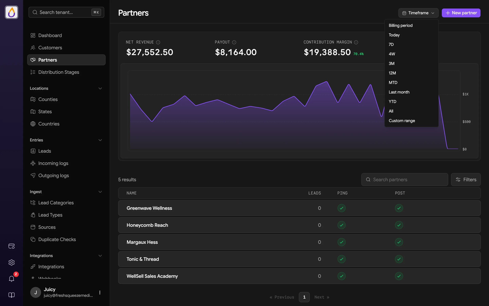
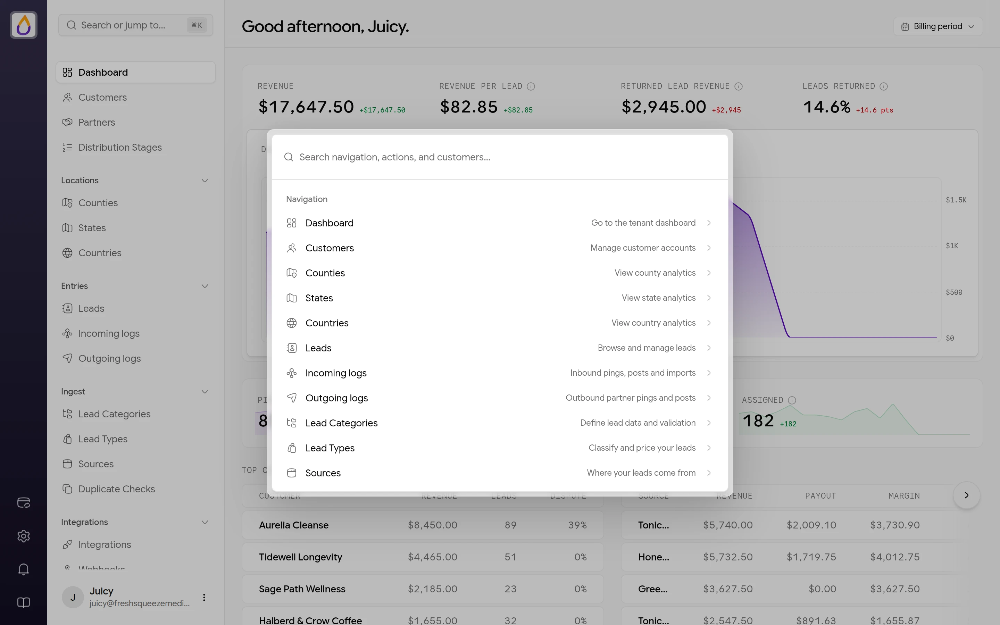
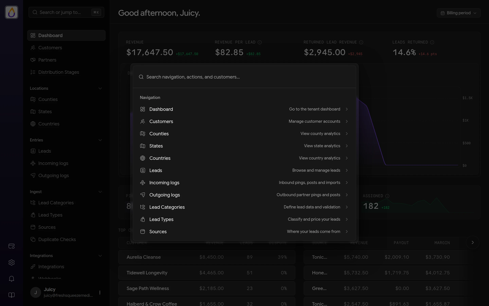
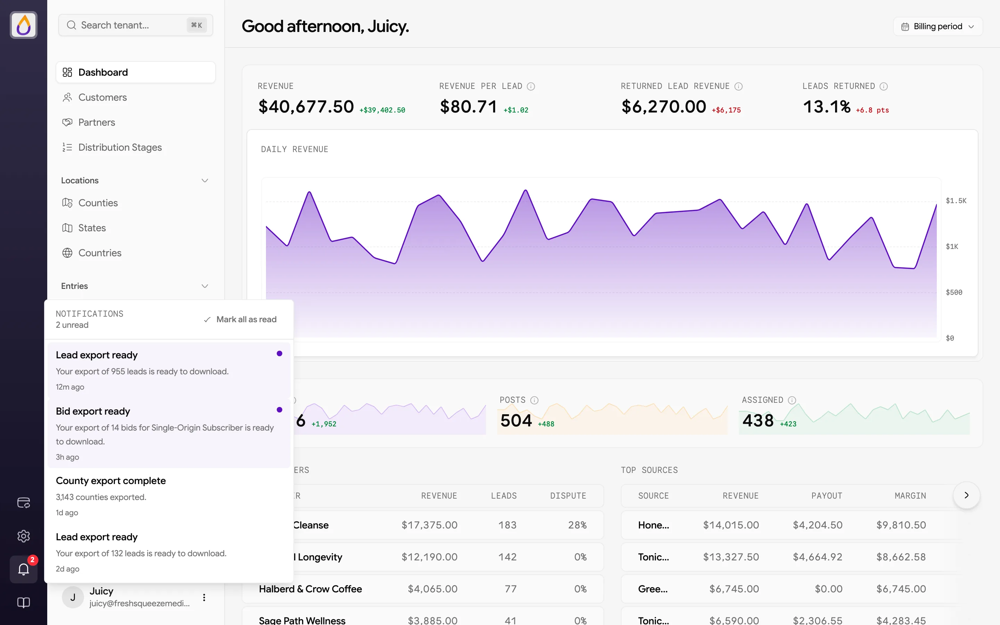
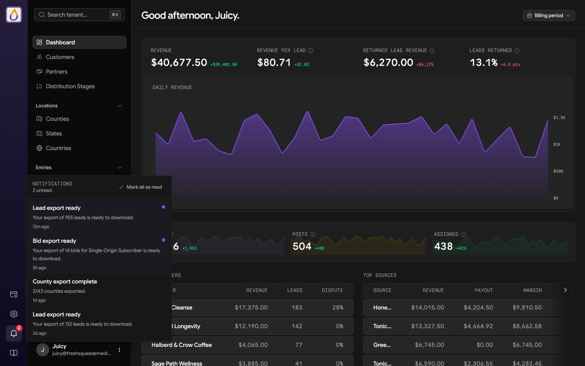

The **Dashboard** is the first thing you see when you sign in to your workspace. It greets you by name and pours your key numbers into one view, showing what you earned, how much traffic came in, how much of it sold, and who's driving it.

Click **Dashboard** at the top of the sidebar to get back to it from anywhere.

<Frame>
  
  
</Frame>

## What's on the dashboard

### Revenue

Four headline numbers cover the selected timeframe.

- **Revenue** is what you earned from leads.
- **Revenue per Lead** is your average revenue for each lead.
- **Returned Lead Revenue** is revenue from leads that were later returned.
- **Leads Returned** is the share of leads that were returned.

Each number shows the change from the previous period of the same length, so "+$1.02" next to Revenue per Lead means you're earning a little more per lead than last time. Hover the info icon next to a label for its exact definition. Below them, the **Daily Revenue** chart shows how revenue moved day by day.

### Traffic funnel

**Pings**, **Posts**, and **Assigned** show how much traffic came in and how much of it sold, each with a sparkline and the change from the previous period.

- **Pings** are price and eligibility checks your sources sent before submitting a lead.
- **Posts** are full leads your sources submitted.
- **Assigned** counts leads delivered to a customer or partner.

A big drop between Posts and Assigned is your cue to check your [distribution stages](/features/distribution) and [incoming logs](/features/logs).

### Leaderboards

- **Top customers** ranks your biggest buyers by revenue, with how many leads they bought and their dispute rate.
- **Top sources** ranks your best sources by revenue, with the payout you owe them, your margin, and their lead count.

Click a name to open that customer or source.

<Note>
Revenue, the funnel, and the leaderboards are only shown to users whose role can view analytics. Everyone else sees the greeting.
</Note>

### Getting started

Workspaces set up with the [setup guide](/get-started/quickstart#3-follow-the-setup-guide) keep their remaining setup steps in **Guided setup** on the rail, and your first visit after the guide greets you with **Welcome to Juiced** instead of the usual good morning. See [Pick up where you left off](/get-started/quickstart#pick-up-where-you-left-off).

New workspaces on a paid plan may also see a **Get set up with our team** banner with a **Book a time** link for an onboarding call. Dismiss it with the **×**, which hides it for everyone in your workspace. Workspaces on [Ginger Shot](/features/billing#ginger-shot), the free plan, don't get the banner.

## Choosing a timeframe

Use the timeframe picker in the top-right to change the period the numbers cover. The options are **Billing period**, **Today**, **7D**, **4W**, **3M**, **12M**, **MTD** (month to date), **Last month**, **YTD** (year to date), **All**, and **Custom**, which lets you pick a start and end date.

<Frame>
  
  
</Frame>

Juiced remembers your choice, and it carries over between the Dashboard and the [Demand](/features/location-analytics) pages. Other pages with stats, such as a customer, partner, lead type, or source, have the same picker in their header.

## Searching with the command palette

Press **⌘K** (Mac) or **Ctrl+K** (Windows and Linux), or click **Search or jump to...** at the top of the sidebar, to open the command palette. Start typing, and it can do three things.

- **Jump to a page** like Dashboard, Customers, Leads, Incoming logs, Outgoing logs, Counties, States, Countries, Lead Categories, Lead Types, Sources, Distribution Stages, Webhooks, Usage, and settings pages like Bidding Settings, Payments & Deposits, Domains & Links, and Users.
- **Find a record.** Search results are grouped into **Customers**, **Leads**, **Sources**, **Lead Categories**, **Lead Types**, and locations.
- **Log out.** Yes, it's in there too.

<Frame>
  
  
</Frame>

You'll only see pages and records your role can access. [Finding your way around](/get-started/finding-your-way-around#the-command-palette) covers everything it can find, like leads by email or lead ID and customers by a team member's email or Stripe ID.

## Notifications

The bell in the rail on the far left is where Juiced drops things that finished in the background. Exports are the big one. When a [lead export](/features/leads#exporting-leads) or [location export](/features/location-analytics#exporting) is ready, a notification appears here with a link to download the file. A red badge shows how many notifications you haven't read.

<Frame>
  
  
</Frame>

Click a notification to open it and mark it read, or use **Mark all as read** to clear the badge.

## Getting around the panel

Here's a quick map of everything else around the dashboard.

- **Rail** is the narrow strip on the far left. It switches between the panel's modules (**Operate**, **Analytics**, **Configure**, **Storefront**, and **Company**), and holds the notification bell and a link to these docs at the bottom.
- **Sidebar** lists the pages in the module you're in. The Dashboard lives in **Operate**, next to **Leads**, **Customers**, **Partners**, **Logs**, and **Demand**. See [Finding your way around](/get-started/finding-your-way-around#the-rail-and-its-modules) for what each module holds.
- **User menu** sits at the bottom of the sidebar, with your profile, theme (light or dark), and log out.
- **More actions** is the **⋯** menu in the page header, where record pages keep their secondary actions.

## Related pages

- [Leads](/features/leads)
- [Logs](/features/logs)
- [Location analytics](/features/location-analytics)
