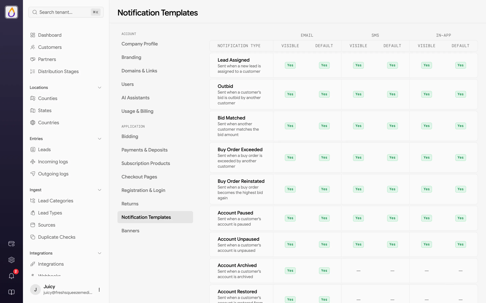
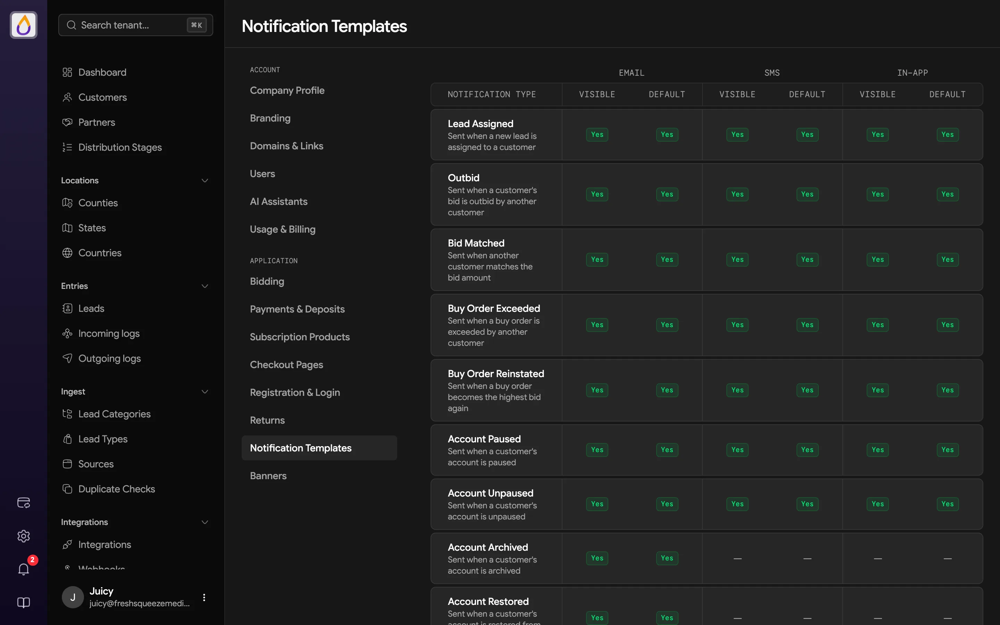
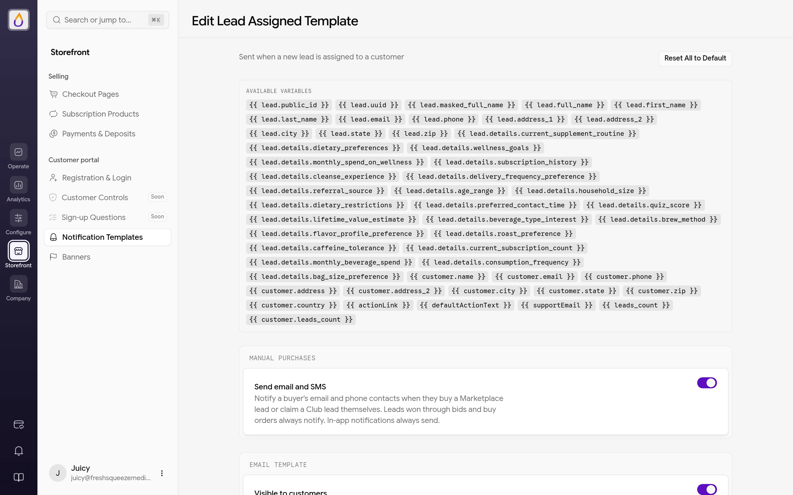
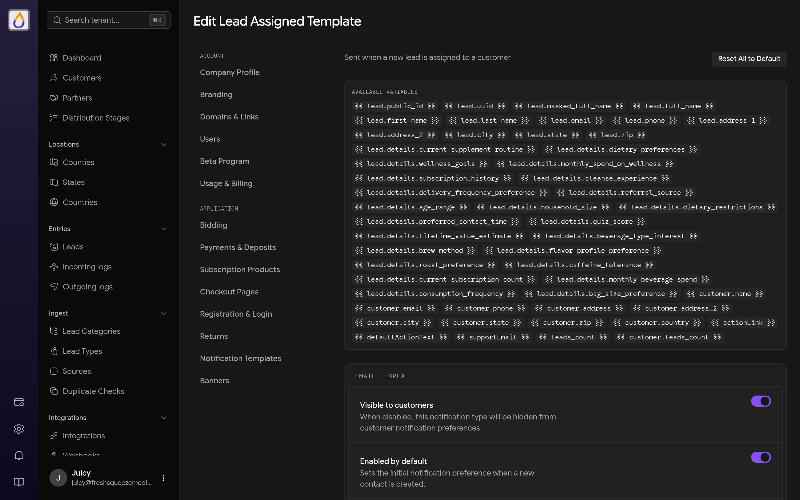
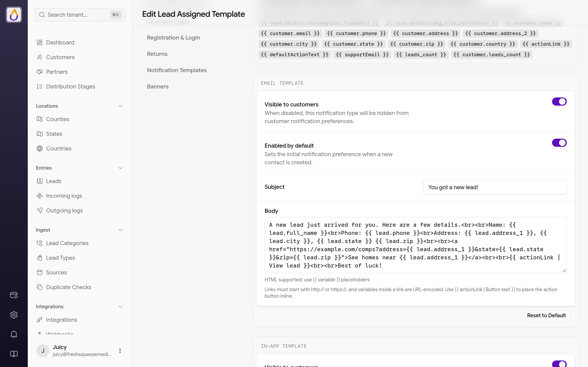
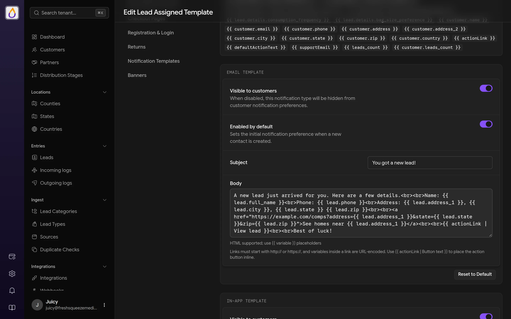

import { HugeIcon } from '/snippets/hugeicon.jsx';

Notification templates let you customize the messaging customers receive when events happen in the system. You control the verbiage, formatting, and what details are included in each notification.

Find them under **Settings → Application → Notification Templates**. Each row is a notification type, with columns for each channel showing whether it's **Visible** to customers and turned on by **Default** for new contacts.

<Frame>
  
  
</Frame>

## Channels

Notifications can be delivered through three channels, but channel availability varies by event.

| Channel | Description | Requirements |
|---------|-------------|--------------|
| Email | Sent via SendGrid | [SendGrid integration](/features/integrations#sendgrid) |
| SMS | Sent via Twilio | [Twilio integration](/features/integrations#twilio) |
| In-App | Shown in the notifications bell of every user on the customer's account | None |

Each channel has its own template, so you can tailor the message format and length appropriately, such as detailed HTML emails, concise text messages, and quick in-app alerts. The Email channel only appears once SendGrid is configured, and SMS only once Twilio is.

Some events don't support every channel. Account Archived, Account Restored, Payment Failed, Payment Successful, and the two checkout emails are email-only, and Subscription Payment Failed goes out by email and in-app.

## Notification events

Templates are available for the following events.

| Event | Description |
|-------|-------------|
| Lead Assigned | A lead is assigned to a customer |
| Outbid | Customer's bid is outbid by another customer |
| Bid Matched | Another customer matches the bid amount |
| Buy Order Exceeded | Customer's buy order is exceeded by another |
| Buy Order Reinstated | Customer's buy order becomes the highest bid again |
| Account Paused | Customer's account is paused |
| Account Unpaused | Customer's account is unpaused |
| Account Archived | Customer's account is archived |
| Account Restored | Customer's account is restored from archive |
| Return Approved | Customer's return is approved |
| Return Tier Updated | Customer's return tier changes |
| Payment Failed | A payment transaction fails |
| Payment Successful | A payment processes successfully |
| Subscription Payment Failed | A recurring [subscription](/features/subscription-products) payment fails or needs authentication |
| Under Funded Bids | Customer has bids limited by their available balance |
| Checkout Welcome | A new buyer purchased from a [checkout page](/features/checkout-pages); includes a link to set up their login |
| Checkout Purchase Confirmation | An existing customer purchased from a checkout page |

## Template variables

Templates support merge fields using double curly braces, like `{{ variable_name }}`. Available variables depend on the notification type.

### Common variables

These are available in all templates.

- `{{ actionLink }}` is the URL to the relevant page. In an email, `{{ actionLink | Button text }}` places the action button at that spot instead. See [Links and the action button](#links-and-the-action-button).
- `{{ defaultActionText }}` is the default text for the action button.
- `{{ supportEmail }}` is your tenant's support email.

### Lead variables

These are available for lead-related notifications (Lead Assigned, Outbid, Bid Matched, Return Approved).

- `{{ lead.public_id }}`, `{{ lead.uuid }}`
- `{{ lead.full_name }}`, `{{ lead.first_name }}`, `{{ lead.last_name }}`
- `{{ lead.email }}`, `{{ lead.phone }}`
- `{{ lead.address_1 }}`, `{{ lead.address_2 }}`, `{{ lead.city }}`
- `{{ lead.state }}` (the two-letter abbreviation, like `TX`), `{{ lead.zip }}`
- `{{ lead.leadType.name }}`
- `{{ lead.details.field_name }}` for any custom field on the lead category

### Customer variables

These are available for customer-related notifications.

- `{{ customer.name }}`, `{{ customer.email }}`, `{{ customer.phone }}`
- `{{ customer.address }}`, `{{ customer.city }}`, `{{ customer.state }}`, `{{ customer.zip }}`
- `{{ customer.leads_count }}` for batch notifications

### Other variables

- **Buy order notifications** can use `{{ buyOrder.amount }}`, `{{ buyOrder.scope }}`, `{{ buyOrder.status }}`
- **Return tier notifications** can use `{{ disputeTier.name }}`, `{{ disputeTier.discount_percentage }}`, `{{ disputeTier.penalty_percentage }}`

## Editing templates

Click a notification type to open its editor. The top of the page lists the **Available variables** for that type; copy any of them into your templates.

<Frame>
  
  
</Frame>

Below that is one card per channel (**Email Template**, **SMS Template**, **In-App Template**), each with four settings.

- **Visible to customers** hides this notification type from customers' notification preferences when it's off.
- **Enabled by default** sets the initial preference when a new contact is created.
- **Subject** is the email subject or the in-app notification's title. It's required for email, and SMS has no subject.
- **Body** takes `{{ variable }}` placeholders. Emails keep basic formatting (bold, italic, underline, strikethrough) and links, and put each line in its own paragraph. Lines written as `Label: value` are laid out as a tidy details list, unless the line contains a link. Keep SMS bodies short.

Emails get a button to the relevant page automatically, labeled with the type's default action text, so you don't need to add the link yourself.

### Links and the action button

Email bodies can link anywhere, such as a partner tool, a booking page, or your own site. Write the link as HTML.

```html
<a href="https://example.com/comps?address={{ lead.address_1 }}&state={{ lead.state }}&zip={{ lead.zip }}">See homes near {{ lead.address_1 }}</a>
```

- **Links must start with `http://` or `https://`.** Any other link, and any attribute other than `href`, is removed when the email is sent.
- **Variables inside a link are URL-encoded**, so a value with spaces or an `&` doesn't break the query string. The exception is a variable that starts the link, like `href="{{ actionLink }}"`, which is used as the URL itself.
- **Lead and customer values always show as plain text.** A lead whose name looks like a link or HTML can't turn into one in your customer's inbox.

<Frame>
  
  
</Frame>

To move the action button, write `{{ actionLink | Button text }}` on its own line or within one. The button appears at that spot with your label (or the default action text when the label is empty), and the automatic button at the bottom is left off. Only the first one becomes a button, and any after it show as text links. A plain `{{ actionLink }}` still prints the URL, so existing templates don't change.

Other channels handle links their own way. In SMS, a link becomes its text followed by the URL in parentheses (or just the URL, when the text is the URL). In-app notifications keep the link's text only, and the first `{{ actionLink | Button text }}` becomes the notification's action.

Changes to every channel are saved together with **Save all** in the floating save bar. Templates are validated when you save, so referencing a variable that doesn't exist for that notification type shows an error.

Each card has **Reset to Default** to restore that channel's template, and **Reset All to Default** at the top restores every channel for the type.

To check how a message lands, add yourself as a [contact](/features/customers#contacts) on a test customer and use the contact's **Test** action.

## Related guides

<Card title="Customizing notification templates" icon={<HugeIcon name="notification-03" card />} href="/guides/customizing-notification-templates" horizontal>
  Rewrite the email, SMS, and in-app messages Juiced sends customers.
</Card>
