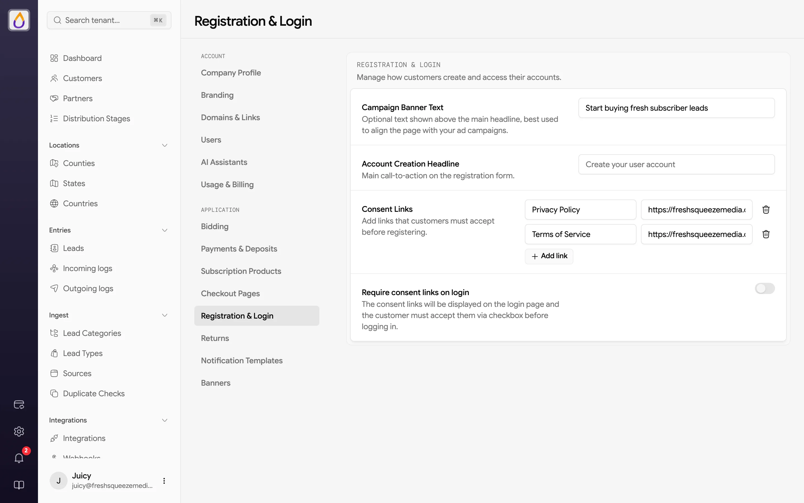
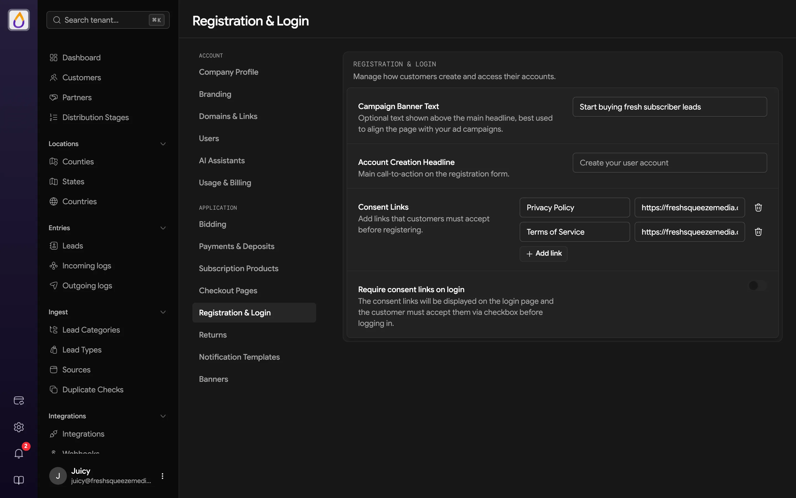

The **Registration & Login** page controls the words and consent checkboxes customers see when they create an account in your portal and, optionally, every time they log in. Click the gear in the rail and choose **Registration & Login** under **Application**. Save changes with the floating save bar.

<Frame>
  
  
</Frame>

## Registration page text

| Setting | What it does |
|---------|--------------|
| **Campaign Banner Text** | Optional. Use it to match the sign-up page to an ad campaign, like "Start buying fresh subscriber leads". When it's set, it becomes the page's title, and the account creation headline moves into the line beneath it. |
| **Account Creation Headline** | The main call to action on the registration form. Leave it empty to use "Create your user account". |

Customers register at `/app/register` on your portal's domain. See [Onboarding customers](/guides/onboarding-customers) for sharing the link and tracking where signups come from.

## Your login and signup URLs

All of these work on your subdomain (`https://<your-subdomain>.usejuiced.com`) or your [custom domain](/features/domains).

| Page | Path |
|------|------|
| Your team's login | `/tenants/login` |
| Customer signup | `/app/register` |
| Customer login | `/app/login` |

Your base URL takes signed-out visitors to the customer login page (or your public marketplace, if you chose that in [Domains & Links](/features/domains)), so bookmark your team's login. To track signups in Google Tag Manager, use `/app/register-business`, the page every new customer lands on right after creating their account.

## Consent links

Add the documents customers must agree to, such as your privacy policy and terms of service. Click **Add link** and enter the link's **Text** and its URL. Customers see the links next to a checkbox and must check it before they can register.

Turn on **Require consent links on login** to show the same links on the login page too. Customers then have to accept them each time they log in, which is handy right after you update your terms.

## Related settings

- [Branding](/features/branding) sets the logo and colors on the sign-up and login pages.
- [Domains & Links](/features/domains) decides whether people who aren't signed in land on the login page or your marketplace.
- [Signing up and logging in](/customer-portal/signing-up-and-logging-in) shows the experience from your customer's side.
