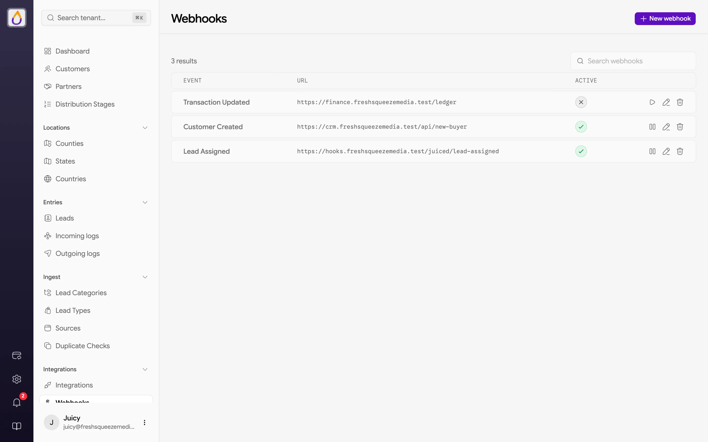
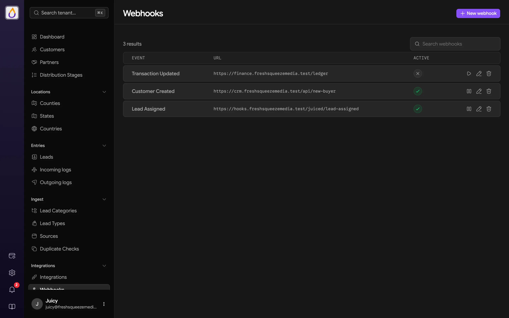
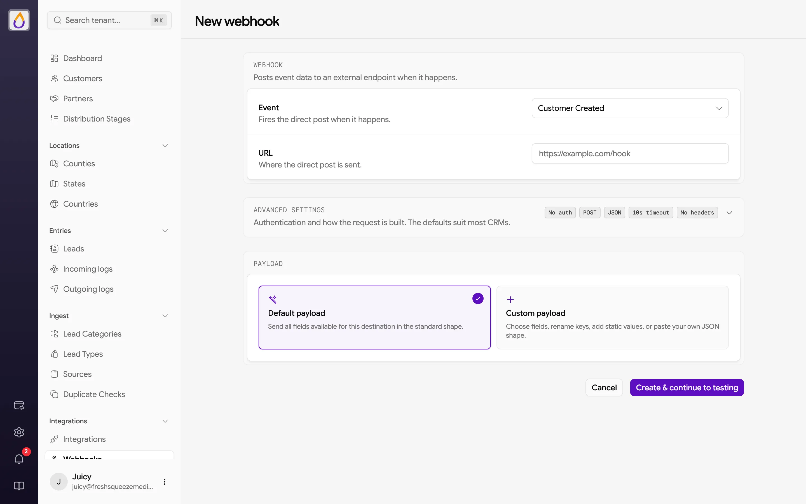
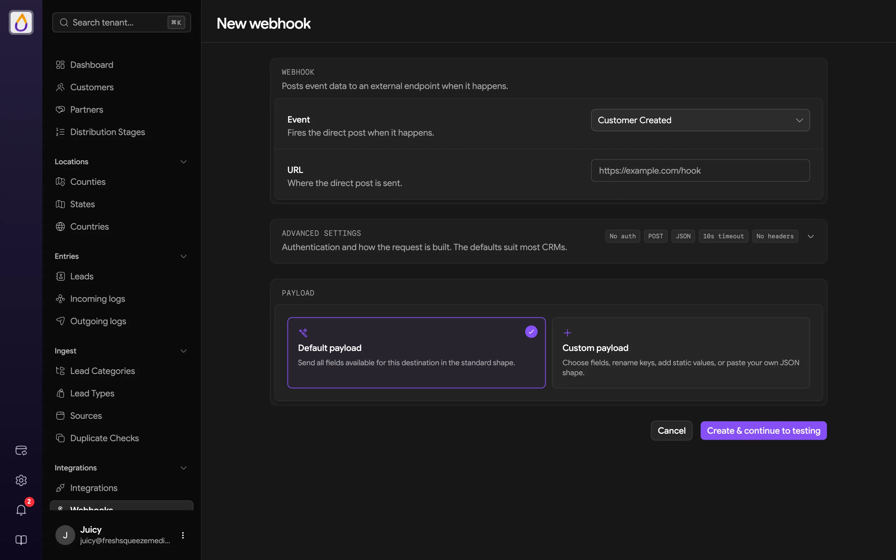
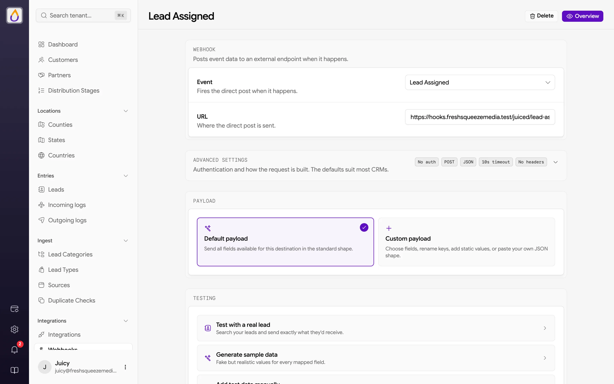
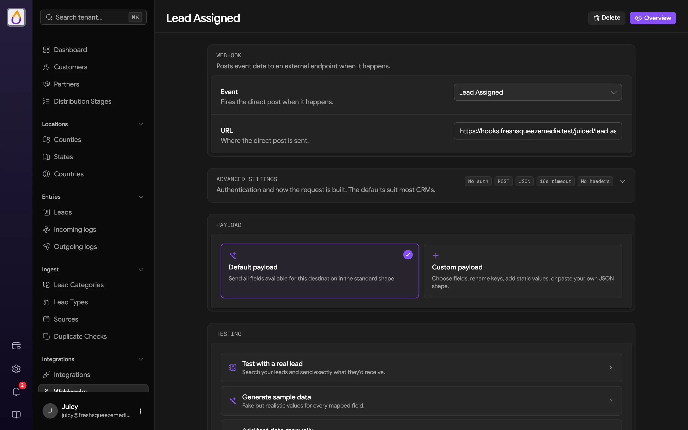
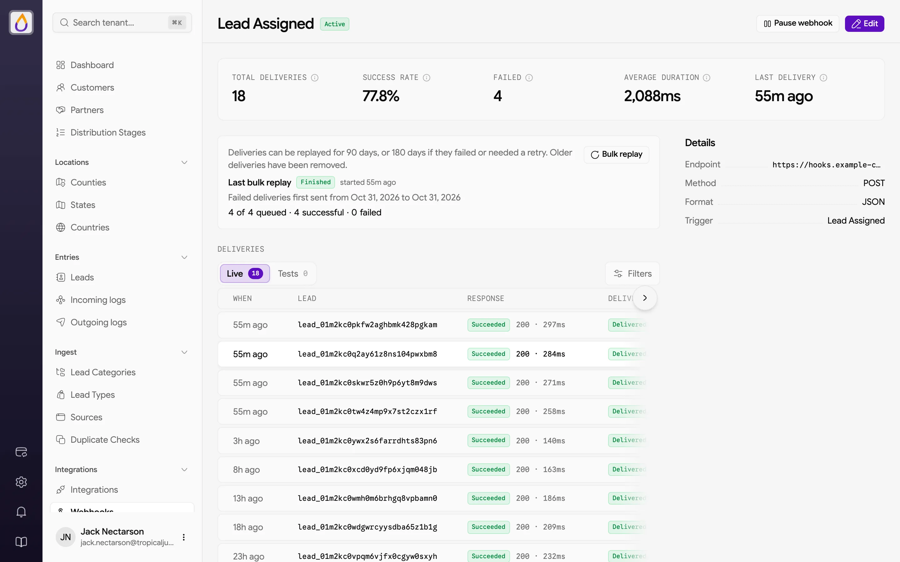
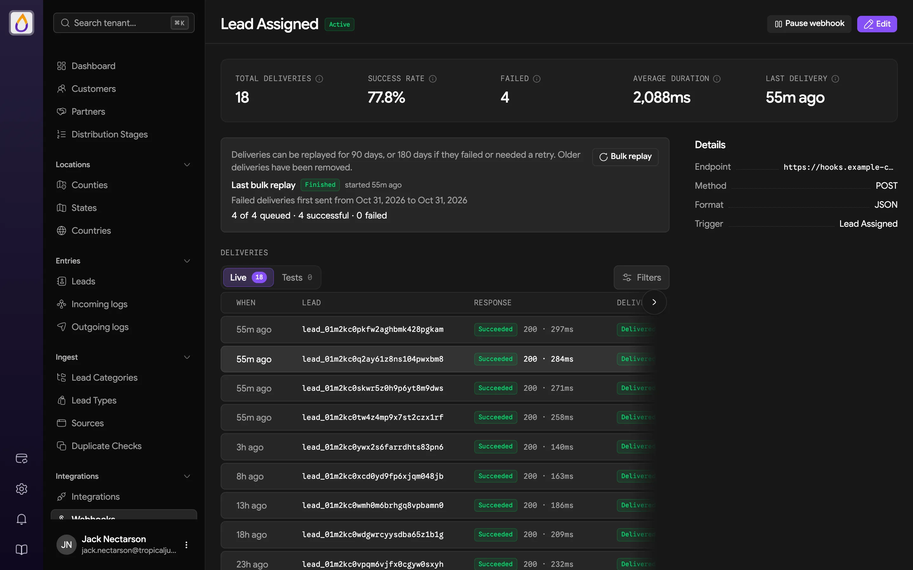

import { HugeIcon } from '/snippets/hugeicon.jsx';

Webhooks send data to an outside system the moment something happens in Juiced. A lead is assigned, a customer signs up, a wallet moves, and Juiced sends an HTTP request to your URL with the payload you chose. Your other tools stay as fresh as your leads.

There are two kinds.

- **Workspace webhooks** fire on events across your whole workspace. You manage them under **Integrations → Webhooks**, and they're what most of this page covers.
- **Customer webhooks** deliver each lead assigned to one customer to that customer's own endpoint. See [Customer webhooks](#customer-webhooks).

## The Webhooks page

Open **Webhooks** under **Integrations** in the sidebar. Each row shows the **Event**, the **URL** ("Not configured" if it has none), and whether the webhook is **Active**.

<Frame>
  
  
</Frame>

The buttons on each row pause or re-enable the webhook, edit it, or delete it. Click a row to open its [deliveries](#deliveries). A paused webhook keeps its settings and simply stops sending.

You can create as many webhooks as you like, including several for the same event. Each one fires on its own, which is handy when two systems want different payloads.

## Creating a webhook

Click **New webhook** and fill in the form.

- **Event** is what triggers the webhook (see [Available events](#available-events)). Each webhook listens for one event.
- **URL** is where the request goes. It must be a public address, since internal and private addresses are rejected.
- **Advanced settings** (optional) cover **Authentication** (None, Basic Auth, or Bearer Token), **Method** (POST, PUT, or GET), **Format** (JSON or Form), **Timeout** (3 to 60 seconds, 10 by default), and extra **Headers**. The defaults suit most CRMs.
- **Payload** is either the **Default payload** or a **Custom payload** (see [Payloads](#payloads)).
- **Payload version** starts on **v1** for a new webhook and sets the shape of every request (see [Payload versions](#payload-versions)).

<Frame>
  
  
</Frame>

Click **Create & continue to testing**. The webhook is active as soon as it's created, and the edit page opens with a **Testing** section so you can try it right away. For a step-by-step walkthrough, see [Sending events to your webhook](/guides/sending-events-to-your-webhook).

### Saved credentials and secret headers

Once saved, passwords, tokens, and secret header values never show again, not even to you. A header is secret when its name is `Authorization`, `Cookie`, `Set-Cookie`, `X-Api-Key`, `Api-Key`, `Token`, `Access-Token`, `Auth-Token`, `Password`, `Secret`, or `Bearer` (in any case, with dashes, underscores, or neither). Other headers stay visible and editable.

- A saved secret header shows a lock and **Saved** in place of its value, and its name is locked. Click **Replace** to type a new value. Leave it alone and Juiced keeps the saved one.
- If you move the **URL** to a different host, enter each secret header value again. Juiced only reuses a saved value for the same endpoint host, so a secret is never sent somewhere new without you retyping it.
- When a receiver echoes a credential back in its response, the delivery history shows it masked. Deliveries recorded before November 6, 2026 aren't re-masked.

The same rules apply to [customer webhooks](#customer-webhooks), the customer portal, and [partner](/features/partners) ping and post endpoints.

## Available events

| Event | v1 `type` | Fires when |
|-------|-----------|------------|
| **Lead Created** | `lead.created` | A new lead is created |
| **Lead Assigned** | `lead.assigned` | A lead is assigned to a customer |
| **Lead Not Assigned** | `lead.unassigned` | A lead finishes distribution without being assigned |
| **Lead Duplicated** | `lead.duplicated` | A lead is rejected as a [duplicate](/features/duplicate-detection) |
| **Lead Posted** | `lead.posted` | A lead is posted to a [partner](/features/partners) |
| **Customer Created** | `customer.created` | A new customer is created |
| **User Attached To Customer** | `customer.user_attached` | A user is added to a customer |
| **Transaction Updated** | `transaction.updated` | A wallet [transaction](/features/transactions) is created or updated |
| **Customer Subscription Updated** | `subscription.updated` | A customer's subscription changes, such as starting, renewing, canceling, or falling past due |
| **Customer Subscription Payment Recorded** | `subscription.payment_recorded` | A customer's subscription payment is recorded |
| **Customer Subscription Payment Failed** | `subscription.payment_failed` | A customer's subscription payment fails |
| **State Lead Type Stats Updated** | `lead_type_stats.updated` | Lead type statistics for a state are updated |

On the [v1 payload version](#payload-versions), each request names its event in `type`, using the value in the middle column.

## Payloads

The **Default payload** sends every field available for the event in a standard shape. For lead events, that includes all of the lead category's deliverable fields, and it adapts on its own when you add or remove fields.

Pick **Custom payload** to build your own shape, row by row. Each row has a **Key** (use dot notation, like `contact.email`, to nest values) and a value made of static text, inserted fields, or both. You can also add transformers to a field to reformat its value. Two shortcuts get you started faster.

- **Load default mapping** fills the builder with the default payload, ready for you to trim or rename.
- **Paste JSON** takes a sample payload, such as one from your receiver's docs, and turns it into rows. Values that match an available field become linked fields.

### Available fields

The field picker groups what you can insert. Every event has **Tenant** fields (`tenant.id`, `tenant.name`) and the `event` name, but those only fill in on the Legacy payload version. On v1 they render empty, because the envelope already carries the event `type` and `tenant_id` (see [Mappings on v1](#mappings-on-v1)). The rest depends on the event.

- **Lead events** add **Lead** (`lead.first_name`, `lead.email`, `lead.public_id`, and the fields on your lead categories), **Buyer** (`buyer.name`, `buyer.customer_public_id`), **Partner**, **Pricing** (`price`, `charged_amount`, `payout_amount`), **Assignment**, **Source**, plus `lead_type` and `lead_category`
- **Customer events** add the customer's details under `customer.`, such as `customer.name`, `customer.email`, and `customer.wallet_balance`. Subscription events add `subscription.` fields, and User Attached To Customer adds `user.name` and `user.email`.
- **Transaction Updated** adds the customer under `customer.` and the transaction under `transaction.`, such as `transaction.amount` and `transaction.event`

When you paste JSON, a placeholder like `{{ lead.email }}` becomes a linked field, and so does a bare lead field name like `email`.

### Lead fields

Lead events can include an **all lead fields** row. It expands to the lead's deliverable fields when the webhook fires, so new fields show up without editing the webhook. If you'd rather list fields one by one, you can expand the row into individual fields, but that's a snapshot, so fields added later won't be included.

### Public IDs

Leads and customers have stable public IDs that are safe to store in other systems. `lead.public_id` looks like `lead_01arz3ndektsv4rrffq69g5fav`, and `customer.customer_public_id` (or `buyer.customer_public_id` on lead events) looks like `cus_01arz3ndektsv4rrffq69g5fav`.

On v1, Juiced's internal numeric IDs aren't sent. Each block's `id` (such as `lead.id`, `buyer.id`, `customer.id`, and `source.id`) carries the same value as its public ID, and a lead's `source_id`, `customer_id`, and `submission_id` carry the public IDs of its source (`src_…`), customer (`cus_…`), and submission (`subm_…`). Lead fields named after other internal ID columns are left out. Legacy keeps sending the internal numeric IDs it always has.

## Payload versions

Every workspace webhook and [customer webhook](#customer-webhooks) sends one of two payload versions. You pick it in the **Payload version** section of the webhook's form.

| Version | Who gets it | What it sends |
|---------|-------------|---------------|
| **Legacy** | Webhooks created before payload versions existed, and any webhook set to Legacy. | The original payload shape. Your mapping shapes the whole body. |
| **v1** | New webhooks, unless you pick **Legacy**. | A fixed envelope around your data. Your mapping shapes only `data`. |

Existing webhooks stay on **Legacy** and keep receiving exactly what they get today, so nothing changes for your receiver until you switch. v1 is the version to build new receivers against.

### The v1 envelope

A v1 request body always has the same six keys.

| Key | What it holds |
|-----|---------------|
| `version` | Always `"v1"`. |
| `id` | The event ID, like `evt_01jbq7m4x2c9t5w8k3n6r0yzde`. Unique to the event and the same on every attempt to deliver it. |
| `type` | The event, like `lead.assigned` (see [Available events](#available-events)). |
| `created_at` | When the event happened, in UTC (ISO 8601). It doesn't change when a delivery is retried, so it isn't the time the request was sent. |
| `tenant_id` | Your workspace's public ID, like `ten_01h8x2k4m6p8r0t2v4w6y8z0ab`. |
| `data` | The event's payload, with [public IDs](#public-ids) in place of internal ones. |

Here's a trimmed **Lead Assigned** body with the default payload.

```json
{
  "version": "v1",
  "id": "evt_01jbq7m4x2c9t5w8k3n6r0yzde",
  "type": "lead.assigned",
  "created_at": "2026-10-28T14:03:12Z",
  "tenant_id": "ten_01h8x2k4m6p8r0t2v4w6y8z0ab",
  "data": {
    "price": "$12.00",
    "charged_amount": "$9.00",
    "scope": "county",
    "buyer": {
      "id": "cus_01arz3ndektsv4rrffq69g5fav",
      "customer_public_id": "cus_01arz3ndektsv4rrffq69g5fav",
      "name": "Citrus Roofing"
    },
    "lead": {
      "id": "lead_01arz3ndektsv4rrffq69g5fav",
      "public_id": "lead_01arz3ndektsv4rrffq69g5fav",
      "source_id": "src_01hq3c5e7g9j1k3m5n7p9r1s3t",
      "first_name": "Ada",
      "email": "ada@example.com"
    },
    "lead_type": "Motivated Seller",
    "lead_category": "Home Sellers"
  }
}
```

### Mappings on v1

On v1 the envelope is fixed, and the [payload](#payloads) you choose fills `data`.

- With the **Default payload**, `data` carries the full default payload for the event.
- With a **Custom payload**, your mapping shapes `data` and nothing else. You can't rename or remove the envelope keys.
- The `{{ event }}` and `{{ tenant.* }}` fields render empty on v1, because the envelope's `type` and `tenant_id` already carry them. On a workspace webhook, **Load default mapping** adds `event`, `tenant.id`, and `tenant.name` rows, so delete those on v1 and read the envelope instead.

### Switching versions

The **Payload version** section sits below **Payload** on the webhook's form, with a card for **Legacy** and one for **v1**. Pick one, and a preview below the cards shows the request your endpoint would receive, built from sample data (on a saved lead webhook, **Use a real lead** previews one of your leads instead).

- When the version you picked differs from the saved one, the preview shows the **Current** payload next to the payload **After save**, so you can compare the two before anything changes.
- The **Headers** list shows the headers the request carries, with credentials hidden.
- When v1 is picked, or you're switching versions, a note above the payloads sums up what that means for this webhook. It turns amber when saving would change what your endpoint receives, or when your mapping uses `{{ event }}` or `{{ tenant.* }}` fields (it names them, since they'd render empty on v1).
- The preview's `id` and `created_at` are samples. Every live event gets its own.

Moving a webhook from Legacy to v1 changes what your receiver reads, even with the default payload.

- Your payload now sits under `data`, inside the envelope.
- The root `tenant` block and `event` key are gone. Read `tenant_id` and `type` instead, and note that `type` uses names like `lead.assigned` where `event` sent names like `LeadAssigned` (`LeadAssignedWebhook` on customer webhooks).
- Numeric IDs become public ID strings like `lead_…` and `cus_…` (see [Public IDs](#public-ids)), so anything that stores or matches on the old numbers needs updating.
- Lead fields titled after an internal ID column, such as an old `state_id` field, aren't sent. On Legacy they carry Juiced's internal ID rather than the field's own value. To send a value of your own, rename the field (see [Adding fields to a lead category](/guides/adding-fields-to-a-lead-category#title)) and have your sources submit it under the new name.

Nothing changes until you save, and the **Testing** section sends the version you've picked even before then. Switching back to **Legacy** works the same way.

<Warning>
Switching changes the shape of every request the webhook sends from the moment you save, and any delivery not yet sent or still waiting to be retried at that point is stopped (it shows as failed) rather than sent in either shape. Update your receiver to read the new shape first, and send a test from the **Testing** section before you save.
</Warning>

### Handling duplicates

Build your receiver so the same event arriving twice does no harm. On v1, use `id` to spot repeats, since every automatic retry of an event carries the same `id`, and so does a [replay](#replaying-deliveries) of the original event. Store the IDs you've processed, and skip any event whose `id` you've already seen. Legacy requests have no event ID.

## Testing a webhook

Once a webhook exists, its edit page has a **Testing** section. Pick what to send.

- **Test with a real lead** searches your leads and sends exactly what that lead would produce.
- **Generate sample data** fills every mapped field with realistic but fake values.
- **Add test data manually** lets you type the values yourself.

<Frame>
  
  
</Frame>

Click **Run Webhook Test** to send it. The **Request** and **Response** appear below, so you can see what your receiver got and what it said back. Tests go to your real endpoint, so point the webhook at a staging receiver if a test record would cause trouble.

## Deliveries

Click a webhook in the list, or **Overview** on its edit page, to see how it's doing. The title shows whether it's <span className="tone-badge tone-success">Active</span> or <span className="tone-badge tone-warning">Paused</span>, and the header has **Pause webhook** (or **Enable webhook**) and **Edit**.

<Frame>
  
  
</Frame>

- **Stats** show **Total deliveries**, **Success rate**, **Failed**, **Average duration**, and **Last delivery**.
- **Details** list the **Endpoint**, **Method**, **Format**, and **Trigger**.
- **Deliveries** are split into **Live** and **Tests**, with **Filters** for the result and delivery date. Each row shows when it was sent, the lead (for lead events), the result with its response code and duration, and the delivery ID.

Click a delivery to see the request headers and payload Juiced sent, and the response headers and body your receiver returned.

Webhook deliveries also appear in [Outgoing logs](/features/logs#outgoing-logs) with the **Webhook** type.

### Replaying deliveries

Once your receiver is back on its feet, replay what it missed. A panel above the delivery history shows how far back you can go. Deliveries can be replayed for 90 days, or 180 days if they failed or needed a retry. Older ones have been removed.

To replay one delivery, click **Replay** on its row, or open it and click **Replay** at the bottom. Juiced queues the replay, and it appears in the history as a new delivery once it's sent. The original stays as it was. The note beside the button in the open delivery tells you which kind of replay you'll get. Either kind is sent with the webhook's current URL, method, format, authentication, and headers, so fix a wrong URL or expired credentials first and the replay picks it up.

- **The original event** goes out again when the webhook is on [v1](#payload-versions) and the delivery is a v1 delivery whose data Juiced kept. Your receiver gets the same `id`, `created_at`, `type`, and `data` as the first time, so it can spot the repeat, and a failed replay is retried like any other v1 delivery.
- **A new event** built from the lead's current data goes out otherwise. That covers Legacy webhooks, v1 deliveries sent before replay existed, and deliveries sent while the webhook was on Legacy. It goes out as a single delivery with no scheduled retries and, on v1, a new `id`. This kind needs a lead behind the delivery, so a delivery for any other event can only be replayed as the original event.

To replay a batch, click **Bulk replay** above the history. Pick the **Deliveries** to replay (**Failed**, **Successful**, or **Successful and failed**), optionally narrow them with **First sent from** and **First sent until**, and click **Start replay**.

- The dates are when each event was first sent, so replaying an outage finds every event from it however many times some have been replayed since.
- Only the latest delivery of each event is replayed, and only once it has finished. The status you pick applies to that latest delivery, so **Failed** skips an event whose last replay succeeded.
- Replays go out at 5 per second, so your receiver isn't flooded.
- A bulk replay that matches more than 1,000 deliveries is refused, with the count, so you can narrow the dates or status.
- Each webhook runs one bulk replay at a time, and **Bulk replay** stays disabled until the current one finishes.

The panel then shows the last bulk replay, what it covered, and how many of its replays were queued, in progress, successful, failed, or skipped, with a status badge.

- <span className="tone-badge tone-info">Queueing</span> means Juiced is still creating the replays.
- <span className="tone-badge tone-info">Sending</span> means the replays are going out. On v1, retries can keep a bulk replay here for hours.
- <span className="tone-badge tone-success">Finished</span> means every replay is done. The badge is <span className="tone-badge tone-warning">Finished</span> instead when some of them failed.
- <span className="tone-badge tone-danger">Stalled</span> means Juiced gave up creating the replays after an hour, so some were never queued. It doesn't block a new bulk replay.

There's no **Replay** on a test send (run the test again instead) or on a delivery that's still being attempted, and Juiced refuses a replay while an earlier replay of the same event is still being sent. Nothing can be replayed while the webhook is paused, so enable it first.

Replaying needs permission to edit the webhook. Users who can only view it still see the history, the replay window, and bulk replay progress, just without the replay buttons.

## Reliability

- **Automatic retries** kick in when your endpoint returns a server error (5xx), or the connection fails before the request is sent. Juiced tries again, for up to 3 attempts in total. Client errors (4xx) and timeouts after the request was sent aren't retried, so your receiver never gets the same event twice by accident.
- **Timeouts** follow the webhook's **Timeout** setting, which is how long each request waits for a response.
- **Isolation** means each webhook is delivered on its own, so a failing endpoint doesn't hold up the others.

## Customer webhooks

Customer webhooks send each lead assigned to a customer straight to that customer's endpoint, such as their CRM. You can set them up from the customer's **Webhooks** tab (see [Customers](/features/customers#webhooks)), and customers can manage their own from their portal (see [Webhooks in the customer portal](/customer-portal/webhooks)).

They use the same form, payload builder, [payload versions](#payload-versions), testing, and deliveries view as workspace webhooks. On v1, their `type` is always `lead.assigned`.

## Related guides

<Card title="Sending events to your webhook" icon={<HugeIcon name="webhook" card />} href="/guides/sending-events-to-your-webhook" horizontal>
  Create a webhook, pick an event, shape the payload, and test the delivery.
</Card>
