import { HugeIcon } from '/snippets/hugeicon.jsx';

The tenant panel is where you run your whole operation, so it's worth five minutes to learn the layout. Once you know how the rail's modules and the sidebar fit together, every other page in these docs will make a lot more sense.

Panel addresses look like `yourcompany.usejuiced.com/tenants/{workspace id}/...`. You rarely need to type them, because everything below is a click (or a keystroke) away.

<Tip>
  If you only learn one thing on this page, make it <kbd>⌘</kbd> <kbd>K</kbd> (<kbd>Ctrl</kbd> <kbd>K</kbd> on Windows and Linux). It opens the [command palette](#the-command-palette), which gets you to any page, setting, customer, or lead in a few keystrokes.
</Tip>

<Frame>
  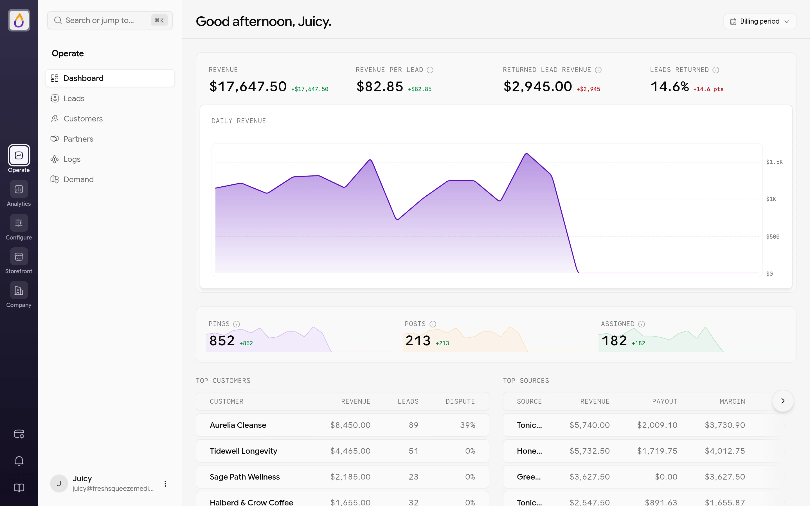
  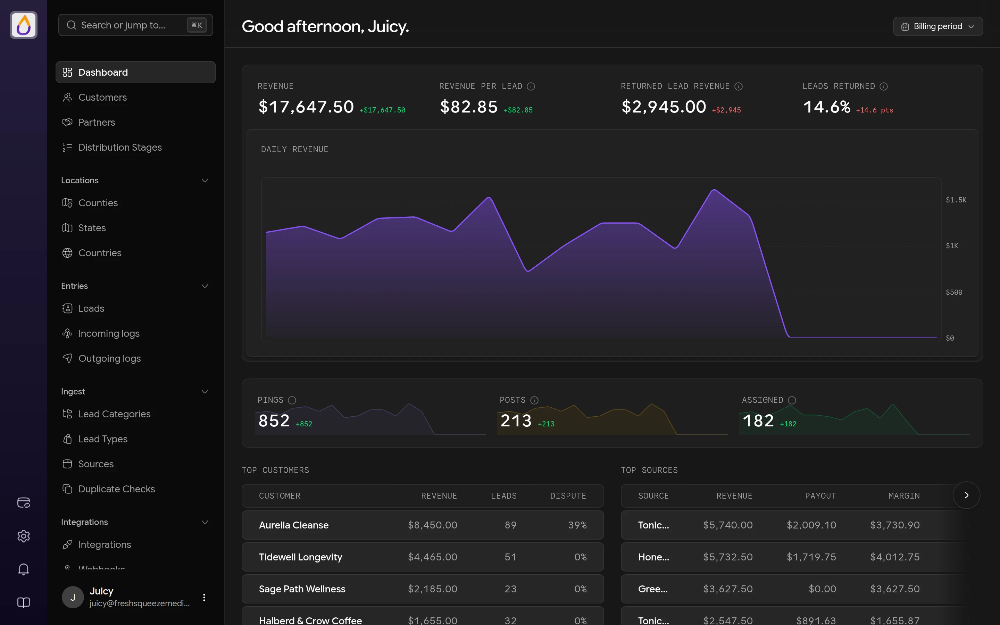
</Frame>

## Signing in

Sign in at `/tenants/login` on your subdomain or [custom domain](/features/domains) with your email address and password, or choose **Sign in with a passkey** if you've set one up. **Forgot password?** sends a reset link. Accounts that only use a passkey are asked to sign in with it instead of a password.

Bookmark that login page. Your base URL takes signed-out visitors to the customer login instead. See [Your login and signup URLs](/features/registration-and-login#your-login-and-signup-urls).

<Frame>
  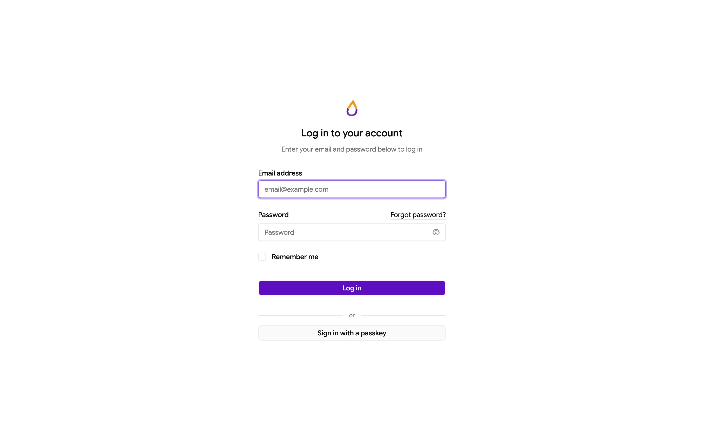
  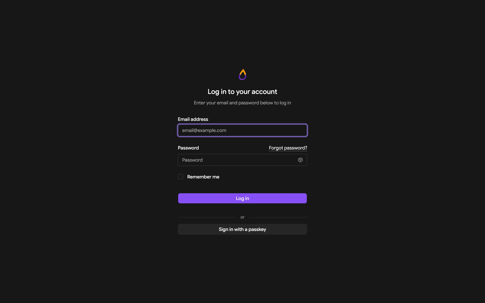
</Frame>

You need a verified email address to use the panel. If you just signed up, the **Confirm it's you** screen asks for the 6-digit code from your verification email (see [Create your account](/get-started/quickstart#confirm-your-email)). Otherwise you'll see **Verify your email address** with a **Resend verification email** button until you click the link in that email.

## The command palette

The command palette is the panel's hidden superpower. Press <kbd>⌘</kbd> <kbd>K</kbd> (Mac) or <kbd>Ctrl</kbd> <kbd>K</kbd> (Windows and Linux) on any page, or click **Search or jump to...** at the top of the sidebar. Start typing, use the arrow keys to pick a result, and press <kbd>Enter</kbd> to go there. Press the shortcut again or <kbd>Esc</kbd> to close it.

<Frame>
  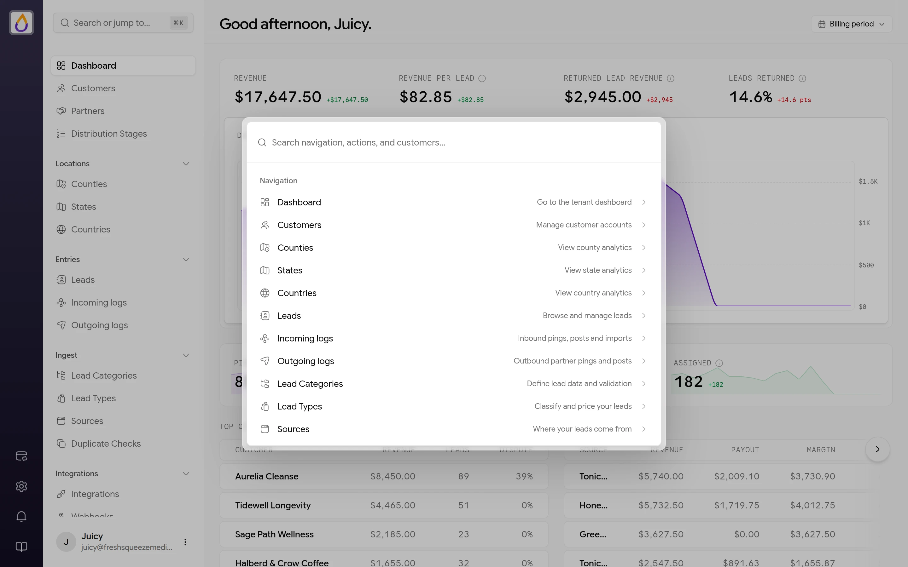
  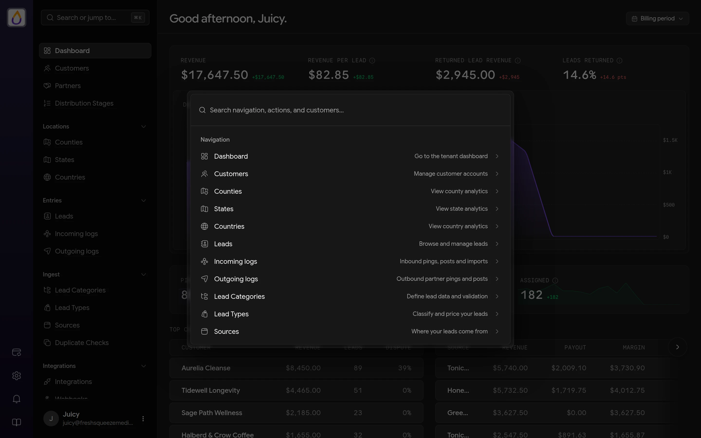
</Frame>

### Jump to any page

Every page your role can open is in the palette, whichever module it lives in, and so are the tabs inside a page (like **Outgoing logs** or **Return settings**). You don't need the exact page name either, because the palette also matches what a page is for. Type what's on your mind and the right page comes up.

| Type | And you get |
|------|-------------|
| `stripe` or `twilio` | Integrations |
| `dns` or `domain` | Domains & Links |
| `dedupe` | Duplicate Checks |
| `fees` or `deposits` | Payments & Deposits |
| `logo` or `colors` | Branding |
| `consent` or `signup` | Registration & Login |
| `caps` | Bidding |
| `webinar` | Checkout Pages |
| `claude` or `mcp` | AI Assistants |
| `team` or `invites` | Users |

**Log Out** is in there too, for when you're done for the day.

### Find any record

Type two or more characters and the palette searches your data as well, grouping matches under each record type with up to five results per group. Pick one to open it.

| Group | What it matches |
|-------|-----------------|
| **Customers** | Business name, business email, Stripe customer ID, or the name or email of any user on the account. Archived customers are included, and each result shows the customer's status. |
| **Leads** | First name, last name, email, or lead ID |
| **Sources**, **Lead Categories**, **Lead Types** | Name |
| **Countries**, **States** | Name, within the countries you operate in |
| **Counties** | County name, state name, or ZIP code |

<Frame>
  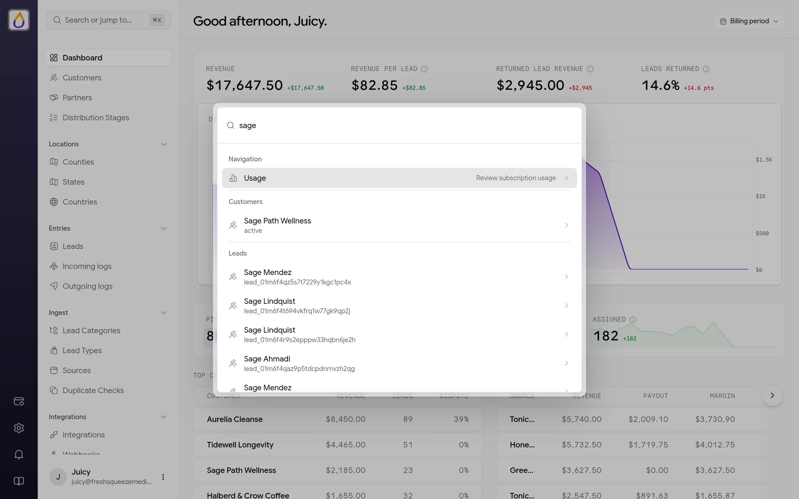
  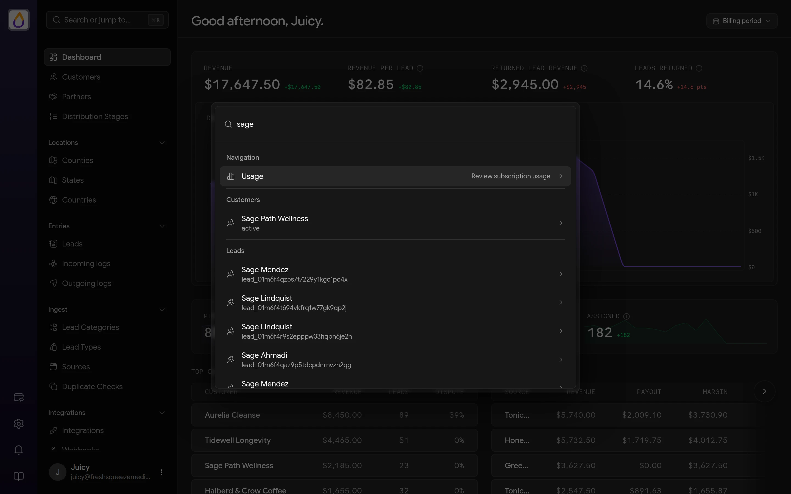
</Frame>

This is where the palette really earns its keep. A few everyday examples follow.

- A buyer emails about a lead. Paste the lead ID or the consumer's email and you're on the lead in one step.
- Someone on a buyer's team calls in. Type their email and the palette finds the customer account they belong to, even if you don't know the business name.
- Reconciling payments in Stripe? Paste the `cus_...` ID from Stripe to find the matching customer.
- Wondering how a market is doing? Type a ZIP code to open its county's [location analytics](/features/location-analytics).

If you type more than one word, a page only shows up when it matches every word. Like everything else in the panel, the palette only shows pages and records your [role](/features/roles) can access.

Once it's in your fingers, you'll rarely touch the sidebar again.

## The rail and its modules

The narrow column on the far left is the rail. The panel is split into five modules, and the rail switches between them. Click a module and the sidebar shows its pages.

| Module | What's in it |
|--------|--------------|
| **Operate** | Day-to-day work, with [Dashboard](/features/dashboard), [Leads](/features/leads), [Customers](/features/customers), [Partners](/features/partners), [Logs](/features/logs), and Demand ([location analytics](/features/location-analytics)) |
| **Analytics** | An overview of the deeper reports that are on the way. Planned reports show a **Soon** tag. |
| **Configure** | How leads come in, get routed, and go out. **Intake** has [Lead Categories](/features/lead-categories), [Lead Types](/features/lead-types), [Sources](/features/sources), and [Duplicate Checks](/features/duplicate-detection). **Routing** has [Distribution Stages](/features/distribution), [Bidding](/features/bidding), and [Returns](/features/returns). **Connections** has [Integrations](/features/integrations) and [Webhooks](/features/webhooks). |
| **Storefront** | What your customers see and buy. **Selling** has [Checkout Pages](/features/checkout-pages), [Subscription Products](/features/subscription-products), and [Payments & Deposits](/features/payments-and-deposits). **Customer portal** has [Registration & Login](/features/registration-and-login), [Notification Templates](/features/notifications), and [Banners](/features/banners). |
| **Company** | Your business, team, and plan. **Identity** has [Company Profile](/features/company-profile), [Branding](/features/branding), and [Domains & Links](/features/domains). **Team & billing** has [Users](/features/users), [AI Assistants](/features/ai-assistants), Beta Program, and [Usage & Billing](/features/billing). |

<Frame>
  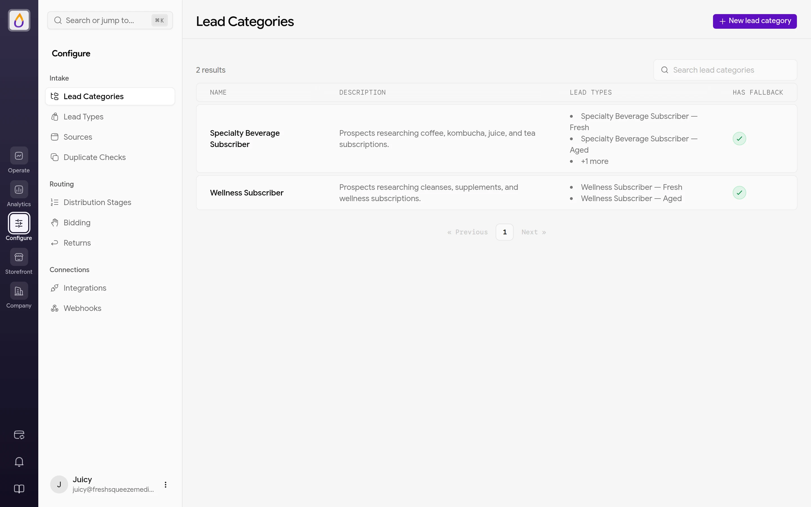
  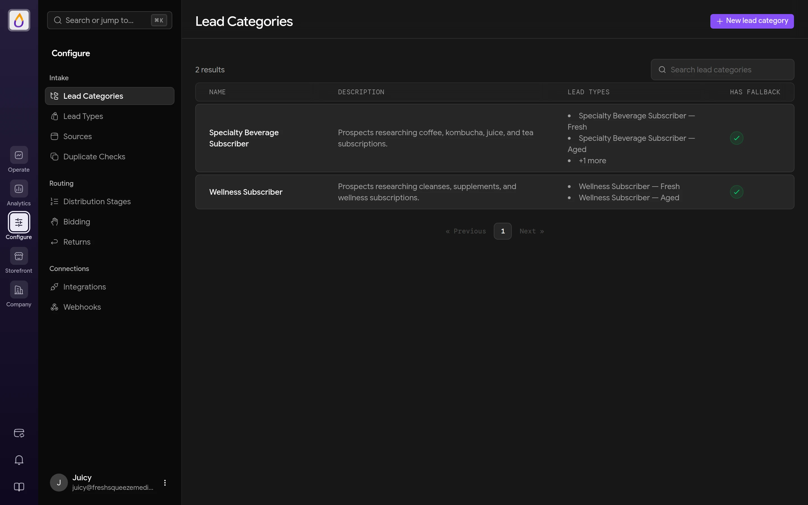
</Frame>

These docs write a page's location as module, then page, so **Configure → Webhooks** means "choose **Configure** in the rail, then **Webhooks** in the sidebar." Each module remembers the last page you had open in it, so switching back drops you where you left off. Page addresses didn't change with the modules, so bookmarks keep working.

Your [role](/features/roles) decides which modules and pages appear. A Sales user, for example, won't see Partners or Distribution Stages at all, and a module with nothing your role can open is left off the rail. Most pages in **Configure**, **Storefront**, and **Company** are Admin-only. AI Assistants only appears once Juiced has enabled it for your account.

The bottom of the rail holds a few utilities.

- **Guided setup** appears in workspaces created with the [setup guide](/get-started/quickstart#3-follow-the-setup-guide). It's a progress ring for the way to sell you're setting up, with an amber dot while skipped steps wait, or a compass between paths. Click it to pick up the next step.
- **Switch to the classic panel** returns you to the previous version of the panel if you need something that hasn't moved over yet.
- **Notifications** (bell) shows your in-app notifications, such as a lead or bid export that's ready to download, with a red count for unread ones and **Mark all as read**.
- **Documentation** (book) opens these docs.

<Frame>
  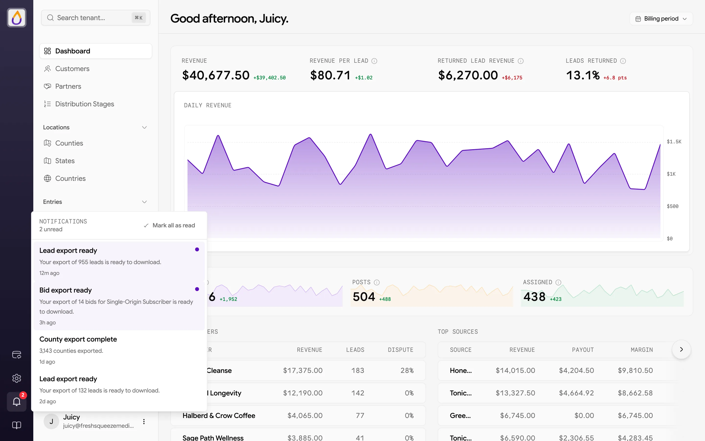
  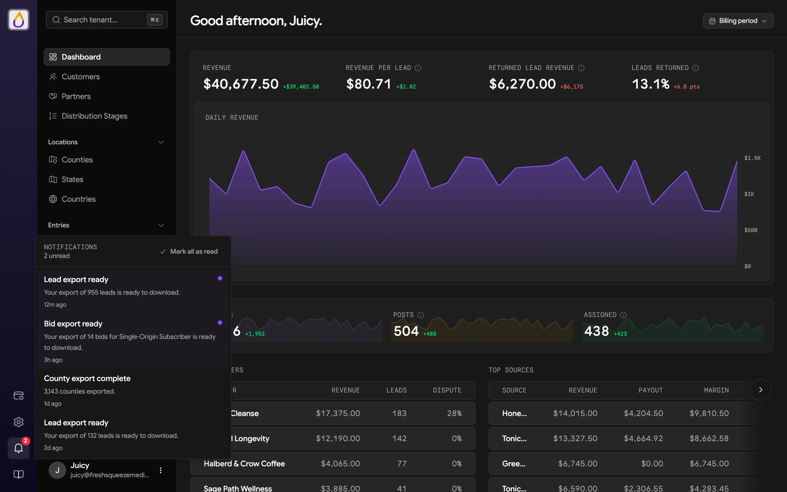
</Frame>

Collapse the sidebar and the rail shrinks with it, showing module names when you hover. On a phone there's no rail. Open the menu to see the modules as a list, then tap one to see its pages.

## The sidebar

The sidebar lists the pages in the module you're in, under the module's name, grouped under small headings like **Intake** and **Routing**. A few pages split into tabs across the top instead of taking several sidebar spots. **Logs** has **Incoming** and **Outgoing**, **Demand** has **Counties**, **States**, and **Countries**, and **Returns** and **Subscription Products** each have **Tiers** and **Settings**.

The footer of the sidebar shows who you're signed in as. Its menu has **Profile** (your name, password, passkeys and other sign-in methods), a **Theme** switch (Light, Dark, or System), and **Log out**.

## Patterns you'll see everywhere

A few conventions repeat on almost every page, so learning them once pays off everywhere.

**Saving changes.** Edit forms and settings pages don't have a Save button sitting at the bottom. As soon as you change something, a floating bar appears at the bottom of the screen with **Unsaved changes**, a **Reset** button that throws away your edits, and **Save changes**. Forms that create something new use a plain **Cancel** and a submit button instead.

**More actions.** Record pages (a customer, a partner, a lead) show their main action, usually **Edit**, as a button in the header. Everything else lives in the **More actions** menu (the ⋯ button) next to it, with things like adding funds, pausing, viewing the timeline, or archiving.

**Record tabs.** Records with a lot going on have a row of tabs under the header. A customer, for example, has Overview, Bids, Lead Eligibility, Leads, Transactions, Payment Methods, Contacts, Webhooks, and Users.

**Lists.** Lists share the same toolbar, with status tabs across the top, a search box, a **Filters** button, and pagination at the bottom. Pages with analytics also have a timeframe picker in the header.

## When your subscription needs attention

If there's a problem with your Juiced subscription, a yellow bar across the top of the panel reads "Your subscription requires attention. Some features are restricted." with a **Manage billing** link. If the subscription becomes inactive, a **Your subscription is inactive** dialog blocks the panel until billing is resolved. From it you can **Manage billing** or **Log Out**. See [Billing](/features/billing) for details.

## Next steps

<CardGroup cols={2}>
  <Card title="Quickstart" icon={<HugeIcon name="rocket-01" card />} href="/get-started/quickstart">
    Set up everything you need to sell your first lead.
  </Card>
  <Card title="Core concepts" icon={<HugeIcon name="book-open-01" card />} href="/get-started/core-concepts">
    Learn the vocabulary you'll see on every page.
  </Card>
</CardGroup>
