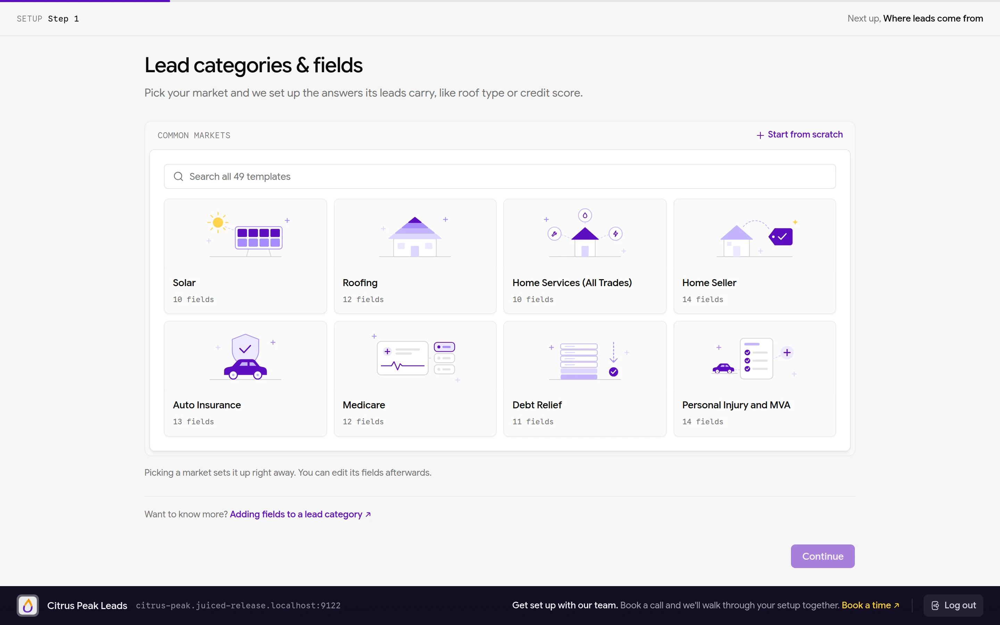
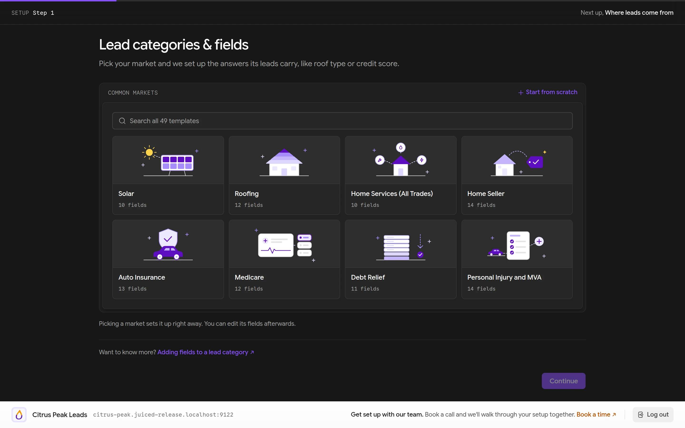
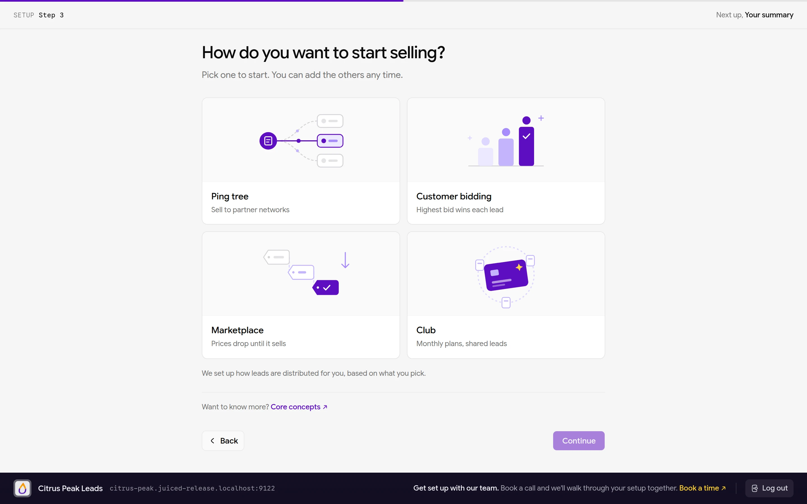
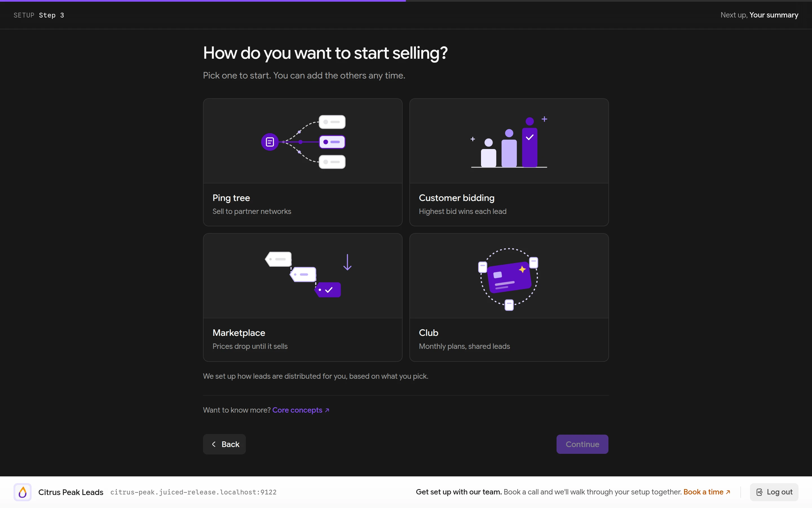
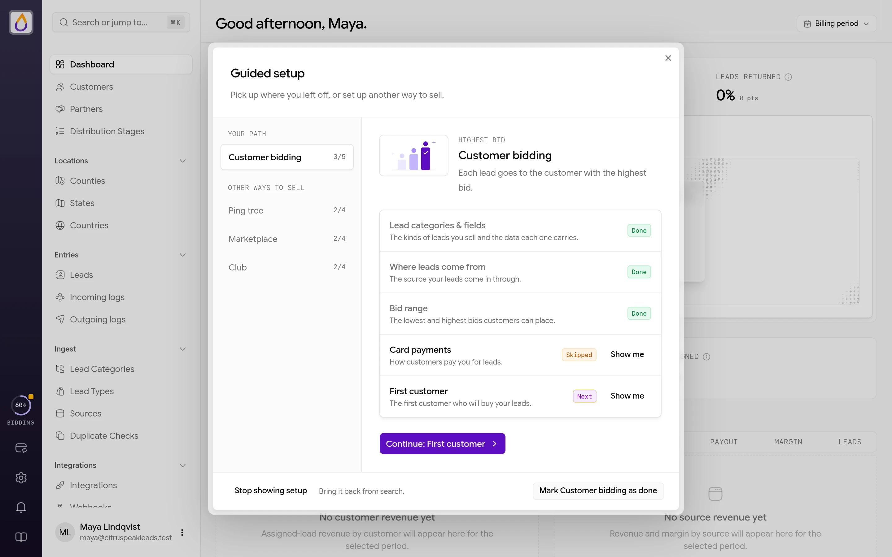
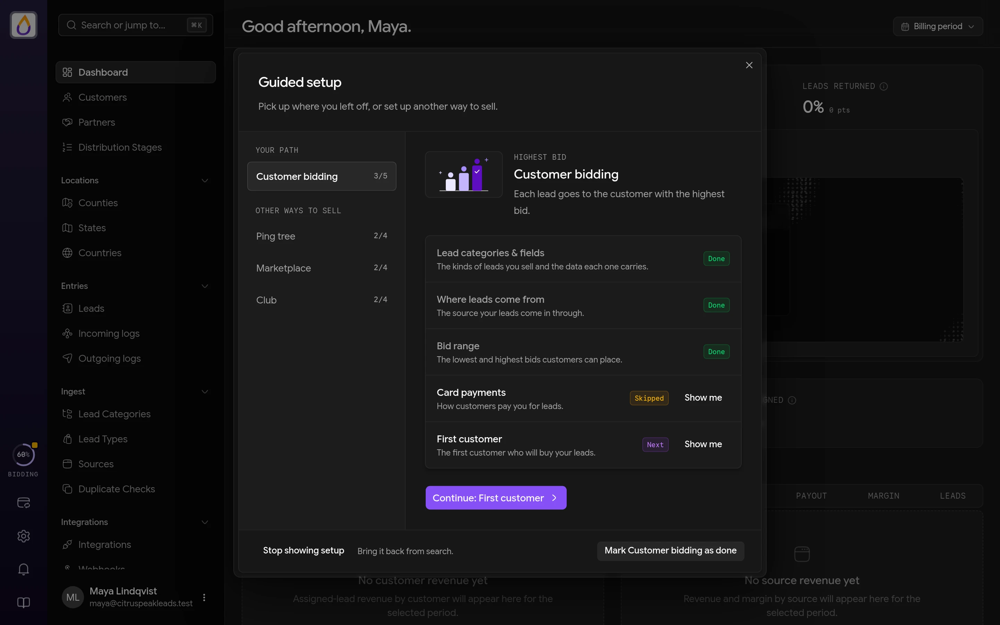
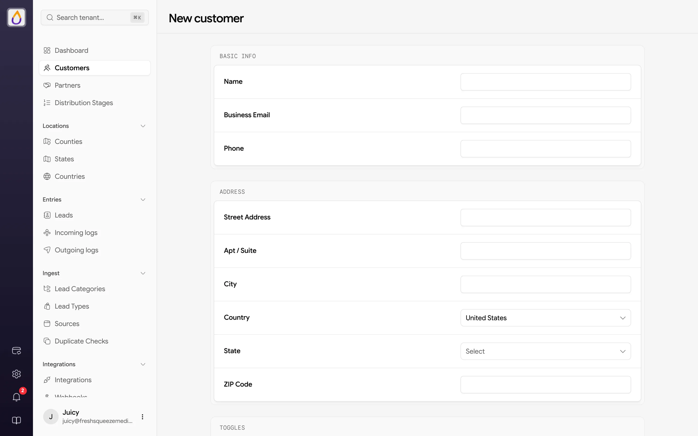
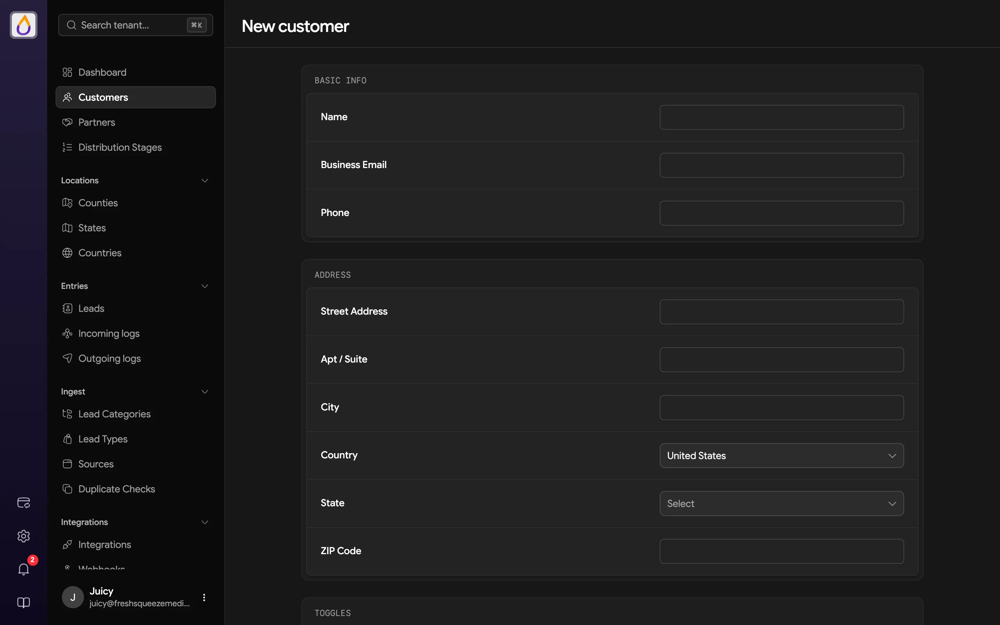

import CommunityCards from '/snippets/community-cards.mdx';

Welcome to Juiced. This guide takes you from a blank browser tab to a tenant capable of ingesting leads and routing them to a paying customer. It's longer than a typical "quickstart" because there are genuinely a handful of moving parts to configure before anything can flow. The good news is that a setup guide walks you through most of them right after signup, and we'll link out to the full reference docs wherever you want to go deeper.

<Tip>
You can do most of this in under an hour if you have your Stripe account ready and know what kind of leads you sell. Grab coffee, settle in.
</Tip>

## What you're building

Before diving in, it helps to understand the shape of what you're assembling. A working tenant has seven pieces.

1. **An account, a subscription, your company details, and your operating countries**, plus a Stripe connection if you want to collect payment from customers.
2. **A lead category**, which is the schema for the leads you sell (auto insurance, solar, home insurance, etc.).
3. **Lead types** within that category. These are pricing tiers, optionally with conditions that refine which leads qualify.
4. **Bidding settings** on each lead type, which set the geographic scope, price range, and increments customers use to bid.
5. **A distribution plan**, the pipeline leads flow through. The setup guide creates its first stage for the way you choose to sell.
6. **At least one customer with a funded wallet** to buy leads.
7. **At least one source**, the API endpoint where leads arrive.

With all of that in place, a lead submitted to your API flows through the pipeline, auctions off to the highest bidder, and charges the winning customer's wallet.

Let's build it.

## 1. Create your account

Head to [usejuiced.com/register](https://usejuiced.com/register) and fill out the short signup form.

- **You** covers your name, work email, and a password. Juiced sends your sign-in codes to this email.
- **Your company** is your company name, which becomes your workspace.
- **Your workspace address** fills itself in from the company name, e.g. `yourcompany.usejuiced.com`. Click **Edit** to change it. Juiced checks it as you type, and if it's taken you get a few free alternatives to pick from. Pick something you won't regret, because it appears in URLs your customers see. You can add a [custom domain](/features/domains) later.

Click **Create account** and Juiced takes you straight to your new workspace.

### Confirm your email

The **Confirm it's you** screen asks for the 6-digit code Juiced just emailed you. Type it in and click **Verify and continue**. The email also has a **Verify email address** button that works on any device, so you can open it on your phone and the signup tab moves on by itself. The code expires after an hour, and **Send a new code** gets you a fresh one.

### Choose how you'll sign in

Email codes are already on for your account, so this step is an offer rather than a hurdle. Set up a **Passkey** or an **Authenticator app** if you'd like a faster sign-in, or click **Continue with email codes** to move on. You can change this later from your profile.

## 2. Unlock your workspace

Three short steps unlock your workspace. Juiced brings you back to the right one if you leave partway through.

<Steps>
  <Step title="Finish your company details">
    Add a **Company phone** and your **Billing address** (country, street, city, state or region, and postal code). These appear on your invoices and are how customers and partners know your company. The company name and email from signup are shown here too, with **Edit** if you need to change them. US, Canadian, and Australian addresses use a required state, province, or territory selector, and other supported billing countries accept an optional region.
  </Step>
  <Step title="Choose where you operate">
    Pick the countries your leads come from (any mix of the **United States**, **Canada**, and **Australia**) and click **Save and continue**. These are the countries you accept and distribute leads in, and they're separate from your billing country. You can change them later in [Company Profile](/features/company-profile#operating-countries).
  </Step>
  <Step title="Choose a plan">
    Pick a [subscription plan](/features/billing). Plans scale by monthly lead revenue, from **Juicy Start** up to **Exotic Extracts**. Three are shown first, and the rest are a click away. Click **Continue to checkout** to add a card on Stripe. If the plan comes with a free trial, the step says so and you aren't charged until it ends. You can change plans later, and [auto-upgrade](/features/billing#auto-upgrade) is available if you don't want to babysit.
  </Step>
</Steps>

Once Stripe confirms your subscription (usually a few seconds), your workspace unlocks and the setup guide opens.

## 3. Follow the setup guide

The setup guide asks a few questions about your business and builds the pieces below for you, one step at a time. Until you finish it, the guide is what you see instead of the panel.

<Frame>
  
  
</Frame>

Every workspace starts with the same three steps.

1. **Lead categories & fields.** Pick your market from the templates and Juiced creates a [lead category](/features/lead-categories) with the fields its leads carry, or choose **Start from scratch**. Need more fields? **Import from a spreadsheet** reads a CSV or Excel (.xlsx) file of leads you already have (up to 10 MB) and suggests a field name and type for each column, and nothing is saved until you confirm.
2. **Where leads come from.** Say whether leads come from your own websites, a vendor, or ping/post, and name the [source](/features/sources) they'll arrive through.
3. **How you'll sell.** Pick one way to sell to start with. You can add the others any time.

<Frame>
  
  
</Frame>

Your choice creates a matching [distribution stage](/features/distribution) and decides the rest of the guide.

| Way to sell | What the guide sets up next |
|-------------|-----------------------------|
| **Ping tree** | How partners get leads (**Highest price** or **Round robin**), your first [partner](/features/partners), and delivery to that partner |
| **Customer bidding** | Your bid range, card payments through Stripe, and your first [customer](/features/customers) |
| **Marketplace** | Your starting [marketplace](/features/marketplace) price and card payments through Stripe |
| **Club** | Card payments through Stripe and your [Club](/features/club) plans |

A few things worth knowing along the way.

- Most steps have **Skip for now**. The lead category, how you'll sell, how partners get leads (ping tree), and card payments (Club) can't be skipped.
- The card payments step is where you connect [Stripe](/features/integrations#stripe). Outside the Club, you can choose **I'll add funds by hand for now** and connect later from **Settings → Payments & Deposits**.
- For your first customer, you can ask for **A test customer for you**. Juiced creates a "(Test)" customer from your company details, makes you its admin, and (if you've set a bid range) places a bid with enough credit for one lead, which is handy for the test in [step 11](#11-send-a-test-lead).

When you're done, the guide shows a summary of what it set up. Click **Open my workspace** and you're in.

### Pick up where you left off

Skipped steps don't disappear. The **Guided setup** ring on the [rail](/get-started/finding-your-way-around#the-rail) shows how far along your path is, with an amber dot while skipped steps are waiting. Click it to see every step, then **Show me** for a short tour of the page where that step lives. The same window lets you start another way to sell. **Stop showing setup** hides the ring, and **Show guided setup** in the [command palette](/get-started/finding-your-way-around#the-command-palette) brings it back.

<Frame>
  
  
</Frame>

The rest of this page walks through each piece by hand, so you know where it lives in the panel. If the guide already set something up, give it a quick look and move on.

Once you're in, take a minute with [Finding your way around](/get-started/finding-your-way-around) to learn the sidebar, the command palette, and where settings live.

## 4. Create your first lead category

[Lead categories](/features/lead-categories) define the schema for the leads you sell. Navigate to **Lead Categories → New lead category** and give it a name (e.g. "Auto Insurance"). Every new category automatically includes ten basic fields (first name, last name, email, phone, address, city, state, ZIP, address 2, and county).

If your leads carry extra data (vehicle year, coverage amount, roof age, whatever), add [custom fields](/guides/adding-fields-to-a-lead-category). You can always add more later; start with what you know you need.

## 5. Define lead types

Every lead category starts with one [lead type](/features/lead-types), a fallback. The fallback catches every lead that doesn't match a more specific type. Most operations want at least one more, for example a "High Intent" type that commands a higher price.

Open **Lead Types → New lead type**, pick the category, and set the type's priority. When a lead arrives, Juiced evaluates non-fallback types in priority order; the first one whose conditions match wins.

### Add conditions (optional but usually necessary)

Conditions tell a lead type which leads qualify for it. Without conditions, a non-fallback lead type matches nothing. In the lead type form's **Conditions** section, add rules against fields in your category, for example `age > 25 AND violations = 0` to define a premium tier. See [Lead Types → Conditions](/features/lead-types#conditions) for the full operator list.

## 6. Configure bidding settings

Each lead type needs [bidding settings](/features/lead-types#bidding-scopes) before customers can bid on it. Open the lead type, switch to its **Bidding** tab, and click **New bidding scope** to configure one or more scopes.

- **Geographic level** is county, state, or nationwide.
- **Fixed price or range** is a single price, or a min/max with an increment.
- **Min / max / increment** sets the range and granularity of allowed bid amounts.

Enable at least one scope per lead type. Without an enabled scope, customers can't place bids on leads of that type.

## 7. Review your distribution plan

Your [distribution plan](/features/distribution) starts with one stage, created by the setup guide for the way you chose to sell.

| Way to sell | Stage the guide creates |
|-------------|-------------------------|
| **Customer bidding** | **Bidding**, Highest Price method with customer bids enabled |
| **Ping tree** | **Ping tree**, Highest Price or Round Robin with partners enabled |
| **Marketplace** | **Marketplace** |
| **Club** | **Club** |

Starting another way to sell from **Guided setup** adds its stage too. Open **Distribution Stages** in the sidebar to see your plan.

For launch, one stage is often all you need. Want leads that don't sell at auction to fall back to the marketplace, or partner ping-post behind your bidders? Add stages from **Distribution Stages → New stage** and put them in the order you want.

## 8. Create a customer and fund their wallet

Leads go nowhere without a buyer, so you'll need at least one [customer](/features/customers). Open **Customers** and click **New customer**. Fill in the business name, email, phone, and address (street, city, state, and ZIP are required), then click **Create customer**. Alternatively, let the customer register themselves through their portal.

<Frame>
  
  
</Frame>

Two things trip people up here.

- **Can Access Bidding** starts switched off. Turn it on in the **Toggles** section if this customer should place bids from their own portal.
- The **Bidding Limits** section (default caps and budgets) only appears once you've enabled customer-level limits in **Settings → Bidding**. See [Budgets and caps](/features/budgets-and-caps).

Once the customer exists, open their record, click the **More actions** menu (⋯) and choose **Add funds** to deposit a starting balance to their wallet. You can do this manually (for credits, onboarding deposits, or reconciliation) or leave it to the customer to fund through their own [Billing](/customer-portal/billing) page once they log in.

## 9. Place at least one bid

From the customer's **Bids** tab, click **New bid** and create a bid for one of your lead types by picking three things.

- A location (one search box finds counties, states, and countries, e.g., California)
- The lead type (only types with bidding enabled for that location's level are offered)
- An amount within the configured min/max range

Without at least one active bid, no leads will auction off to anyone. A single bid is enough to test the flow end-to-end.

## 10. Set up a source

Navigate to **Sources → New source** and create a [source](/features/sources) tied to your lead category. Juiced generates an API key and secret automatically; click the **Authentication** tab to grab them, or generate a bearer token instead.

Share those credentials (or the **View API Spec** link) with whoever's integrating on the supply side. See [Setting Up a Source and Its Attributes](/guides/setting-up-a-source-and-its-attributes) for a walkthrough with field mapping.

## 11. Send a test lead

Before pointing real traffic at your new tenant, verify the pipeline works. The simplest way is to enable [test mode](/features/sources#test-mode) on the source and submit a lead with ZIP `00001`, which forces a successful assignment regardless of actual bid coverage. Check the lead appears under **Leads**, check **Entries → Incoming logs** (the [distribution log](/features/distribution#distribution-flows-and-the-log)) to see the stages that ran, and check the customer's wallet was charged the expected amount.

If that works, disable test mode and you're ready for production traffic.

## What to do next

You've got the core pipeline running. Here are a few things you might want to do next.

- Add [custom fields](/guides/adding-fields-to-a-lead-category) to your lead category for additional data capture
- Set up [duplicate detection](/features/duplicate-detection) so you don't sell the same lead twice
- Configure [notifications](/features/notifications) and [webhooks](/features/webhooks) so customers and your own systems get pinged on key events
- Invite additional [users](/features/users) to your tenant with the right [roles](/features/roles)
- Configure your [company profile](/features/company-profile) and [branding](/features/branding) so the customer portal looks like yours

Stuck on something, or want someone to look over your setup? Come find us on Skool.

<CommunityCards />

Welcome to Juiced. Time to squeeze some value out of those leads.
