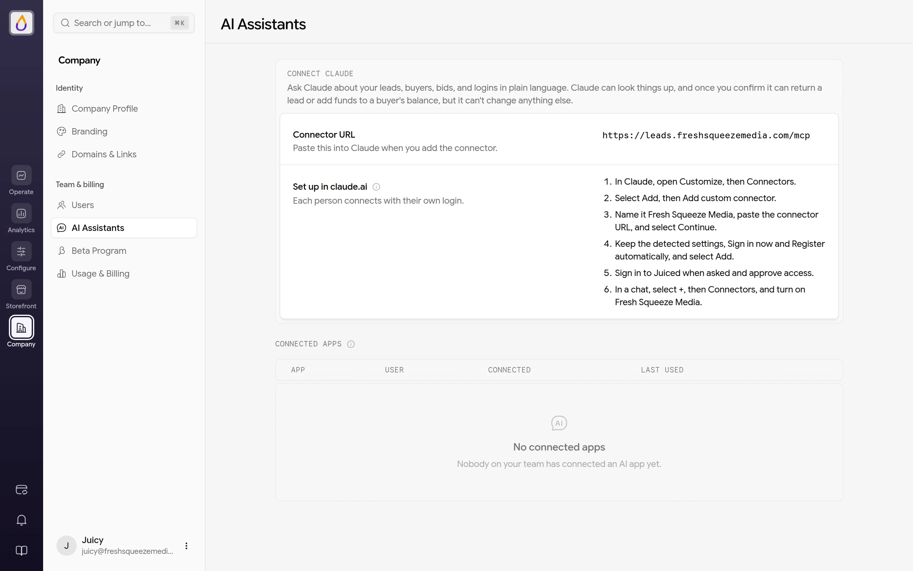
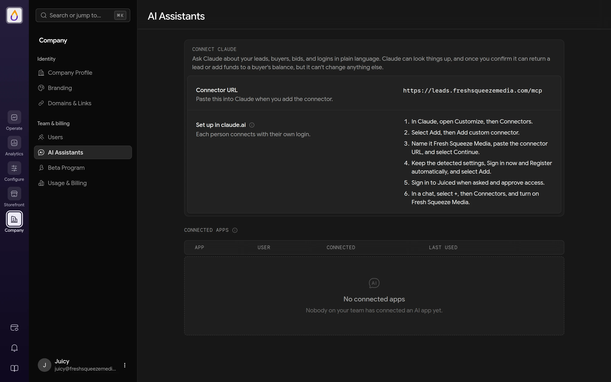

Want to know why a buyer missed a lead without digging through logs? Connect Claude to Juiced and just ask. This guide walks through connecting Claude with your own login. For what the connection can and can't do, see the [AI Assistants](/features/ai-assistants) feature page.

The assistant mostly explains what happened. The only things it can change are returning a lead and adding funds to a buyer's balance, and only after you confirm a preview. It can't touch bids, domains, or settings.

## Prerequisites

- A plan with custom domains ([Citrus Splash and up](/features/billing#premium-features)).
- A verified [custom domain](/guides/adding-a-custom-domain). The assistant connects through your own domain, never your Juiced subdomain.
- The **Admin** or **Customer Support** [role](/features/roles).
- A Claude account at claude.ai.

## 1. Copy your connector URL

Open **Company → AI Assistants**. Copy the **Connector URL**. It's your custom domain followed by `/mcp`, for example `https://leads.yourcompany.com/mcp`.

<Frame>
  
  
</Frame>

If the page says **A custom domain is required**, set one up first. Admins get a **Set up a custom domain** button that takes them to **Domains & Links**. If it says **AI assistants are on** another plan, your plan doesn't include custom domains yet, and the button there lets you upgrade.

## 2. Add the connector in Claude

The page lists these steps with your company's name filled in.

1. In Claude, open **Customize**, then **Connectors**.
2. Select **Add**, then **Add custom connector**.
3. Name it after your company, paste the connector URL, and select **Continue**.
4. Keep the detected settings (**Sign in now** and **Register automatically**) and select **Add**.

<Tip>
On a Claude Team or Enterprise plan, an owner adds the connector once from **Organization settings → Connectors**. Everyone else then opens **Customize → Connectors**, finds it, and selects **Connect**.
</Tip>

## 3. Sign in and approve

Claude sends you to your custom domain to sign in to Juiced. Use your own Juiced login, because each person on your team connects separately.

After you sign in, Juiced shows **Connect an AI assistant to** your company, along with where access will be sent. It explains that the app can look things up, can return a lead or add funds only when you confirm, and never sees lead contact details. Check the details, then click **Approve**. If anything looks off, click **Deny**.

## 4. Turn it on in a chat

In a Claude chat, select **+**, then **Connectors**, and turn on your company's connector. Then ask away. Here are a few examples.

- "Why did lead lead_01h… go to Halberd & Crow instead of another buyer?"
- "Why didn't cus_01h… get any leads yesterday?"
- "Why is bid bid_01h… not in the top position?"
- "Why can't jane@example.com sign in?"
- "Is our custom domain set up correctly?"

You can also ask it to act, like "Return lead lead_01h… for cus_01h…" or "Add \$50 to cus_01h…'s balance for the missed lead last week." Claude shows a preview of the change first and only goes ahead after you say yes. See [Returning leads and adding funds](/features/ai-assistants#returning-leads-and-adding-funds).

Leads, buyers, and bids are identified by their IDs (`lead_…`, `cus_…`, `bid_…`), which you can copy from their pages in the panel.

## Managing connections

Back on the **AI Assistants** page, **Connected apps** lists the apps that have been connected and when each was last used. Admins see everyone's connections; everyone else sees their own. Click **Disconnect** to cut off an app's access immediately. Removing someone from your [team](/features/users) also disconnects their apps.

## Troubleshooting

**I don't see AI Assistants in settings.** Your role isn't Admin or Customer Support, or you're Customer Support and your account has no verified custom domain yet. The page stays hidden for Customer Support until one exists. Admins always see it, along with what's missing.

**"AI assistant connections are not available."** You signed in with an account that isn't allowed to connect. Check your role with a tenant admin.

**The same answer came back after I changed something.** Asking the exact same question within a minute returns the earlier answer. Wait a minute and ask again.
